<div align="center">
    <p align="center">
        
    </p>
</div>
<div align="center"><h3>站在巨人肩膀上的 .NET 通用权限开发框架</h3></div>

<div align="center">

[](https://gitee.com/zuohuaijun/Admin.NET/stargazers)
[](https://gitee.com/zuohuaijun/Admin.NET/members)
[](./LICENSE-MIT)

</div>

## 🎁框架介绍
Admin.NET 是基于 ASP.NET Core、Furion 和 SqlSugar 的通用权限开发框架，支持多租户、权限管理、任务调度、消息通知、文件管理、代码生成与打印等能力。本仓库已完成前端移植，当前使用 Vue 3、Vben、antdv-next 和 Vite 8，采用 pnpm workspace 管理前端应用与共享包。后端共享工程按项目配置支持 .NET 8 / .NET 10，API 入口与测试项目使用 .NET 10。

项目采用前后端分离与模块化设计，可按业务需要扩展应用服务、数据库适配和插件。具体运行环境、数据库驱动及集成功能以当前项目配置为准；部署前需结合实际环境完成验证。

```
超高人气的框架(Furion)配合高性能超简单的ORM(SqlSugar)加持，阅历痛点，相见恨晚！让 .NET 开发更简单，更通用，更流行！
```

## 🍁开始使用

后端入口为 `Admin.NET/Admin.NET.Web.Entry/`，前端入口为 `Web/apps/web-antdv-next/`。准备 .NET 10 SDK、Node.js（`^22.18.0 || ^24.12.0`）和 `pnpm@11.16.0`。依赖版本以仓库配置与 lockfile 为准。

在仓库根目录启动 API：

```powershell
dotnet restore Admin.NET/Admin.NET.sln
dotnet run --project Admin.NET/Admin.NET.Web.Entry/Admin.NET.Web.Entry.csproj
```

在 `Web/` 目录安装并启动前端：

```powershell
pnpm install --frozen-lockfile
pnpm dev
```

数据库连接、前端代理与 API 地址须按本机环境配置；数据库初始化可能创建表和种子数据，应使用独立开发库。集成验收使用 PostgreSQL。前端生产构建为 `pnpm build`，按应用的 Vite 配置输出到 `Web/dist/`。

- [文档索引](docs/README.md)：开发、验证、部署、协议与维护说明。
- [前端说明](Web/README.md) 与 [开发及验证指南](docs/development.md)：完整命令与环境前提。
- [上游在线文档](https://adminnet.top/) 与 [上游演示](https://demo.adminnet.top)：上游资料可能与本分支的前端实现不同。
- 上游仓库：[GitHub](https://github.com/zuohuaijun/Admin.NET) · [Gitee](https://gitee.com/zuohuaijun/Admin.NET) · [GitCode](https://gitcode.com/zuohuaijun/Admin.NET)。
- 许可：[MIT](LICENSE-MIT) 或 [Apache-2.0](LICENSE-APACHE)，另见 [法律声明](DISCLAIMER.md)。

## 📙开发流程

1. 业务服务放在独立应用工程或既有 `Admin.NET.Application` 中，复用 `Admin.NET.Core`，由 Web 层引用需要启用的应用或插件。
2. 前端业务页面放在 `Web/apps/web-antdv-next/src/views/`，接口封装、授权与路由沿用当前应用结构。共享能力按职责维护在 `Web/packages/`。
3. 修改前读取 [仓库规则](AGENTS.md)、[前端规则](Web/AGENTS.md) 或后端模块旁的 `CLAUDE.md`。验证范围和真实联调要求见 [开发与验证](docs/development.md)。
4. 长期文档维护在 `docs/`；已完成前端移植的交接清单、任务草案和临时验收数据按 [维护说明](docs/maintenance.md) 清理。

## 🍎上游历史界面展示

以下为上游旧前端的历史展示资源，保留用于项目介绍。当前 Vben / antdv-next 前端界面以本仓库运行结果为准。

<table>
    <tr>
        <td>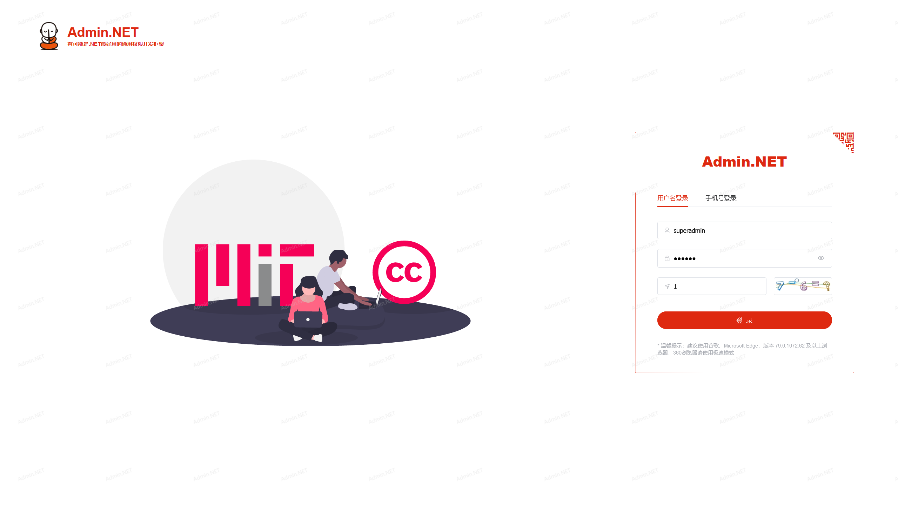</td>
        <td>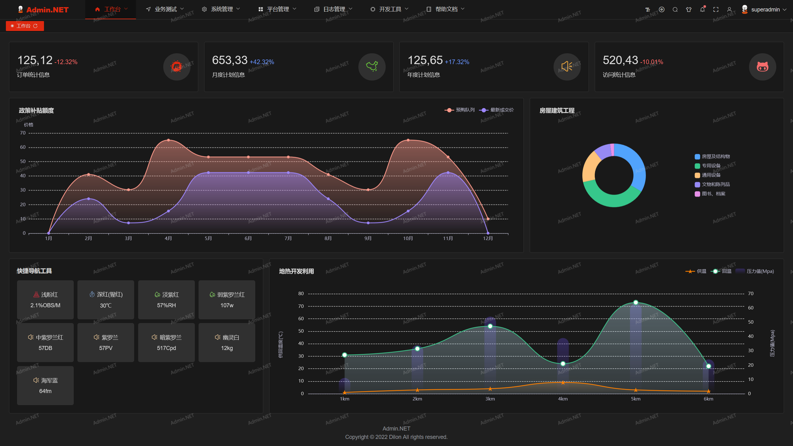</td>
        <td>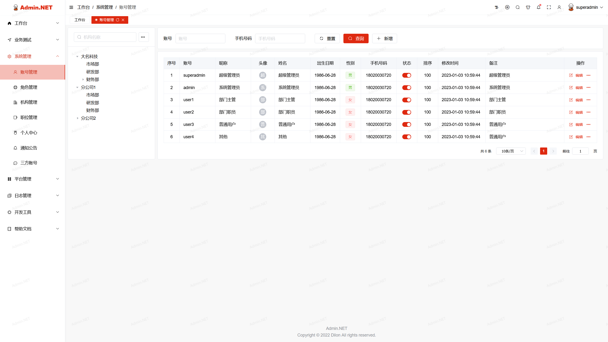</td>
        <td>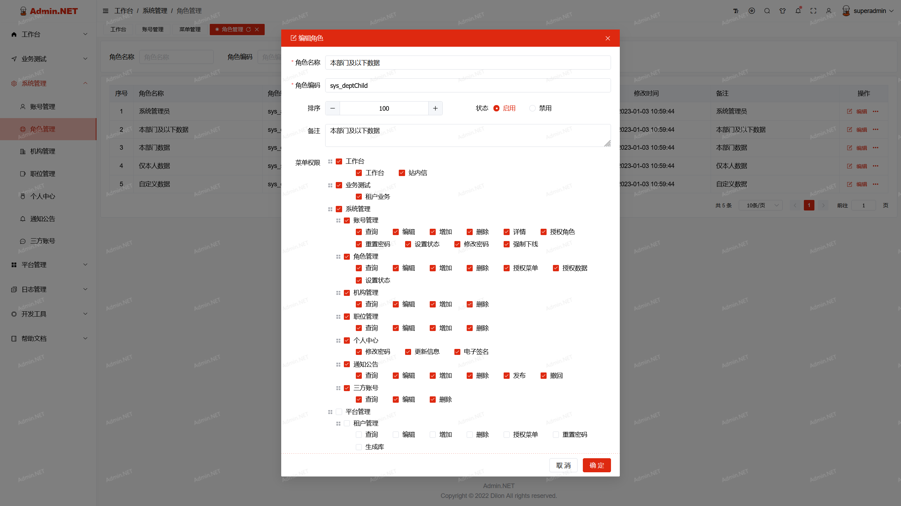</td>
    </tr>
    <tr>
        <td>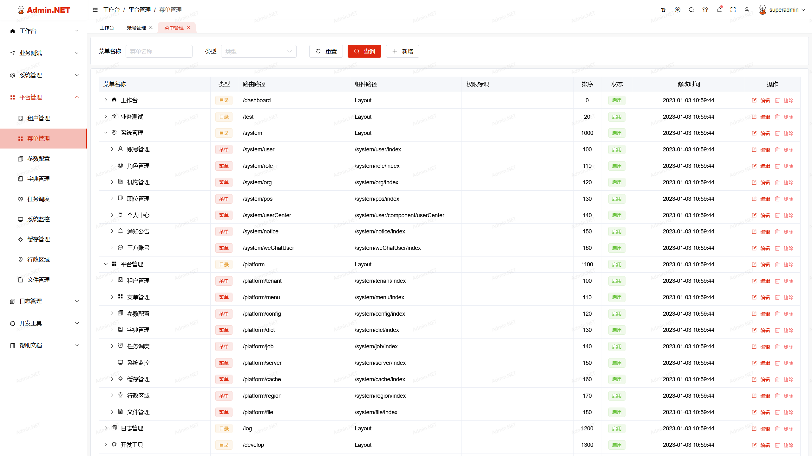</td>
        <td>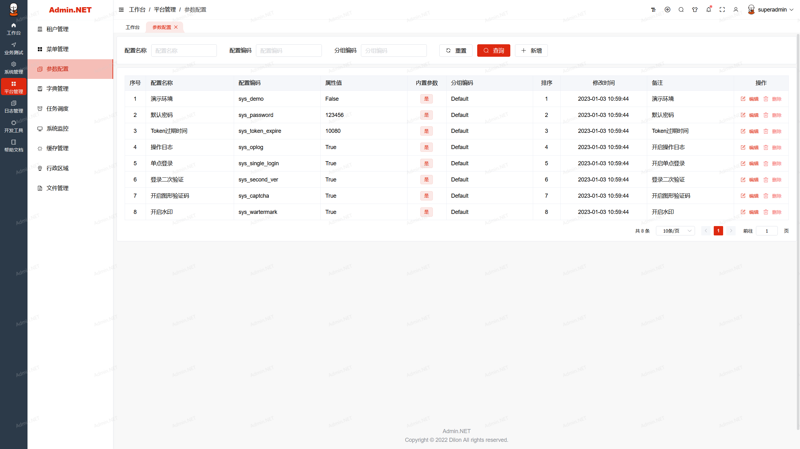</td>
        <td>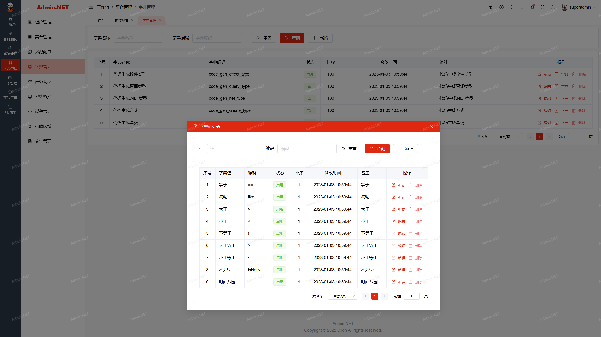</td>
        <td>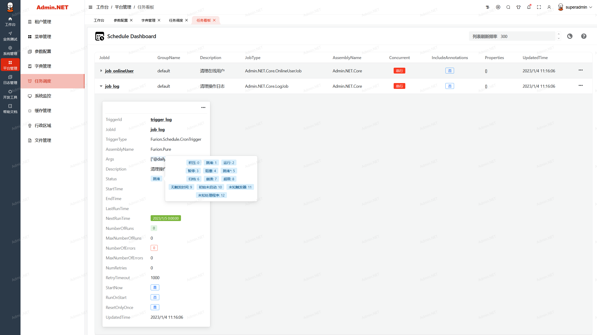</td>
    </tr>
    <tr>
        <td>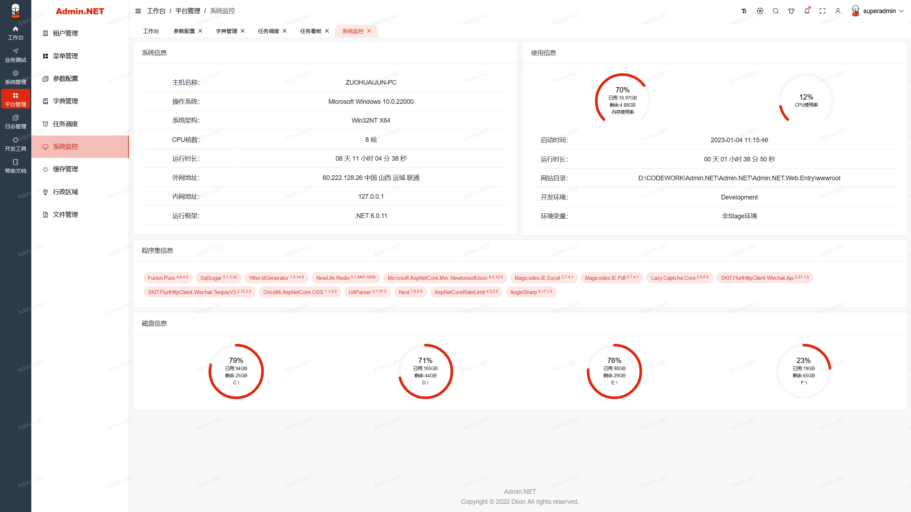</td>
        <td>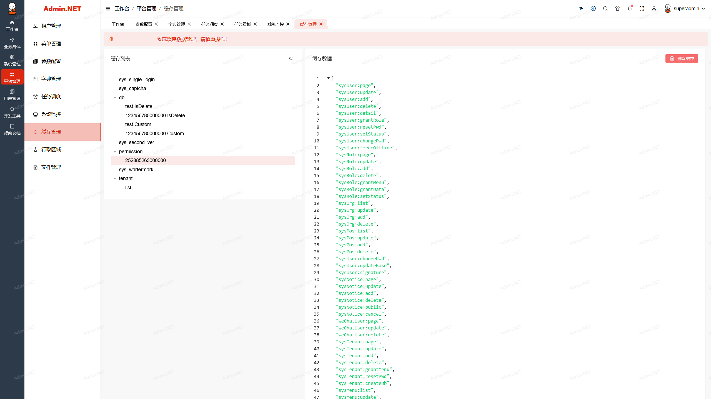</td>
        <td>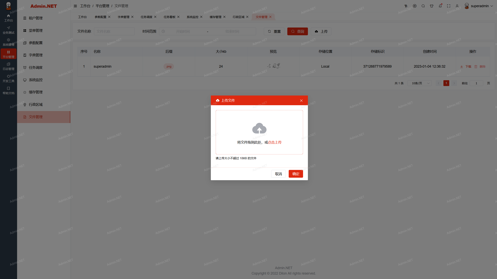</td>
        <td>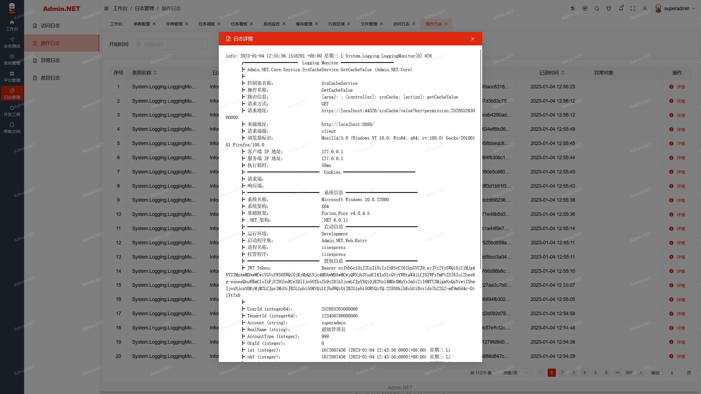</td>
    </tr>
    <tr>
        <td>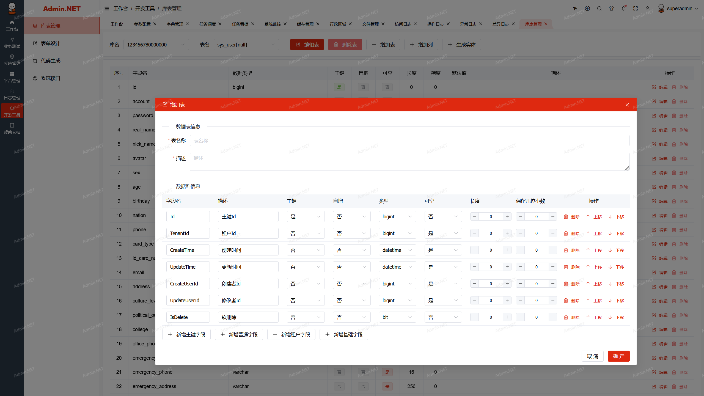</td>
        <td>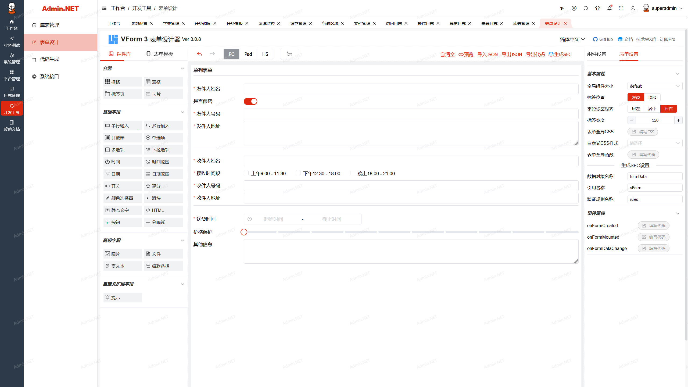</td>
        <td>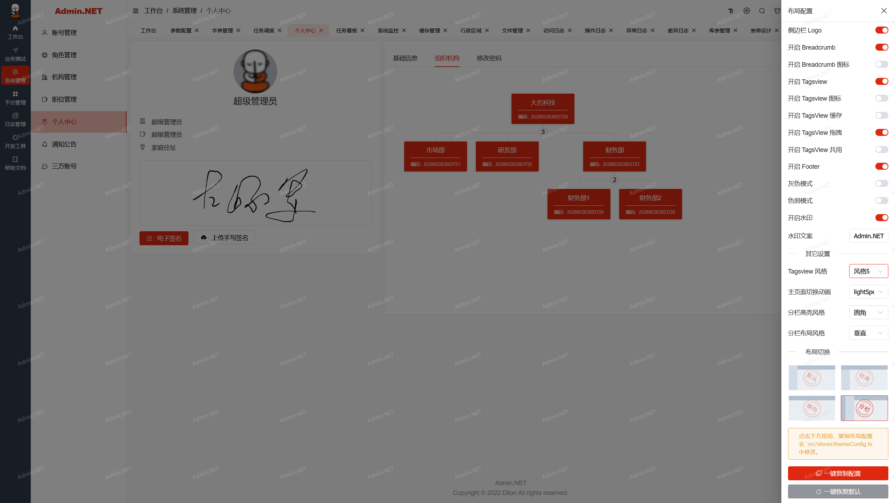</td>
        <td>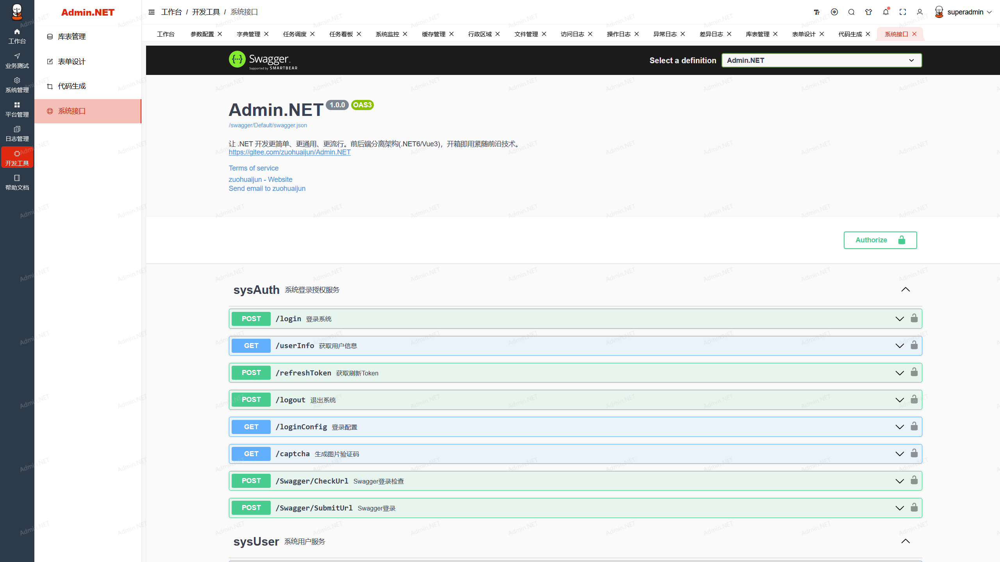</td>
    </tr>
</table>

## 🍖内置功能
 1. 主控面板：控制台页面，可进行工作台，分析页，统计等功能的展示。
 2. 用户管理：对企业用户和系统管理员用户的维护，可绑定用户职务，机构，角色，数据权限等。
 3. 机构管理：公司组织架构维护，支持多层级结构的树形结构。
 4. 职位管理：用户职务管理，职务可作为用户的一个标签。
 5. 菜单管理：配置系统菜单，操作权限，按钮权限标识等，包括目录、菜单、按钮。
 6. 角色管理：角色绑定菜单后，可限制相关角色的人员登录系统的功能范围。角色也可以绑定数据授权范围。
 7. 字典管理：对系统中经常使用的一些较为固定的数据进行维护。
 8. 访问日志：用户的登录和退出日志的查看和管理。
 9. 操作日志：系统正常操作日志记录和查询；系统异常信息日志记录和查询。
10. 服务监控：服务器的运行状态，CPU、内存、网络等信息数据的查看。
11. 在线用户：当前系统在线用户的查看，包括强制下线。基于 SignalR 实现。
12. 公告管理：系统通知公告信息发布维护，使用 SignalR 实现对用户实时通知。
13. 文件管理：文件的上传下载查看等操作，文件可使用本地存储，阿里云oss、腾讯cos等接入，支持拓展。
14. 任务调度：采用 Sundial，.NET 功能齐全的开源分布式作业调度系统。
15. 系统配置：系统运行的参数的维护，参数的配置与系统运行机制息息相关。
16. 邮件短信：发送邮件功能、发送短信功能。
17. 系统接口：使用 Swagger 生成相关 api 接口文档。支持 Knife4jUI 皮肤。
18. 代码生成：可以一键生成前后端代码，自定义配置前端展示控件，让开发更快捷高效。
19. 在线构建器：拖动表单元素生成相应的 VUE 代码(支持vue3)。
20. 对接微信：对接微信小程序开发，包括微信支付。
21. 导入导出：采用 Magicodes.IE 支持文件导入导出，支持根据H5模板生成PDF等报告文件。
22. 限流控制：采用 AspNetCoreRateLimit 组件实现对接口访问限制。
23. ES 日志：通过 NEST 组件实现日志存取到 Elasticsearch 日志系统。
24. 开放授权：支持OAuth 2.0开放标准授权登录，比如微信。
25. APIJSON：适配腾讯APIJSON协议，支持后端0代码，[使用文档](https://github.com/liaozb/APIJSON.NET)。
26. 数据库视图：基于SqlSugar生成查询SQL + 表实体维护视图，可维护性更强。


## 🎀捐赠支持
```
如果对您有帮助，请点击右上角⭐Star关注或扫码捐赠，感谢支持开源！
```


## 💐特别鸣谢
- 👉 Furion：[https://gitee.com/dotnetchina/Furion](https://gitee.com/dotnetchina/Furion)
- 👉 Vue Vben Admin：[https://github.com/vbenjs/vue-vben-admin](https://github.com/vbenjs/vue-vben-admin)
- 👉 Antdv Next：[https://github.com/antdv-next/antdv-next](https://github.com/antdv-next/antdv-next)
- 👉 vue-next-admin（原前端）：[https://lyt-top.gitee.io/vue-next-admin-doc-preview/](https://lyt-top.gitee.io/vue-next-admin-doc-preview/)
- 👉 SqlSugar：[https://gitee.com/dotnetchina/SqlSugar](https://gitee.com/dotnetchina/SqlSugar)
- 👉 NewLife.Redis：[https://github.com/NewLifeX/NewLife.Redis](https://github.com/NewLifeX/NewLife.Redis)
- 👉 Magicodes.IE：[https://gitee.com/magicodes/Magicodes.IE](https://gitee.com/magicodes/Magicodes.IE)
- 👉 SKIT.FlurlHttpClient.Wechat：[https://gitee.com/fudiwei/DotNetCore.SKIT.FlurlHttpClient.Wechat](https://gitee.com/fudiwei/DotNetCore.SKIT.FlurlHttpClient.Wechat)
- 👉 IdGenerator：[https://github.com/yitter/idgenerator](https://github.com/yitter/idgenerator)
- 👉 UAParser：[https://github.com/ua-parser/uap-csharp/](https://github.com/ua-parser/uap-csharp/)
- 👉 OnceMi.AspNetCore.OSS：[https://github.com/oncemi/OnceMi.AspNetCore.OSS](https://github.com/oncemi/OnceMi.AspNetCore.OSS)
- 👉 NETCore.MailKit：[https://github.com/myloveCc/NETCore.MailKit](https://github.com/myloveCc/NETCore.MailKit)
- 👉 Lazy.Captcha.Core：[https://gitee.com/pojianbing/lazy-captcha](https://gitee.com/pojianbing/lazy-captcha)
- 👉 AspNetCoreRateLimit：[https://github.com/stefanprodan/AspNetCoreRateLimit](https://github.com/stefanprodan/AspNetCoreRateLimit)
- 👉 Elasticsearch.Net：[https://github.com/elastic/elasticsearch-net](https://github.com/elastic/elasticsearch-net)
- 👉 Masuit.Tools：[https://gitee.com/masuit/Masuit.Tools](https://gitee.com/masuit/Masuit.Tools)
- 👉 IGeekFan.AspNetCore.Knife4jUI：[https://github.com/luoyunchong/IGeekFan.AspNetCore.Knife4jUI](https://github.com/luoyunchong/IGeekFan.AspNetCore.Knife4jUI)
- 👉 AspNet.Security.OAuth.Providers：[https://github.com/aspnet-contrib/AspNet.Security.OAuth.Providers](https://github.com/aspnet-contrib/AspNet.Security.OAuth.Providers)
- 👉 System.Linq.Dynamic.Core：[https://github.com/zzzprojects/System.Linq.Dynamic.Core](https://github.com/zzzprojects/System.Linq.Dynamic.Core)
- 👉 APIJSON.NET：[https://github.com/liaozb/APIJSON.NET](https://github.com/liaozb/APIJSON.NET)
