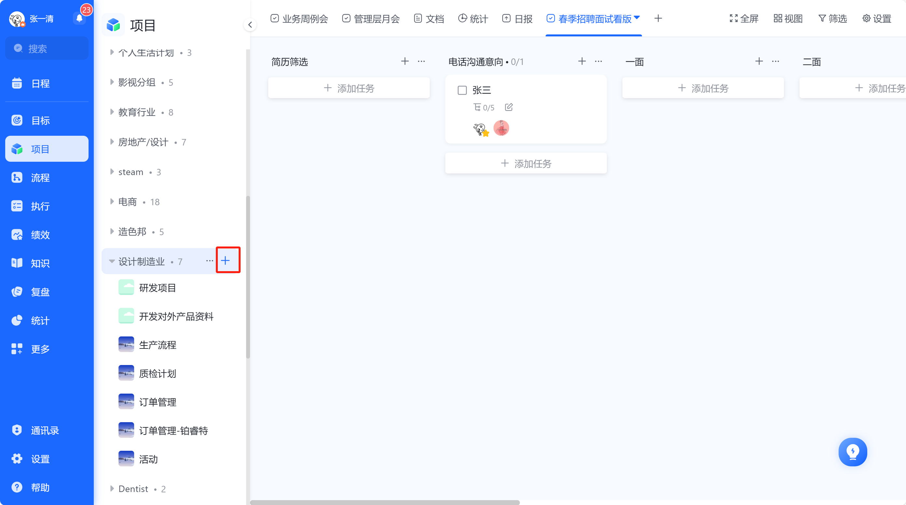
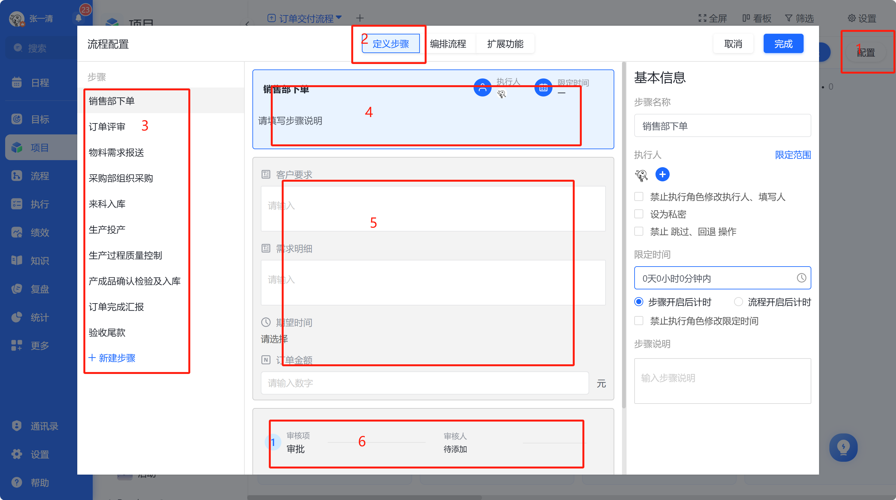
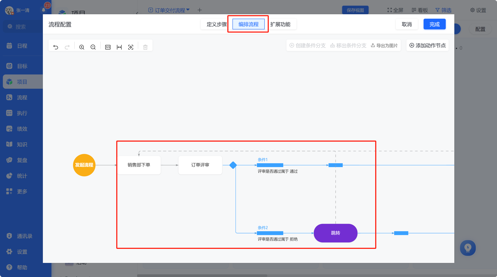
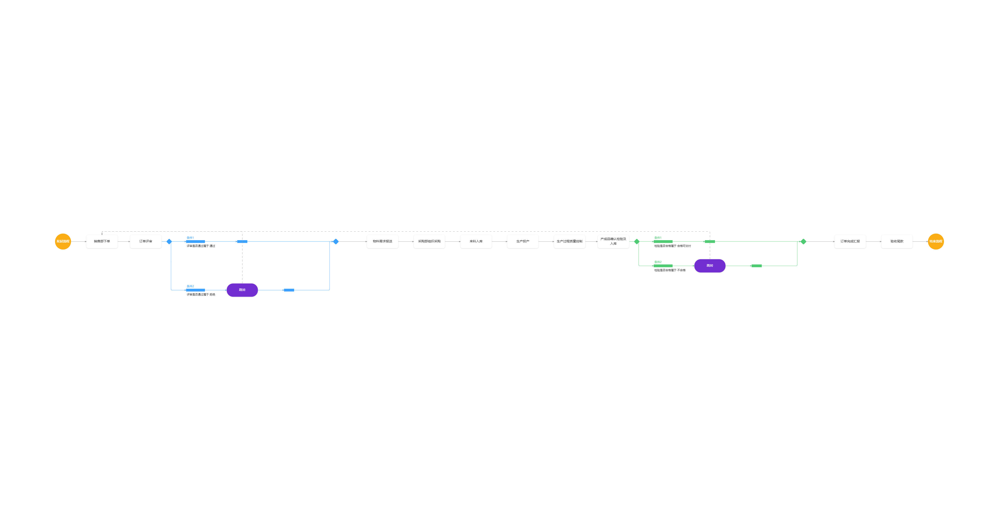
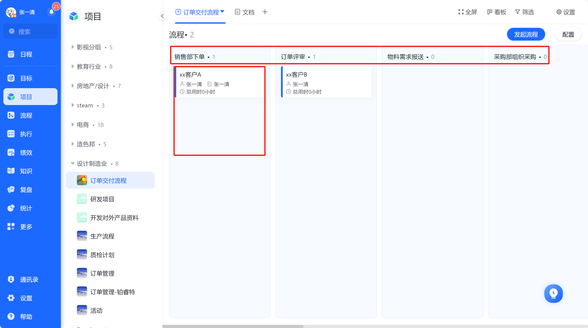
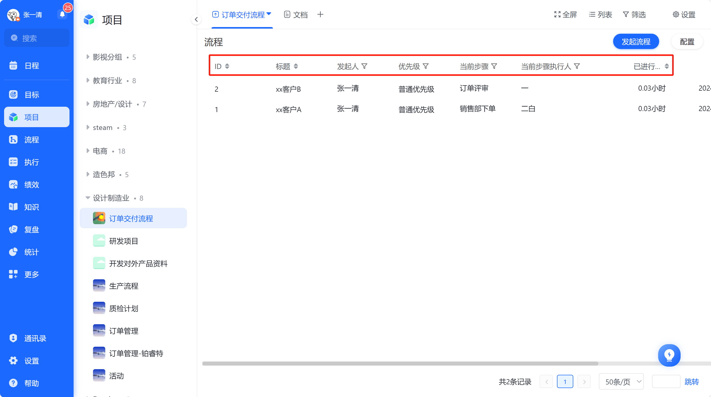
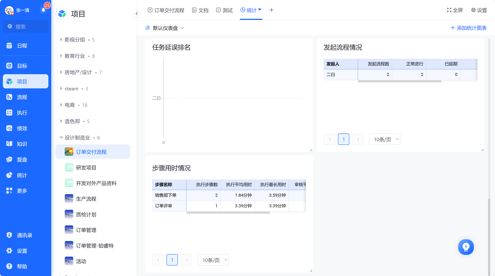
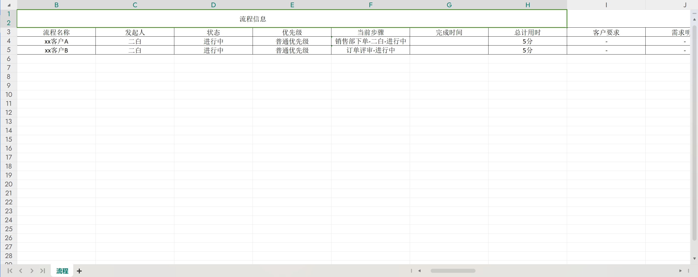
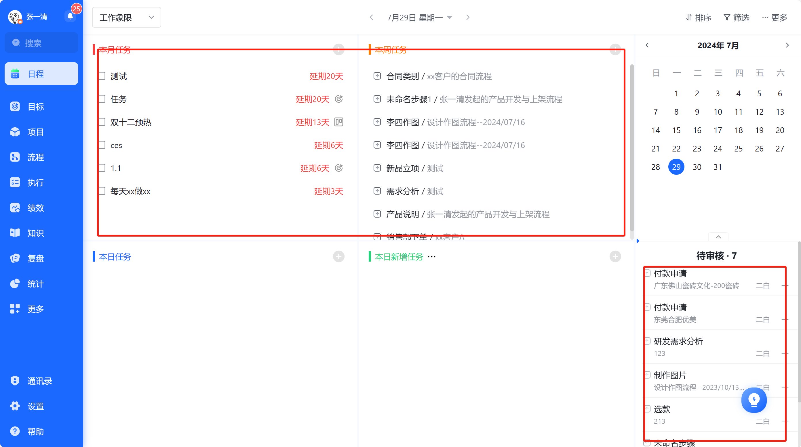
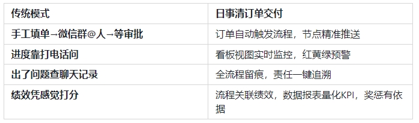

# 半小时，我搭建了一套高效的订单交付系统，效率大幅提升

原文链接：https://www.rishiqing.com/web/solution/1251.html

一、订单交付场景梳理

凌晨3点，工厂的灯还亮着——

你坐在办公室里，桌面上堆满了订单、邮件、文件和各种待办事项。生产部急等原料，财务卡在审批，物流找不到负责人……

每个订单都像是在穿越一个迷宫，每流转一个部门，交付风险就增加**30%**。最头痛的是，大家都在忙，却始终没有任何实质性的进展。

**紧急订单被“踢皮球”，部门协作全靠“吼”**

**流程进度成黑洞，老板客户两头催**

**出了问题找不到“锅”，责任推诿成日常**

你是不是也有过这样的经历？这就是某制造业公司一个订单的魔幻旅程，居然要跑遍采购、生产、物流、仓库等8个部门，经过12双手。

别担心，**日事清「订单交付系统」来了！**它能帮你打破部门间的壁垒，**实现****流程自动化、进度透明化**，甚至还能精准地**分析任务完成情况**，告别繁琐的沟通和无效的加班。

流程自动化：订单自动流转，告别手工“人肉传话”

进度全透明：每个环节实时追踪，卡点5分钟定位

数据驱绩效：谁拖后腿、谁超预期，系统说了算

适用客户

制造类企业、贸易公司，甚至一些需要定制化服务的行业，都适用这种流程管理。

二、订单交付流程实践

创建流程模板

创建流程

首先，你得建个**新的订单流程**，然后把涉及到的相关人员**加进去**，确保每个环节的责任都清楚，谁做什么，啥时候做，什么时候完成。把流程清楚了，后面才好操作。

定义步骤

接下来，就是要对每个流程步骤进行**定义**。首先，得**设定**好每个步骤的**目标**和**内容**，比如说，订单的处理、采购的审批、生产的进度等。

- 配置入口：
- **定义步骤：**每个步骤都得有**明确的任务要求**，谁负责、做什么
- **表单设计：****有些数据必须填写**，比如材料的数量、生产的进度等，这些都要通过表单收集。
- **审批项：**有些环节需要领导或相关人员审批，得在流程里**加入审批步骤**，确保每一环节都经过审核。

编排步骤

当这些步骤都创建好后，你可以通过**流程图**把它们**串联**起来。你可以根据实际情况**设置顺序**，某些步骤要**串行进行**，某些步骤可以**并行进行**，甚至可以**根据条件设定不同的分支**，流程图越清晰，执行起来越顺利。

查看方式

看板视图

想知道每个订单进展如何？**看板视图来帮忙！**每个订单的节点，负责人是谁，花了多少时间都能一目了然。**通过看板，你能清晰看到每个订单在哪个阶段，什么情况，有什么问题需要解决。**这种方式非常直观，随时都能掌握进度。

列表视图

如果你喜欢简洁一点，或者订单很多需要快速查看，**列表视图就是最好的选择**。你可以按**订单状态、日期、负责人**等**筛选**，快速找到你关心的订单。这种方式也很适合做**数据分析**，查看**全局进度**。

绩效支持

流程统计

想知道每个员工的表现怎么样？**通过流程统计功能，**你可以看到**每个执行人的任务完成情况**，分析谁完成得快，谁有延误，做得好可以奖励，做得慢可以提醒。这样，绩效考核就不再是空口无凭，数据有说服力，员工也能更有动力。

支持导出

想把数据导出来方便分析吗？没问题，**支持把数据导出成Excel表格**。通过表格，你可以**快速统计**，**查看数据的趋势**，找出潜在的问题，随时调整策略。

查看待办

不想错过重要任务？没问题，**所有待处理的流程都会在你的日程里显示出来，提醒你及时处理**。你可以清楚看到哪些任务是你的责任，哪些是你需要审批的。**通过四象限时间管理法**，你还可以按照任务的**优先级**来安排工作，确保重要的任务优先处理，工作效率大大提高。

## 三、传统订单交付 VS 日事清，差的不只是效率

某汽配企业生产总监：

“以前订单延期天天被客户骂，现在系统自动预警，交付准时率从68%提到95%，今年拿下3个新客户！”

## 四、立即行动，让订单飞起来

免费体验：14天全功能试用，顾问1对1配置流程

制造业专属礼包：

《日事清制造业数字化协同管理方案》

《制造业系统流程图》

**日事清让你轻松创建智能编排的全流程，**采购→生产→物流→财务自动流转，无需手工操作。不再为部门间的沟通不畅而头痛，不再因订单延期被客户催促。**日事清让你在高效运转中重新定义订单交付～**

