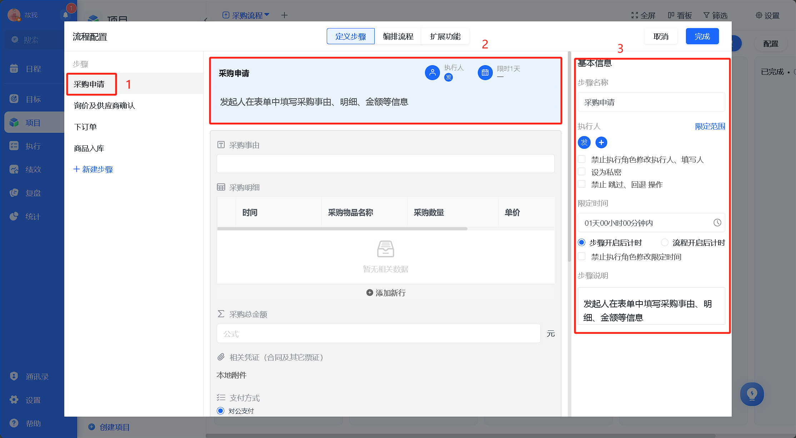
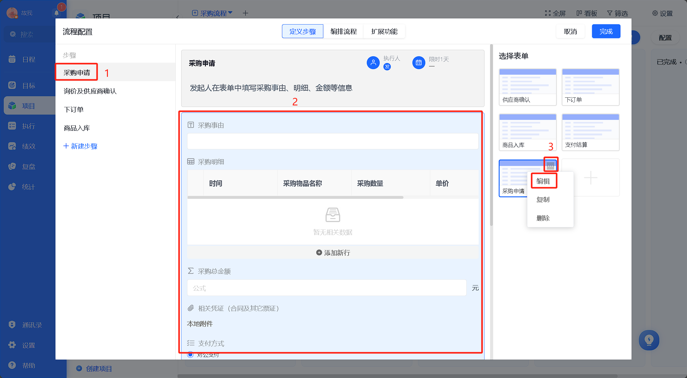
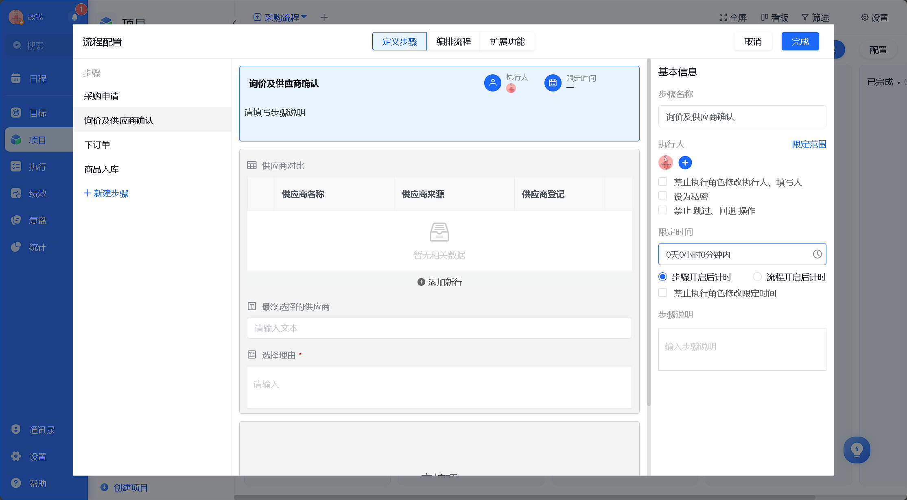
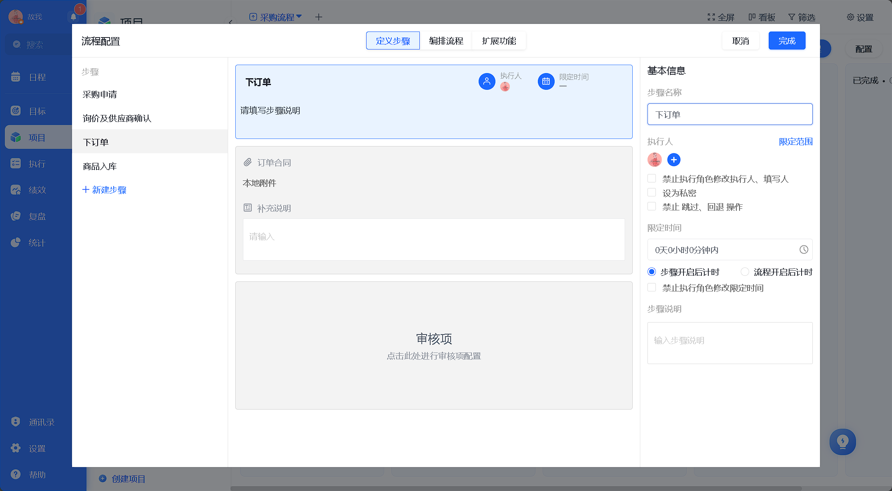
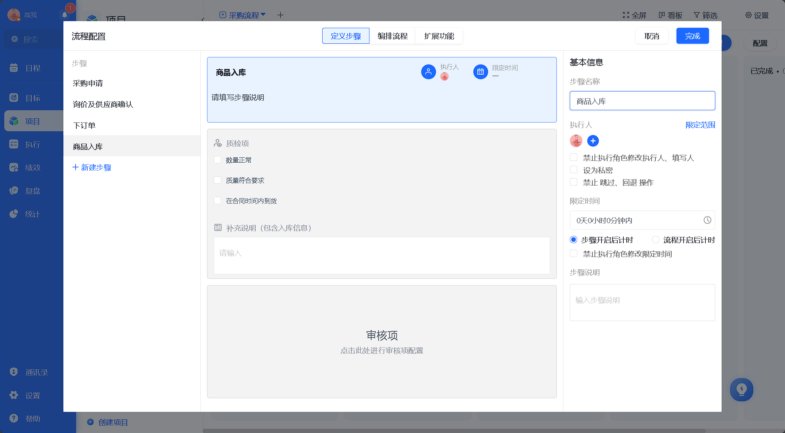
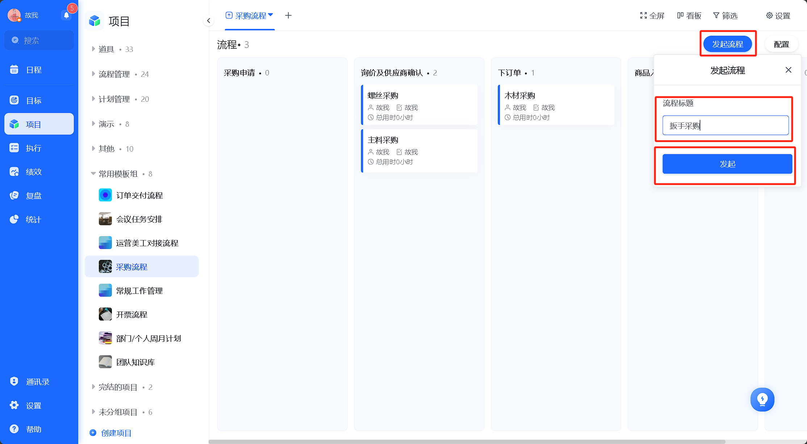
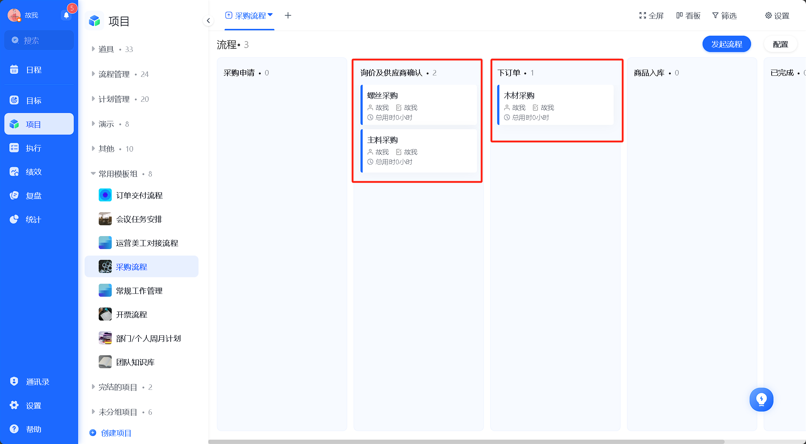
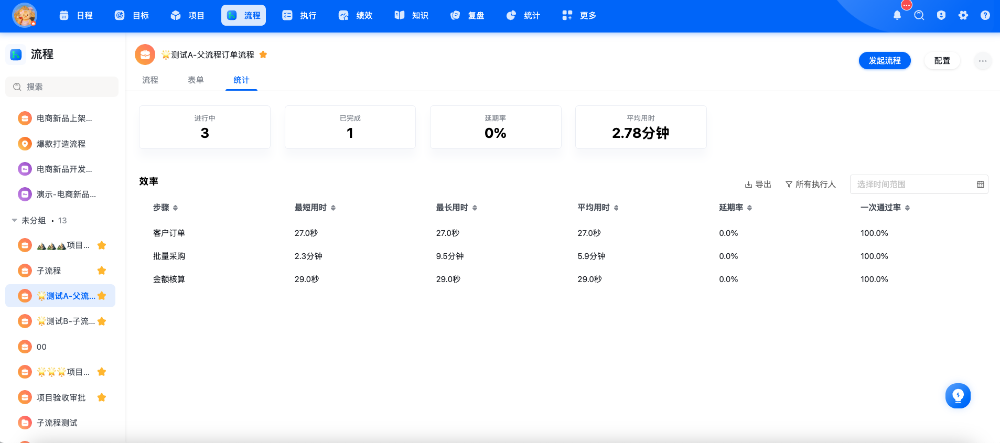

# 原料断供产线瘫痪、员工抱怨设备迟迟不到位，你还在为拖延的采购审批失眠？

原文链接：https://www.rishiqing.com/web/solution/1246.html

## 一、采购流程场景梳理

场景介绍

“原料断供产线瘫痪、员工抱怨设备迟迟不到位、供应商临时涨价措手不及...”

——你是否也经历过这些焦头烂额的采购时刻？

采购流程每拖延1天，企业就多承担1天的隐性成本。生产型企业如果采购慢了，原料跟不上，生产线就得停；而服务型企业如果材料、设备采购拖延，员工的工作效率也会大大降低。据说：

**生产型企业：**原料晚到1天=产线停工损失数十万

**服务型企业：**设备审批卡3天=客户投诉激增

**零售企业：**旺季备货延迟=错失百万销售机会

日事清采购管理方案适用客户

**制造企业老板：**原料采购频率高，设备审批跑断腿？

**服务企业主管：**行政采购总被吐槽“太慢”，拖累团队士气？

**零售采购总监：**供应商频繁掉链子，库存积压如山却总缺爆款？

## 二、日事清采购管理系统实践

### 1. 智能流程引擎：自定义配置，拒绝“人等流程”

**痛点爆破：****还在用Excel+微信催审批？审批卡在领导出差怎么办？**

**解决方案：****智能流程步骤配置：“采购申请→比价→合同→验货”全流程。**

流程配置

**每个环节，都得设定清楚。**你可以设置步骤名称、负责人、限定时间，确保每一步都按时按质完成！

步骤反馈

**每个环节的负责人都得提供具体反馈信息，**采购申请里得写清楚采购原因、商品明细、支付方式等等。这样每个人都知道下一步该干嘛。

独立审核流程

**每一步都可以设置不同的审核方式。**主管审核、财务审核，甚至是总经理审核都可以**自定义**。你可以确保每个流程环节的审批都清晰、透明。

询价与供应商确认

要采购东西，先得比价格，确认供应商！每个环节都会确保选择的供应商**符合标准**，避免采购后才发现麻烦。

下订单、合同上传

确定供应商后，订单**生成**，合同**上传**，流程**自动走**。省时省力，不用到处跑腿。

商品入库检查

商品一到，检查，验货！不合格的，直接退货。确保每个细节不出错。

发起新采购流程

有新的采购需求？**直接点击发起流程，输入信息，**系统**自动通知**下一步负责人处理，流程**自动推进**，省去沟通的麻烦。

### 2. 全流程透视看板：老板一眼掌控采购命脉

**老板之痛：****采购部说“都在走流程”，实际卡在哪根本不知道？**

**解决方案：****采购地图看板：实时显示每个订单的审批节点、滞留时长、责任人。**

流程看板展示

所有流程一目了然！你可以随时查看每个采购申请当前在哪个阶段，哪个环节出了问题，也能随时发现。

### 3. 全流程统计报表：卡点秒级定位，让效率黑洞无处可藏

**血泪痛点：****“审批平均耗时7天，其中4天卡在同一个部门反复修改！”**

**解决方案：****自动抓取每个步骤的最短、最长、平均用时、审批人停留时长、一次性通过率。**

## 三、总结

**特别警示：**采购流程每**拖延**1个月，企业将**损失**大于1%的净利润！

为了帮助您的企业提高采购效率，我们特别为前**100名**咨询企业**赠送《采购流程图》**。**立即行动，点击下方【免费预约演示】，**我们帮您**优化**采购流程，**提升**决策速度，减少不必要的成本浪费，实现利润最大化～～～～

