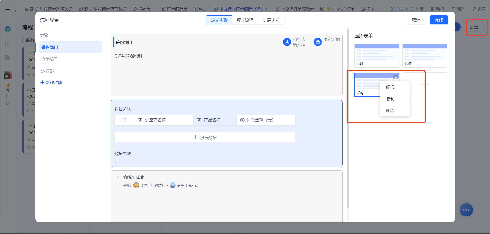
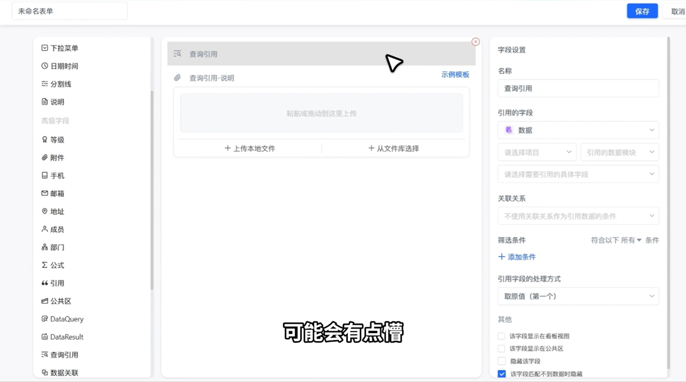
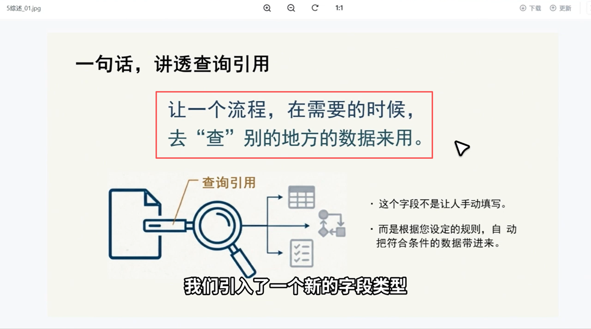
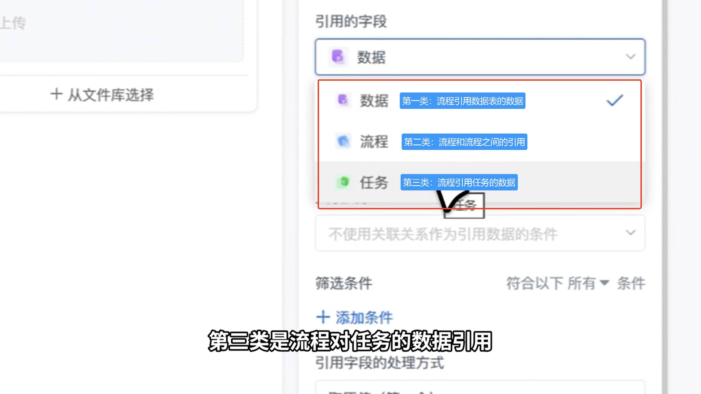
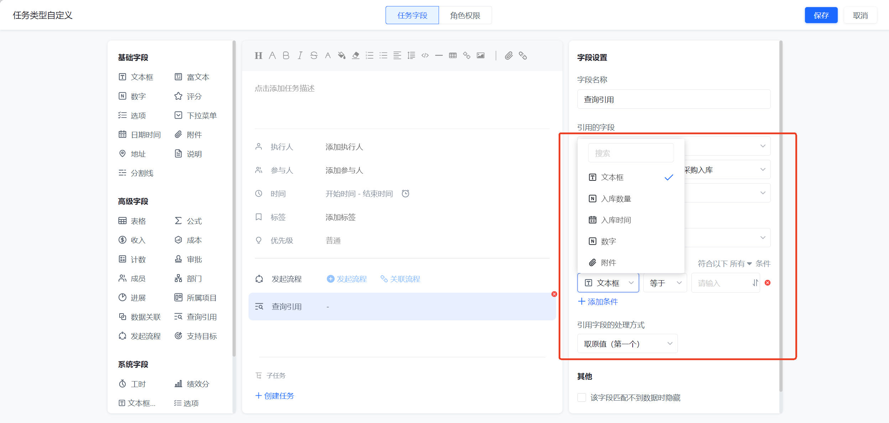
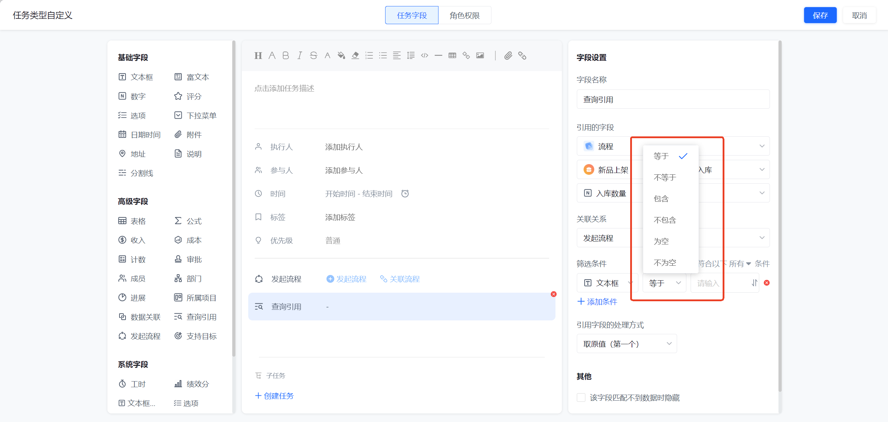
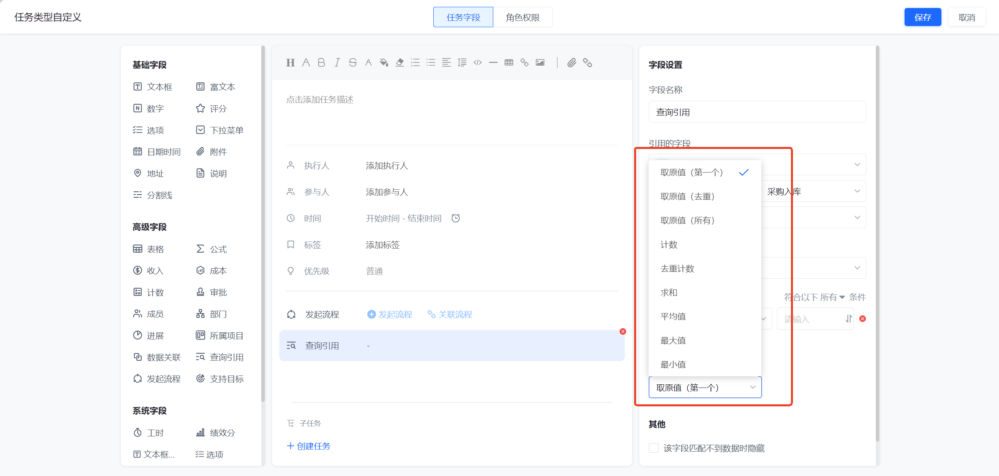
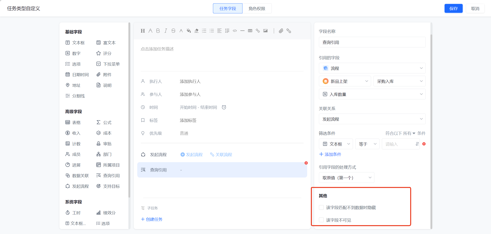

# 日事清查询引用字段是什么？流程数据自动查询复用配置教程

原文链接：https://www.rishiqing.com/web/solution/liuchengchaxunyinyongziduan.html

日事清「查询引用」**字段**是流程配置的核心基础能力，支持流程根据自定义规则，自动查询、调取、复用系统内已有数据，无需人工重复录入、手动核对纠错。核心用于解决企业多流程、多部门协作中，数据反复填写、标准不统一、统计低效易错的痛点，是搭建复杂标准化业务流程的核心支撑。

「查询引用」**字段的核心价值，就是建立标准化的数据流转复用机制，让数据只产生一次、全程多次复用，从源头解决流程数据冗余、错乱、低效问题，让复杂流程逻辑更清晰、运行更稳定。**

## 一、什么是查询引用字段？核心价值是什么？

日事清「查询引用」**字段是****流程专属的数据调取复用能力，可通过自定义筛选规则，自动查询数据表、其他流程、任务的已有数据，完成自动带入、汇总计算与复用，杜绝人工重复录单与纠错工作，保障全流程数据统一、准确、可追溯，支撑复杂业务流程稳定运行。**

随着企业流程增多、部门协作变复杂，传统流程协作的核心短板并非流程步骤缺失，而是**数据碎片化、重复化、不一致**。同一业务数据需要在多个流程反复填写、反复确认，不仅消耗大量人力，还容易出现填错、漏填、版本混乱等问题，严重拖慢业务落地效率。

「查询引用」字段**的核心价值，就是建立标准化的数据流转复用机制，让数据只产生一次、全程多次复用，从源头解决流程数据冗余、错乱、低效问题，让复杂流程逻辑更清晰、运行更稳定。**

## 二、查询引用字段有哪些数据来源？

查询引用按来源分三大类:

- **流程引用数据表的数据**(又分两种——“在数据中通过发起流程字段创建了本流程”由数据来源锁定范围,以及“引用数据关联字段所关联的数据”由数据关联字段先选中再补全信息);
- **流程和流程之间的引用**(父引子、子引父、引用通过发起流程字段创建出来的流程);
- **流程引用任务的数据**(前提是这条流程必须通过任务里的发起流程字段创建,只认发起了它的那一条任务)。

后面会拆成7节课,每种用法都讲透。

## 三、查询引用怎么配置筛选与数据计算规则？

两个贯穿所有场景的能力:**筛选条件**决定这么多数据里哪些才真正要用,支持等于、不等于、不为空等多个条件、可选“全部满足”或“任一满足”,文本、数字、日期、附件都能参与判断(比如金额大于某数才引用、日期在某范围内才算);**数据处理方式**决定结果不止一条时怎么处理——只有一条就“取原值”,多条时可取第一个、求和、平均值、最大值、最小值(比如统计场景关心总金额就求和)。

## 四、查询引用辅助配置怎么优化流程体验？

辅助配置不决定流程能不能跑,而决定流程好不好用、会不会越用越乱。**显示范围**控制字段要不要在公共区、看板视图出现——有些字段只给系统算、对人没意义,藏起来表单才不杂;**无匹配数据时的处理**——筛选条件严或业务还没产生数据时,选“没匹配就隐藏字段”,流程在这个阶段就很干净,不会出现一堆空字段让人困惑。它们是体验配置,价值往往在流程跑一段时间后才被真正感受到。

## 五、查询引用功能怎么用？实现流程数据高效复用

日事清查询引用字段功能，主打**一次产生数据、全程自动复用**，核心解决企业多流程、多场景下的数据重复录入、手动统计低效难题。

通过搭配数据来源、筛选规则、计算方式与辅助配置，可搭建自动化数据流转体系，让业务数据自动查询、精准匹配、智能汇总、整洁展示。

功能操作与应用价值：

企业只需提前配置好查询引用的数据源、筛选条件与数据处理规则，后续所有关联流程即可自动调取、复用已有业务数据，无需人工干预。

系统自动完成数据匹配、筛选、汇总、展示全流程工作，全程数据同源统一、自动更新，规避人工操作带来的各类问题。

该功能彻底解决了传统流程协作中，数据重复填报、人工核对易错、多端数据不一致、表单杂乱冗余、空字段干扰操作的企业协作痛点，全面提升流程数据流转的标准化、自动化与高效性。

## 六、查询引用字段使用注意事项

查询引用字段的配置逻辑层层关联，数据源、筛选规则、展示设置任意环节出错，都会导致数据调取失败、展示异常、汇总不准。

遵循标准化配置规范、做好场景适配与细节优化，可保障查询引用功能长期稳定、精准、高效运行，适配各类复杂业务流程。

核心避坑要点：

1. 数据源避坑：严格区分数据表、跨流程、任务三类数据源，任务数据引用仅支持通过发起流程字段创建的流程，选错数据源会直接导致数据查询失效。

2. 规则配置避坑：多条件筛选需合理搭配「全部满足/任一满足」逻辑，批量统计场景优先配置求和、平均值等计算规则，避免多条数据展示混乱、统计失真。

3. 字段展示避坑：区分系统计算字段与人工查看字段，非必要字段及时隐藏，杜绝表单页面冗余杂乱，保障员工操作简洁高效。

4. 空数据处理避坑：业务初期数据较少、筛选条件严格的场景，务必开启无匹配数据隐藏功能，避免空白字段影响流程操作与页面美观。

## 七、查询引用字段常见问题 FAQ

**Q1：日事清查询引用字段的核心作用是什么？**

A：查询引用字段是流程核心数据复用能力，可自动查询调取数据表、其他流程、任务的已有数据，实现数据自动带入、筛选、汇总计算，替代人工重复填单与手动统计，解决流程数据冗余、错乱、低效问题，保障业务数据统一可追溯。

**Q2：查询引用字段支持哪些数据来源？**

A：支持三大核心数据源，分别是标准化数据表数据、父子流程及各类关联跨流程数据、任务发起生成的溯源数据，覆盖企业基础数据复用、流程联动、任务协同全场景，可按需组合配置适配复杂业务。

**Q3：查询引用可以实现多条数据自动汇总统计吗？**

A：可以。查询引用自带数据处理能力，单条数据可直接原值展示，多条数据支持求和、平均值、最大值、最小值、取第一条等多种计算方式，无需人工导出统计，可直接在流程内完成自动化数据汇总。

**Q4：为什么流程查询后会出现大量空白字段？**

A：大多是暂无匹配数据且未开启空数据处理功能导致。业务初期无对应数据或筛选条件过严时，系统会默认展示空白字段，只需在辅助配置中开启「无匹配则隐藏字段」，即可优化页面展示效果。

**Q5：如何避免查询引用数据匹配不准确？**

A：需精准匹配数据源类型，合理设置多维度筛选条件，按需搭配「全部满足/任一满足」逻辑，同时核对字段类型与判断规则匹配度，避免条件冲突、数据源选错，从源头保障数据查询精准度。

**Q6：查询引用辅助配置有必要设置吗？**

A：非常有必要。辅助配置不影响短期流程运行，但能长期优化流程体验，精简表单冗余字段、隐藏空白内容，让流程页面更整洁、操作更简单，避免长期使用后流程杂乱、员工操作困惑。

**Q7：查询引用和数据关联功能有什么区别？**

A：数据关联主打数据传递与接力复用，查询引用主打主动查询、筛选、汇总外部数据；前者侧重固定数据流转，后者侧重灵活条件匹配与智能计算，两者搭配可搭建完整的流程数据闭环体系。

**Q8：哪些业务场景适合使用查询引用字段？**

A：适用于所有需要跨场景复用数据、自动统计汇总的流程，包含订单数据调取、业务数据复盘、多流程数据联动、月度数据统计、项目任务溯源、跨部门数据同步等标准化协作场景。

## 八、总结

日事清查询引用字段，是企业流程数据自动化流转与复用的核心底层能力，通过「多源数据查询、精准条件筛选、智能数据计算、轻量化辅助配置」三层完整能力，彻底解决传统流程数据重复填写、人工统计易错、页面杂乱、数据不统一的协作难题。

该功能不仅能简化流程操作、提升协作效率，更能建立标准化的数据流转方法论，明确数据来源、流转路径、复用规则，让企业所有业务数据同源统一、全程可追溯，为复杂业务流程落地提供坚实支撑。

依托日事清流程管理能力，让企业流程执行更有节奏、协作更有章法，如需深入了解流程数据配置技巧，可扫码了解日事清流程管理完整功能。

