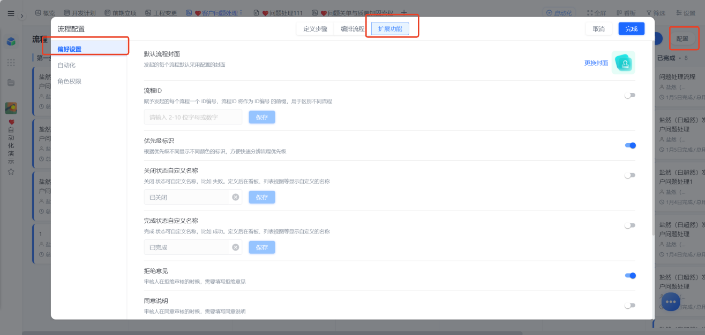
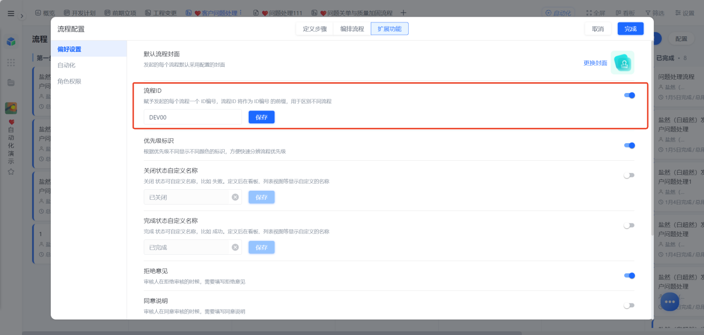
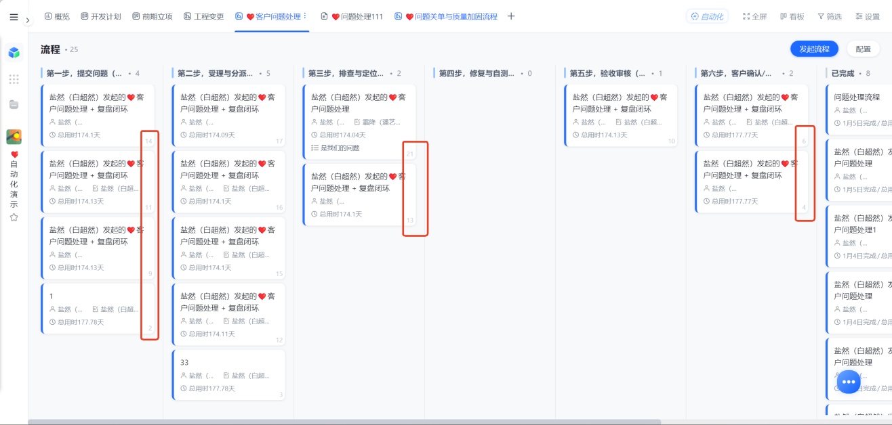
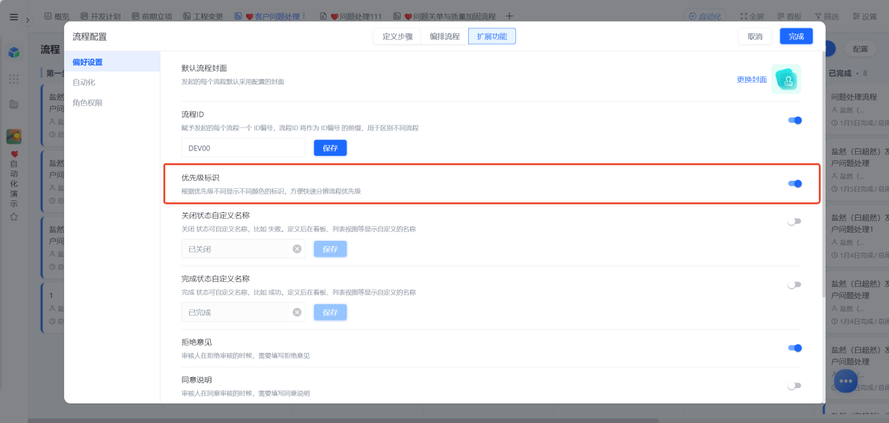
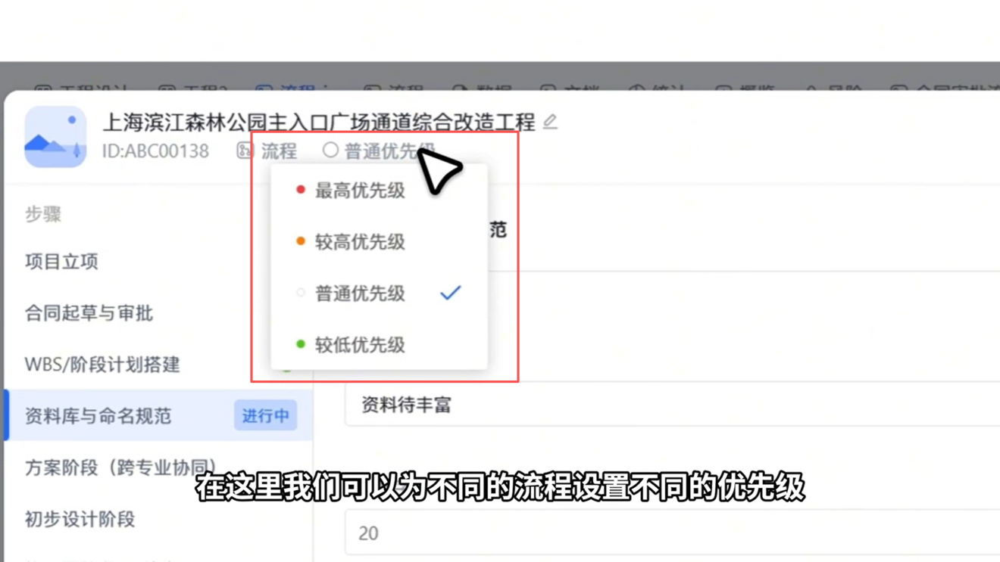
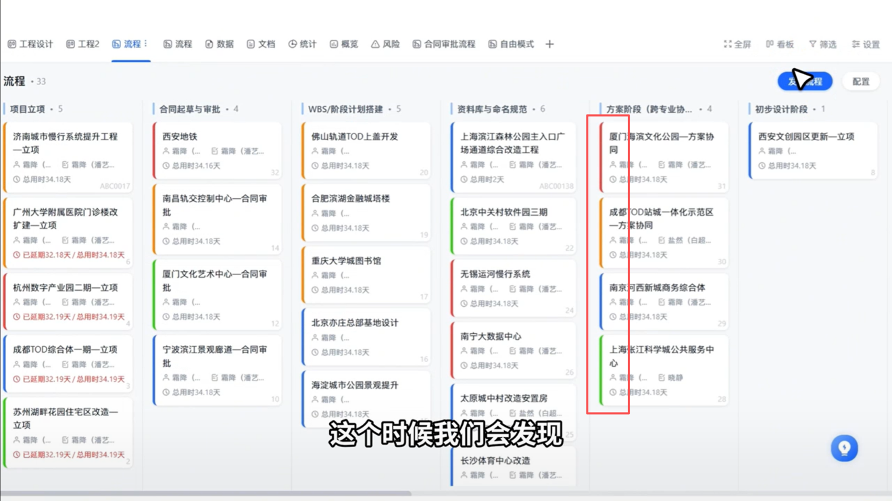
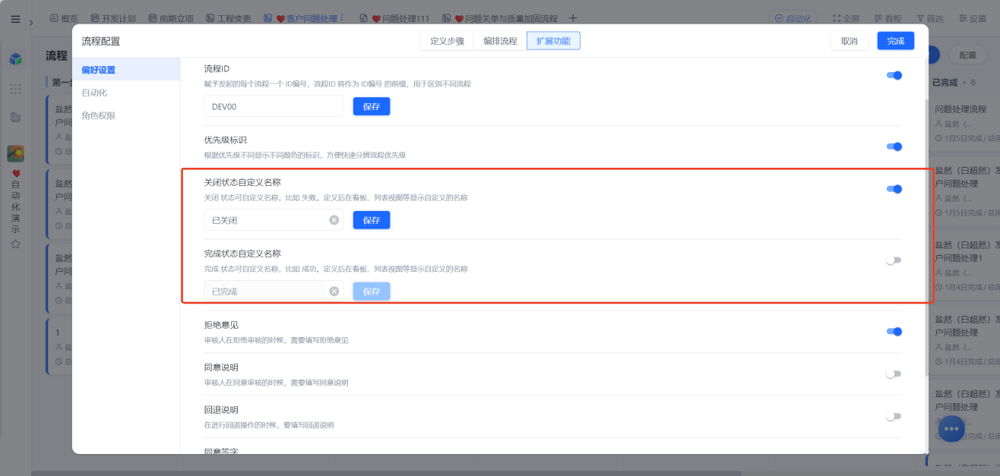
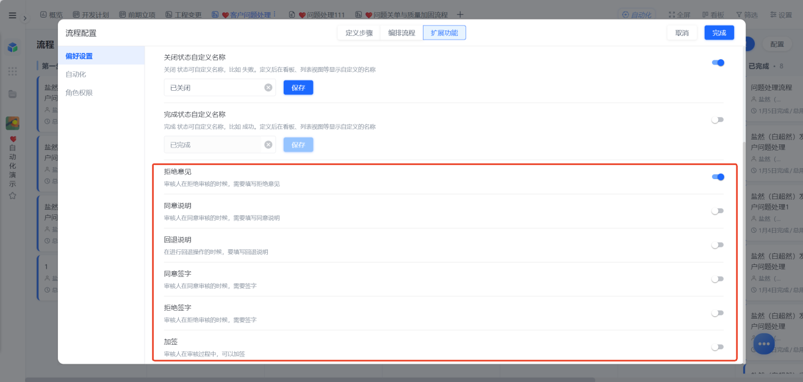

# 日事清流程偏好配置怎么设置？自定义标识与审批规范教程

原文链接：https://www.rishiqing.com/web/solution/rishiqingprocesspreferencesetting.html

日事清流程偏好配置是优化流程展示效果、贴合团队业务习惯、规范审批流程的核心扩展功能，统一入口位于流程配置页右上角「扩展功能 → 偏好设置」。该功能可实现流程编号分类、紧急度可视化、状态名称业务化、审批全程留痕、灵活加签协作，解决企业流程杂乱、状态难懂、审批无依据、合规无保障等问题，是精细化流程管理的基础配置。

## 一、什么是日事清流程偏好配置？核心作用与入口

日事清流程偏好配置是流程管理的个性化、规范化扩展功能，无需修改核心流程逻辑，即可自定义流程标识、展示样式和审批规则，包含编号、优先级、状态名称、审批留痕、加签等配置项，适配不同行业、不同部门的业务需求，让流程更清晰、审批更规范、管理更合规。

很多企业搭建完流程模板后，普遍存在流程类型混杂、紧急流程无法快速识别、状态表述通用生硬、审批操作无留痕等问题，导致流程管理混乱、追责无依据、团队理解成本高。

通过日事清流程偏好配置，企业可在不改动原有流程步骤的前提下，轻量化优化流程细节，统一团队协作标准，兼顾实用性与合规性，适配绝大多数企业的日常流程管理场景。

## 二、怎么设置流程ID与优先级标识？实现流程快速区分

**流程ID**是系统为每个流程自动生成的编号,用来区分流程类型。比如给采购流程设前缀PUR、合同审批设CON、研发流程设DEV,发起后自动生成“DEV-001”“DEV-002”,看板或统计里一眼看出属于哪类。可输入2到10位字母或数字,只影响新流程、历史流程不改号。

**优先级标识**让你在看板里用颜色快速区分紧急程度。一个模板下可能发起很多流程,只靠名字难分辨。点开流程在顶部设“优先级”——红色最高、橙色较高、白色普通、绿色较低,再打开偏好设置里的“优先级标识”开关,回到看板每张卡片左侧就出现一条颜色条,哪些最紧急一目了然。

## 三、怎么自定义流程状态名称？适配企业业务场景

默认流程结束显示“已关闭”、完成显示“已完成”,有时太笼统。可以自定义:

- **关闭状态自定义名称**:研发部门可改成“研发失败”,销售审批可改成“作废”或“未通过”,输入后保存,关闭流程拖到“已关闭”分栏就显示新名称;
- 完成状态自定义名称:生产流程改“已入库”、质检改“合格”、项目改“已验收”或“通过”,保存后看板里所有已完成流程都显示新名称,更贴合业务语境,团队也更好理解当前状态。

## 四、审批意见、签字与加签功能怎么用？实现合规留痕

往下几项都和审批有关:

- **拒绝意见/同意说明/回退说明**:开启后审核人操作时必须写原因,避免只看到“被拒绝了”却不知为什么。适合对透明度要求高的制造业、研发、合规审计类企业;
- **签字设置**:在步骤审核节点打开“同意签字”“拒绝签字”,审核人点同意或拒绝时先填说明、再弹出签名框,可手机扫码签名,签名自动同步到流程记录。合同、资金、验收、质检等关键节点用它能保障真实性与责任明确;
- **加签**:审核中发现需要其他同事共同判断(如让财务或法务再看一下),审核人点“加签”选人,系统自动转交共同审批,完成后回到原路径继续,不用撤回或重新发起。

## 五、流程偏好配置功能怎么用？实现流程精细化合规管理

日事清流程偏好配置无需改动核心流程模板，轻量化操作即可完成流程标识、展示样式、审批规则的个性化设置，零基础管理员也可快速上手配置。

整套功能覆盖流程分类、紧急度区分、状态适配、审批留痕、灵活协作五大核心能力，全方位适配企业各类办公审批场景。

**功能操作与应用价值：**

用户可在流程配置页右上角「扩展功能 → 偏好设置」统一完成全部配置，按需开启、自定义对应功能参数，适配自身团队业务与管理习惯。

该功能彻底解决了企业流程展示杂乱、状态表述不贴合业务、审批无留痕、紧急流程难识别、固定流程模板适配性差、审批协作僵化等流程管理痛点，助力企业实现标准化、精细化、合规化流程管控。

## 六、流程偏好配置使用注意事项

流程偏好配置仅对新发起流程生效，历史流程数据、编号、状态及审批记录不会被动修改，保障企业历史数据稳定。

各类偏好功能需结合业务场景按需开启，无需全部启用，过度配置会增加团队流程理解成本，反而影响审批效率。

**核心避坑要点：**

1. 流程ID前缀建议统一企业规范，固定2-10位字母/数字，切勿随意频繁修改，避免新老流程编号混乱，影响流程检索与统计溯源。

2. 仅支持自定义流程「已完成、已关闭」两类结束状态，流程流转中状态不可修改，禁止随意改动核心状态逻辑，防止流程流转异常。

3. 合规审计、资金、合同等严谨场景，务必开启审批意见必填+电子签字功能，严禁关闭留痕功能，规避企业审批合规风险。

## 七、流程偏好配置常见问题 FAQ

**Q1：日事清流程偏好配置入口在哪里？**

A：所有偏好配置功能统一入口为日事清流程配置页面右上角「扩展功能 → 偏好设置」，无需跳转其他页面，可集中完成编号、标识、状态、审批规则等全部个性化配置，操作集中高效。

**Q2：自定义流程ID会修改历史流程编号吗？**

A：不会。日事清流程ID自定义设置仅对设置完成后新发起的流程生效，已生成的历史流程编号保持不变，可有效保障企业历史流程数据的完整性和稳定性，无需担心数据错乱问题。

**Q3：自定义流程状态名称支持哪些修改范围？**

A：目前仅支持自定义「已完成」和「已关闭」两类结束状态名称，可根据业务场景自由编辑文案，流程进行中的流转状态不支持修改，既保证流程逻辑严谨性，又满足业务场景适配需求。

**Q4：审批签字功能适合哪些业务场景使用？**

A：该功能适合对合规性、真实性要求高的关键场景，包括合同审批、资金支付、项目验收、产品质检、设备入库等，通过电子签字确权，留存永久审批记录，满足企业内部管控和外部审计需求。

**Q5：流程加签会改变原有流程的流转路径吗？**

A：不会。日事清流程加签仅临时增补审批人员，新增人员完成审核后，流程会自动回归原有流转路径，不会修改预设流程步骤，无需撤回重提，兼顾流程规范性与协作灵活性。

**Q6：开启审批意见必填后可以跳过填写吗？**

A：不可以。开启审批同意、拒绝、回退说明必填功能后，审核人员必须填写对应操作原因，方可完成审批操作，强制留存审批逻辑，杜绝随意审批、无依据操作的情况，规范团队审批行为。

## 八、总结

日事清流程偏好配置是企业实现流程精细化、个性化、合规化管理的重要基础功能。流程ID与优先级标识实现流程分类可视化管理，自定义状态名称贴合业务场景、降低理解成本，审批留痕与加签功能解决了企业审批不规范、追责无依据、流程僵化的核心痛点。

所有配置均无需改动核心流程模板，轻量化操作即可大幅优化团队协作体验，适配各行各业的流程管理需求。掌握偏好配置后，可进一步学习流程自动化配置，实现流程自动发起、自动提醒，进一步解放人力、提升流程管理智能化水平。若想要了解更多日事清流程管理实操技巧与全功能详情，可扫码了解日事清完整流程管理能力。

