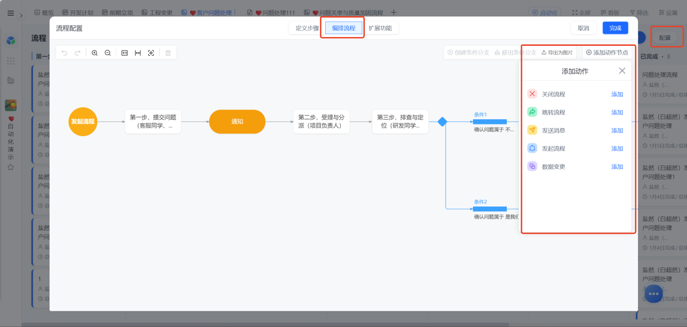
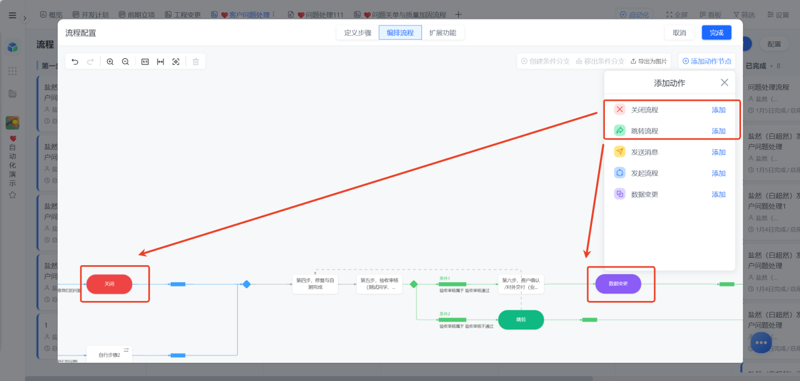
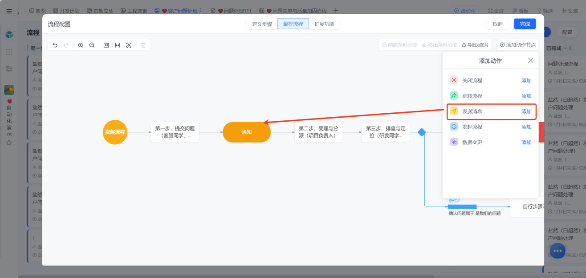
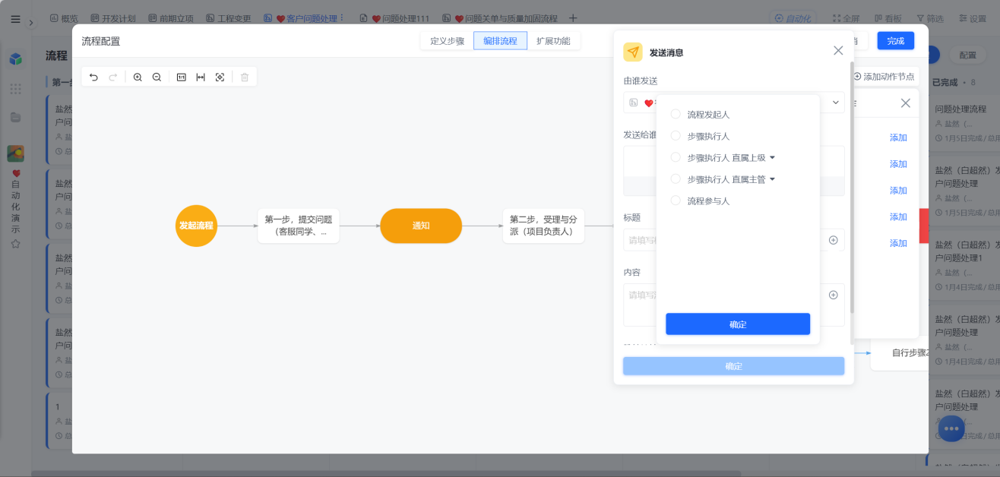
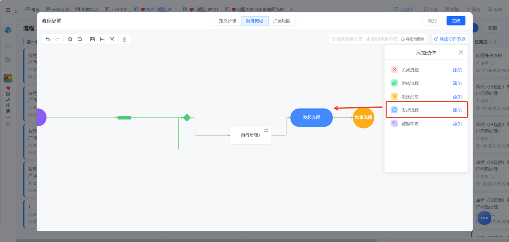
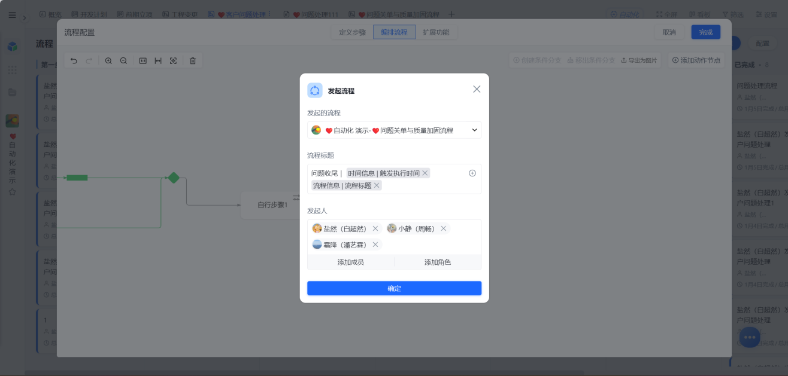
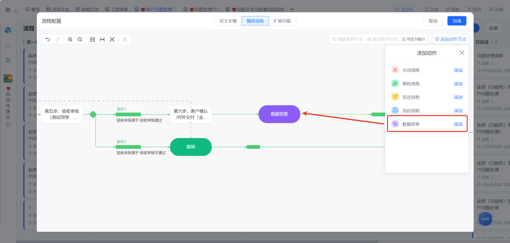
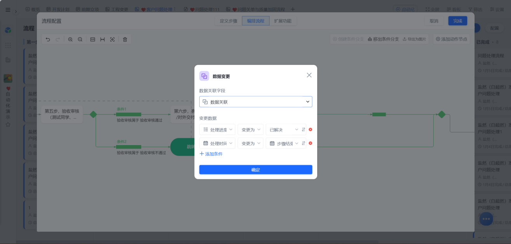

# 日事清流程动作节点怎么用？5大自动动作节点配置教程

原文链接：https://www.rishiqing.com/web/solution/liuchengdongzuojiedianpeizhijiaocheng.html

企业传统办公流程普遍依赖人工跟进收尾、通知、同步数据，极易出现流程挂起、交接断层、多流程断档、台账数据更新不及时等问题。日事清**流程动作节点**是实现流程全自动化的核心功能，可将流程关键操作交由系统自动执行，减少人工盯办、记忆与催促，让企业办公流程自主、有序、精准运转。

入口在流程编辑界面右上角的【添加动作节点】，点开有五个：关闭流程、跳转流程、发送消息、发起流程、数据变更。选中后和步骤首尾相连即可。使用逻辑都是一套：添加、连线、配置、测试。下面用同一条《问题处理流程》把五个节点跑一遍。

## 一、关闭流程与跳转流程节点：流程自动收尾、整改回跳闭环

关闭流程:走到这一步流程直接结束,后面不再走。适合两类场景——条件不满足就到此为止(资料不全、审批不过、风险不允许),以及已处理完不需要后续步骤。要点:它只负责收口,不负责判断,判断交给前面的条件分支。比如排查后选“不是我们的问题”,那条分支接一个关闭节点,流程当场结束,不再让后面的人白跑。

跳转流程:走到这一步回到前面某一步重做,在同一条流程里做回跳。最适合“打回重做”——验收不通过时回到“修复与自测完成”,补修后重新走验收,形成闭环。它会把跳回点之后的步骤全部重置成未开启,保证流程不乱。有个新手坑:加了跳转节点、连了线,却没在弹窗里选“跳转至哪一步”,点完成会直接报错。记住——选好“跳转至”才算配完。

## 二、发送消息与发起流程节点：精准消息同步、跨流程自动联动

发送消息:流程执行到该节点就发一条通知,把该知道的人通知到位,避免交接断层。

常用三类场景：

- 交接(审批通过通知执行人开工)
- 风险提醒(需补材料、需重新确认)
- 结果同步(处理完通知发起人验收)。

通知对象可选发起人、直属上级、部门主管、使用角色等,这些角色在流程发起时就被赋值。一条硬规则:不要配成“自己通知自己”——通知节点的触发者一定是上一步操作人,如果他刚好也是通知对象,这条通知会被系统省略。

发起流程(自动发起):主流程走到这里,系统自动再开一条新的独立流程,把“流程接流程”彻底自动化。常见用法是审批通过自动触发执行流程,比如问题关闭后自动发起《问题复盘流程》。配置三项:选“发起的流程”、用引用值拼出清晰的“流程标题”(如“问题复盘｜流程标题｜触发时间”)、选“发起人”(可选成员或角色、可多人,系统为每人各发一条)。注意和表单里的“发起流程”字段区分——那个是人工触发,这个动作节点是流程驱动的自动触发。

## 三、数据变更节点：流程 台账自动同步、数据永久对齐

数据变更解决的是“流程走完了,但台账没同步”的问题。要先说清它改的是谁——它改的是“数据关联字段”指向的那条台账记录(客户表、订单表、问题台账等某一行),而非流程表单里正在填的这一页。所以前置是先在某一步配好数据关联字段,让流程从一开始就指向台账里的某条记录。

以《问题处理流程》为例:第一步”提交问题”里配好数据关联字段(关联问题台账表、选好显示字段);最后一步”客户确认/对外交付”通过后,加一个数据变更节点——数据关联字段选第一步那个,变更数据设为“处理状态→变更为→已解决”。这样只要交付通过,台账里这条记录自动从“处理中”改成“已解决”。逻辑很清楚:流程负责做判断,数据变更负责把判断结果写回台账,通过了才写,没通过就不动台账。常用在客户类、订单类、问题/工单类台账。

## 四、流程动作节点怎么用？功能操作与应用价值

日事清流程动作节点的核心使用逻辑，是依托系统预设自动化能力，替代传统人工操作，让企业办公流程实现自主流转、自动闭环。

所有自动化节点无需复杂代码配置，统一沿用「添加、连线、配置、测试」标准化流程，零基础即可完成流程自动化改造。

**功能操作与应用价值：**

企业只需根据自身流程痛点，匹配对应的动作节点，针对性改造流程薄弱环节，无需全盘重构现有流程体系。

该功能彻底解决了传统流程人工盯办、手动补位、信息漏传、流程断档、台账数据不同步的诸多难题，把不确定的人治流程，转化为标准化、自动化的系统流程，大幅降低团队协作与管理成本。

## 五、流程动作节点使用注意事项

企业在配置流程动作节点时，必须遵循系统结构规则，规范节点连线与参数配置，避免违规操作导致流程报错、功能失效。

流程自动化改造建议循序渐进、试点落地，切忌一次性叠加多个节点，避免流程逻辑复杂、难以排查问题。

**核心避坑要点：**

1. 结构避坑：所有流程动作节点均不可直接连接流程开始节点，必须前置基础业务步骤，保证流程逻辑合规有序；关闭、跳转两类节点禁止对接流程结束节点。

2. 配置避坑：跳转节点必须手动选定回跳步骤，消息节点规避自我通知，数据变更节点提前绑定台账关联字段，缺一不可。

3. 报错避坑：遇到节点无法连线、结构不允许的情况，可新增「自行步骤」作为过桥节点，快速打通流程链路，解决结构适配问题。

## 六、流程动作节点常见问题FAQ

**Q1：流程动作节点和人工操作流程的核心区别是什么？**

A：传统流程依赖人工收尾、通知、同步数据，疏漏率高、效率低；流程动作节点由系统自动执行预设动作，全程无需人工干预，流程流转更稳定、标准，彻底摆脱人工盯办模式。

**Q2：为什么跳转流程节点配置完成后无法生效？**

A：多数为配置缺失导致，仅添加节点、完成连线无法生效，必须在配置弹窗中手动选择指定回跳步骤，补全参数后，节点才可正常实现流程重做闭环。

**Q3：发送消息节点收不到通知是什么原因？**

A：核心原因是触发了自我通知规则，上一步操作人与通知对象为同一人时，系统会自动屏蔽通知，配置时需规避此类场景，保证信息正常同步。

**Q4：数据变更节点为什么无法同步台账数据？**

A：数据同步失效的核心原因是缺少前置配置，必须在流程初始步骤绑定数据关联字段，精准对接台账数据表，否则节点无法定位目标数据，无法完成自动更新。

**Q5：新手如何高效落地流程动作节点改造？**

A：优先针对企业高频出错的流程试点配置，单节点跑通、流程稳定后，再逐步叠加其他自动化节点，循序渐进完成全业务流程数字化升级。

## 七、总结

日事清五大流程动作节点，覆盖流程收尾、整改回跳、消息同步、跨流程联动、台账数据同步全场景自动化需求，通过标准化的节点配置，彻底解决传统企业流程协作混乱、执行滞后、数据失真、管理低效等核心痛点。

区别于传统人工管控模式，流程动作节点依靠系统自动化能力固化流程标准，让企业流程执行有节奏、团队协作有章法。企业可通过轻量化试点落地，逐步实现全业务流程规范化、数字化、自动化升级，全方位提升企业流程管理效率与标准化能力。

想要完整体验流程自动化管控能力，优化企业办公流程，可扫码了解试用日事清流程管理。

