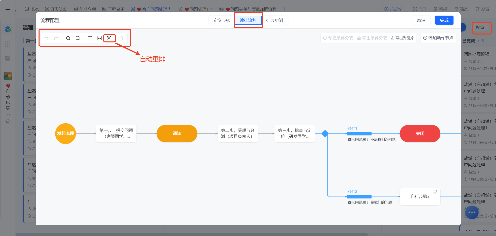
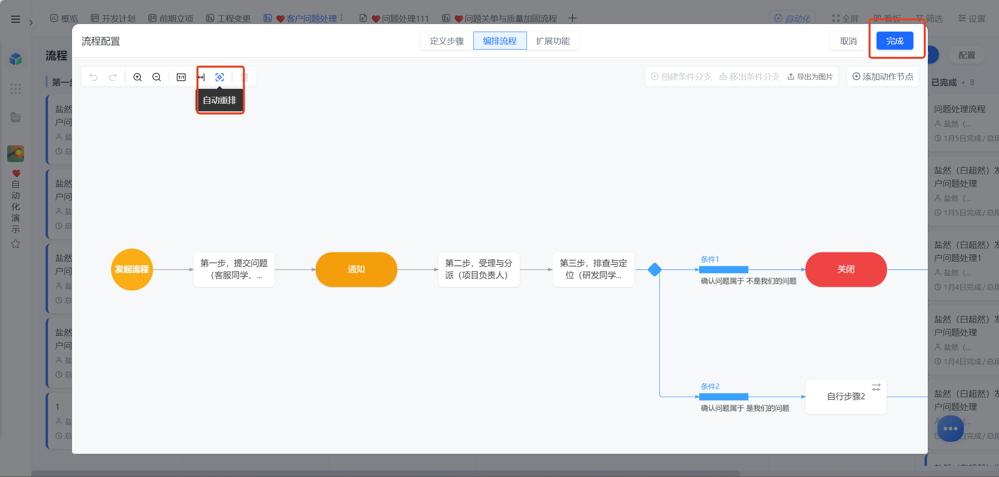
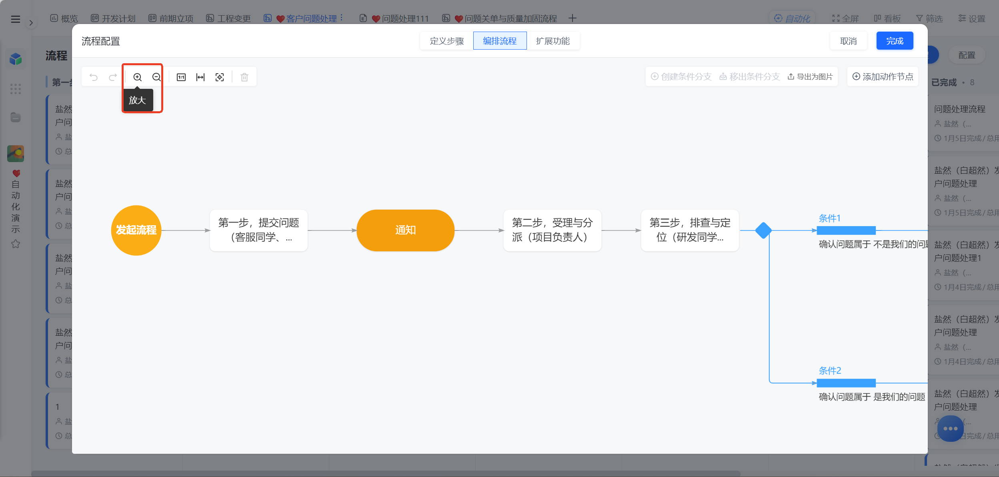
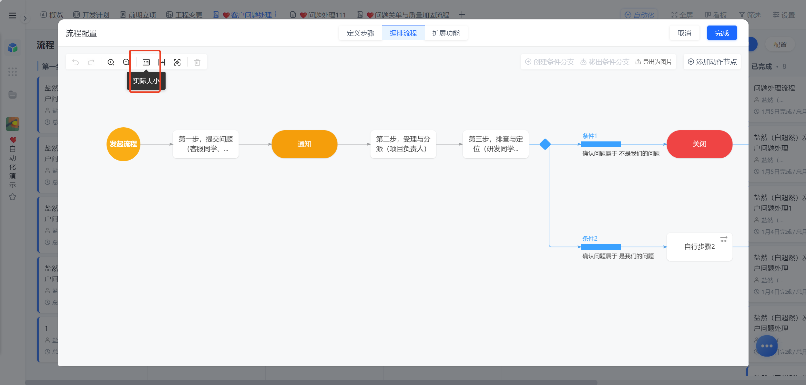
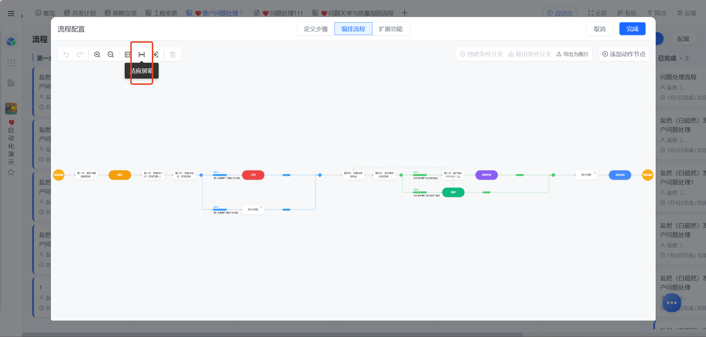
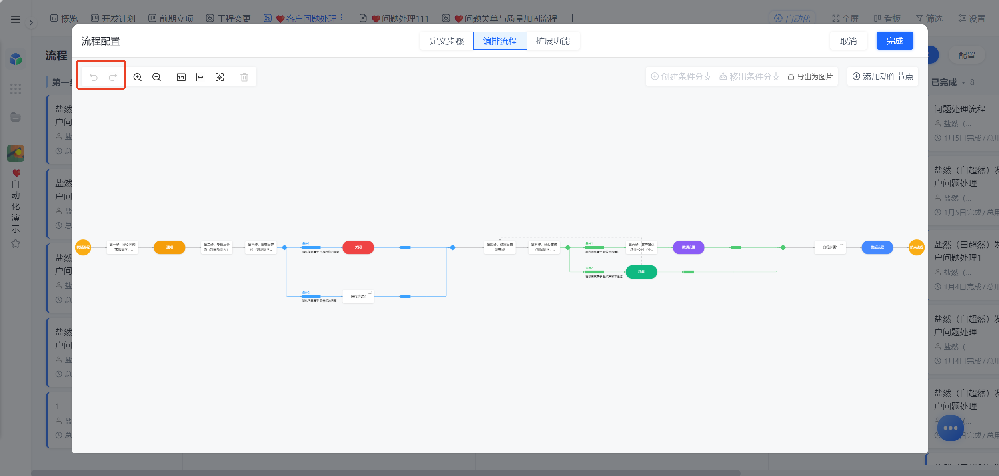

# 日事清流程图怎么整理排版？自动重排与视图工具使用教程

原文链接：https://www.rishiqing.com/web/solution/flowchartlayout.html

在企业流程搭建过程中，步骤多、节点复杂的流程图，极易出现线条交错、节点重叠、布局错乱等问题，手动调整耗时费力。日事清内置全套流程图排版视图工具，核心以**自动重排**为核心，搭配缩放、适配屏幕、撤销纠错功能，可一键规整流程布局，让流程图清晰整洁、适配编辑与汇报场景。

## 一、什么是日事清流程图排版工具？核心作用

日事清流程图排版工具是流程模块内置的视图整理功能合集，包含自动重排、画布缩放、屏幕适配、撤销操作等能力，主要用于规整错乱的流程节点与线条，无需手动拖拽调整，快速优化流程图整体布局，适配流程编辑、梳理复盘、工作汇报等场景。

多数用户在搭建复杂流程时，会因节点增多、线条叠加导致画布杂乱，不仅自身梳理逻辑困难，对外汇报、团队同步也不够专业。日事清流程排版工具主打高效规整、一键优化，通过系统化工具替代手动微调，大幅降低流程排版成本，让每一张流程图都结构清晰、逻辑直观、格式统一。

## 二、日事清流程图自动重排是什么？正确操作步骤是什么？

自动重排的作用是把流程图重新排得整整齐齐——节点对齐、线条横平竖直,画面瞬间清爽。步骤特别多、线特别密的流程,不用手动一点点挪,点一下就能整理出漂亮结构。

但有个特别重要的注意点:自动重排千万不能太早点。系统还没识别完整的逻辑关系时去重排,节点会全叠到一块,越排越乱。正确顺序就三步:第一步先把所有线连完整,确保从开始节点能连到结束节点形成闭环;第二步点右上角【完成】,让系统检查有没有连错,有问题会直接报错;第三步检查通过后,再点【自动重排】。记住口诀——先连线、再完成、最后重排。

## 三、日事清画布视图工具有哪些？分别怎么使用？

- **放大和缩小**:流程复杂时先缩小看全局,要专注某段就放大聚焦,看整体看细节都自如;

- **恢复实际大小**:一键把画布恢复到正常比例,放太大看不全、放太小看不清时点一下就回到最合适比例;

- **适应屏幕**:根据屏幕尺寸自动把整张流程图缩放到正好完整显示,一眼看到全貌,不用来回拖画布,特别适合给领导讲流程、团队汇报时用;

- **撤销操作**:误删了连线、手一抖把步骤拖错位置,点一下撤销立刻回到上一步,省去重新调整的时间。

这几个工具组合起来用,流程图就能一直保持清晰干净,自己理逻辑或拿去汇报都一目了然。

## 四、日事清流程图自动重排怎么用？实现一键规整布局

日事清自动重排是流程图排版的核心高阶功能，专为复杂混乱的流程画布设计，可智能识别节点逻辑、对齐排布、规整线条，适配多步骤、长流程的快速优化场景。

用户无需手动拖动单个节点与线条，遵循标准操作顺序点击重排，即可自动生成横平竖直、对齐规整的标准化流程图，大幅提升流程编辑效率。

**功能操作与应用价值：**

依托日事清流程图自动重排智能算法，系统可自动识别流程逻辑关系，统一对齐节点、拉直线条、优化整体布局，快速将杂乱画布整理为标准化流程图。

该功能彻底解决了复杂流程图节点重叠、线条交错、布局混乱、手动排版低效、调整效果不规整的办公痛点，实现流程图一键标准化、专业化排版。

## 五、流程图排版高频注意事项

使用日事清流程图排版工具，核心是把控重排时机与工具搭配逻辑，禁止未完成连线校验就重排，根据编辑、汇报、纠错场景灵活切换视图工具，养成标准化操作习惯，可长期保持流程图规整、专业、无错乱。

为帮助用户规避操作误区，稳定流程排版效果，整理核心注意事项：

1. 禁止半成品重排：流程未连线完整、存在逻辑报错时，绝不执行自动重排；

2. 场景化使用视图：编辑细节用放大、全局预览用缩小、汇报展示用适应屏幕；

3. 失误及时撤销：节点移位、线条误删第一时间撤销，避免二次调整增加工作量；

4. 组合使用工具：复杂流程优先重排规整布局，再通过视图工具优化查看效果。

## 六、流程图排版常见问题FAQ

**Q1：日事清自动重排为什么会把流程图排得更乱？**

A：多数是操作时机错误导致。未完成全部连线、流程逻辑未闭环、存在报错时执行重排，系统无法识别完整逻辑，会出现节点堆叠、线条错乱。严格遵循「先连线、再完成、最后重排」的顺序，即可彻底规避该问题。

**Q2：适应屏幕功能有什么专属使用场景？**

A：适应屏幕可将整张流程图自适应窗口完整展示，无需手动拖拽画布。最适合团队汇报、领导评审、流程复盘等需要展示完整流程框架的场景，能让观看者一眼看懂全流程逻辑。

**Q3：缩放错乱后如何快速恢复正常视图？**

A：可以直接使用「恢复实际大小」功能，一键将画布还原为标准比例，无需手动微调缩放数值。该功能可快速修复放大过度、缩小过度导致的视图异常，恢复舒适的编辑查看界面。

**Q4：流程图编辑失误移位、删线怎么补救？**

A：日事清流程编辑支持一键撤销操作，出现节点拖动错位、线条误删、配置错误等问题时，点击撤销即可退回上一步状态，无需重新搭建流程，大幅降低误操作带来的返工成本。

**Q5：简单流程图需要使用自动重排吗？**

A：简单流程节点少、线条清晰，手动调整即可规整；节点多、步骤长、线条复杂的大型流程图，推荐优先使用自动重排，可大幅节省排版时间，保证布局统一规范。

**Q6：流程重排后还能手动微调节点位置吗？**

A：可以。自动重排仅负责标准化整体布局，重排完成后，用户可根据个性化需求手动微调局部节点位置、线条角度，兼顾标准化排版与个性化展示效果。

## 七、总结

日事清流程图排版工具是流程精细化搭建的重要辅助能力，自动重排解决布局杂乱核心问题，缩放、适配屏幕、撤销功能覆盖全场景编辑与展示需求。只要坚守标准化操作顺序，即可让复杂流程图长期保持整洁、规整、专业，适配内部梳理与对外汇报双重场景。

想要搭建标准化、可落地、易管控的企业流程体系，实现团队协作有序、执行高效，可深入了解日事清流程管理解决方案。

