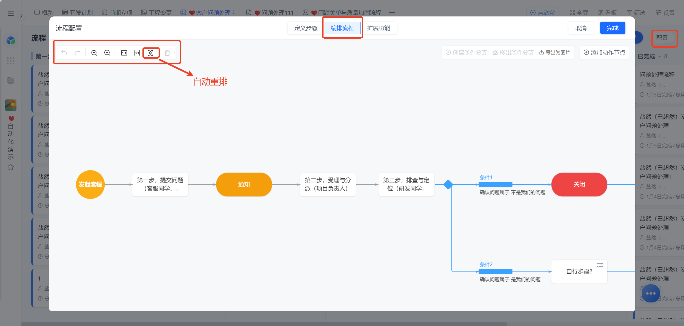
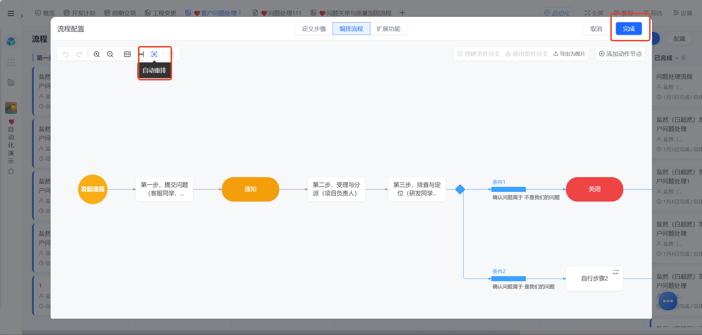
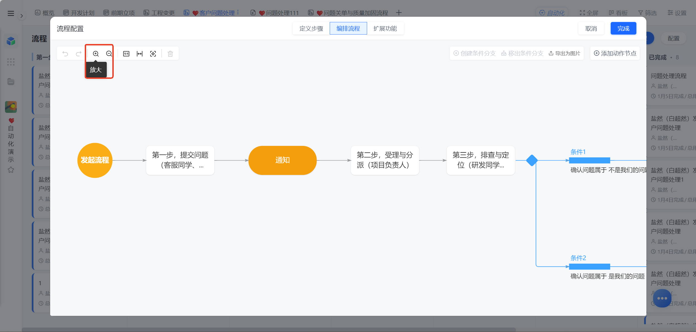
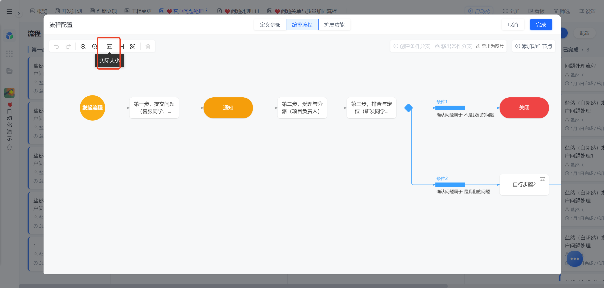
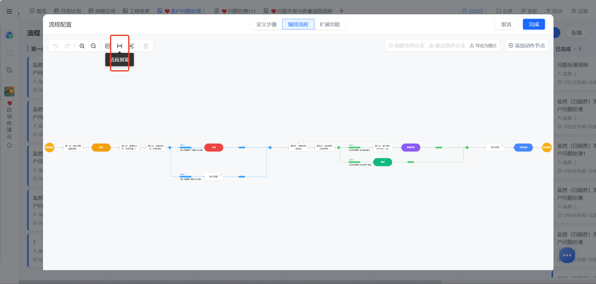
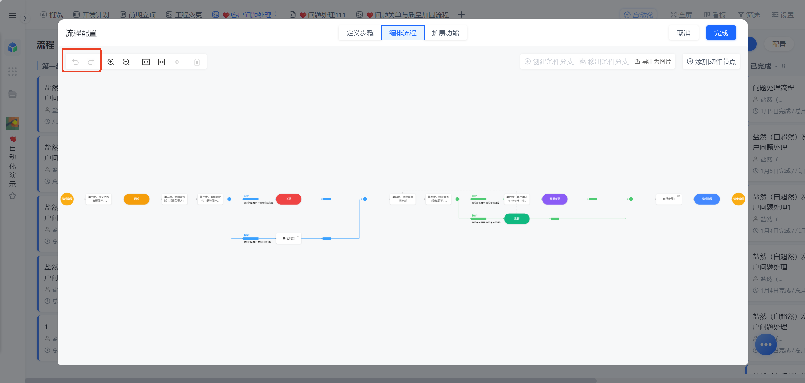

# 日事清流程图排版工具怎么用？自动重排与视图优化实操教程

原文链接：https://www.rishiqing.com/web/solution/rishiqingprocesslayouttool.html

日事清流程图排版工具是流程编排页面的辅助核心工具，包含自动重排、画布缩放、适应屏幕、撤销纠错等功能，专门解决复杂流程线条交错、节点重叠、布局杂乱的问题。无需手动拖拽调整，通过标准化操作即可快速规整流程图布局，优化画布视图展示效果，适配流程编辑、自查复盘、工作汇报等各类场景，是搭建专业标准化流程的必备工具。

## 一、什么是日事清流程图排版工具？核心作用

日事清流程图排版工具是内嵌在流程编排页面的视图优化辅助功能合集，核心包含自动重排、画布缩放、适应屏幕、撤销操作四大能力，主要用于整理杂乱的流程图布局、优化画布展示视角、修正编辑失误，帮助用户高效排版，让复杂流程结构清晰、视图规整、展示专业。

依托日事清流程图排版工具，用户可轻量化完成流程布局优化，一键规整结构、自由切换视图、随时纠错兜底，大幅降低复杂流程的排版难度，提升流程搭建的专业性与效率。

## 二、流程图自动重排怎么用？正确操作步骤与避坑方法

自动重排的作用是把流程图重新排得整整齐齐——节点对齐、线条横平竖直,画面瞬间清爽。步骤特别多、线特别密的流程,不用手动一点点挪,点一下就能整理出漂亮结构。

但有个特别重要的注意点:自动重排千万不能太早点。系统还没识别完整的逻辑关系时去重排,节点会全叠到一块,越排越乱。正确顺序就三步:第一步先把所有线连完整,确保从开始节点能连到结束节点形成闭环;第二步点右上角【完成】,让系统检查有没有连错,有问题会直接报错;第三步检查通过后,再点【自动重排】。记住口诀——先连线、再完成、最后重排。

## 三、画布视图工具怎么用？缩放、适配、撤销功能实操

- **放大和缩小**:流程复杂时先缩小看全局,要专注某段就放大聚焦,看整体看细节都自如;

- **恢复实际大小**:一键把画布恢复到正常比例,放太大看不全、放太小看不清时点一下就回到最合适比例;

- 适应屏幕:根据屏幕尺寸自动把整张流程图缩放到正好完整显示,一眼看到全貌,不用来回拖画布,特别适合给领导讲流程、团队汇报时用;

- **撤销操作**:误删了连线、手一抖把步骤拖错位置,点一下撤销立刻回到上一步,省去重新调整的时间。

这几个工具组合起来用,流程图就能一直保持清晰干净,自己理逻辑或拿去汇报都一目了然。

## 四、流程图排版功能怎么用？实现流程视图整洁规整

熟练搭配日事清流程图全套排版工具，可快速解决各类流程布局杂乱问题，零基础用户也能搭建出规整、专业、清晰的流程图，适配企业各类流程搭建场景。

**功能操作与应用价值：**

该功能彻底解决了复杂流程图线条交错、节点重叠、手动排版耗时、视图适配差、操作失误难撤回、汇报展示不完整等问题，大幅提升流程搭建效率与流程可视化专业性。

## 五、流程图排版使用注意事项

自动重排功能严禁在流程未完成、连线不完整时使用，未闭环的流程会导致系统识别逻辑错乱，引发节点重叠、布局混乱等问题。

各类视图工具按需搭配使用，编辑细节时放大画布，复盘汇报时开启适应屏幕，无需固定视图比例，灵活适配不同使用场景。

**核心避坑要点：**

1. 严格遵循「先连线、再完成、最后重排」的操作顺序，禁止提前触发自动重排，规避排版翻车问题。

2. 自动重排仅优化布局样式，不会修改流程核心逻辑与节点内容，排版后无需重新校验流程规则，可直接使用。

3. 撤销功能仅恢复编辑操作，无法撤回已保存、已提交的流程配置，关键操作前建议提前确认，避免数据误改。

## 六、流程图排版常见问题 FAQ

**Q1：日事清流程图自动重排越排越乱是什么原因？**

A：主要是操作顺序错误导致，流程连线未闭环、存在断线或逻辑错误，未点击【完成】校验就触发重排，系统无法识别完整流程逻辑，会造成节点重叠、布局错乱。严格按照三步操作即可解决该问题。

**Q2：适应屏幕功能适合哪些场景使用？**

A：该功能适合流程复盘、团队讲解、工作汇报等展示场景，可自动适配屏幕完整展示整张流程图，无需手动拖拽调整，能让观看者快速掌握流程整体架构，提升展示效率与效果。

**Q3：撤销操作可以恢复所有误操作吗？**

A：可以撤回画布编辑中的临时操作，包括节点拖拽、连线删除、视图调整等，但无法撤回已保存、已提交、已发布的流程配置，核心流程修改建议谨慎操作。

**Q4：简单流程图需要使用自动重排功能吗？**

A：简单流程节点少、线条少，手动排版即可规整；多节点、多分支、多层级的复杂流程图，建议优先使用自动重排，高效规整布局，节省排版时间。

**Q5：自动重排会修改我设置的流程节点和规则吗？**

A：不会。日事清自动重排仅优化流程图的布局、节点位置和线条样式，不会改动流程节点内容、审批规则、流转逻辑、分支设置等核心配置，不影响流程实际运行效果。

**Q6：画布比例失调看不清内容怎么快速恢复？**

A：可直接点击工具栏「恢复实际大小」功能，一键还原画布标准编辑比例；需要全局查看可开启适应屏幕，需要细节编辑可放大画布，快速适配使用需求。

## 七、总结

日事清流程图排版工具，可有效优化流程可视化效果，大幅提升流程搭建效率。依托自动重排、画布缩放、适应屏幕、撤销纠错等功能，可一键规整复杂流程布局，适配编辑、复盘、汇报全场景，解决手动排版杂乱、视图适配差、操作易失误等问题。坚守「先连线、再完成、最后重排」的操作习惯，即可规避大部分排版问题，快速搭建规整、专业的企业流程模板。若想要全面了解日事清流程管理的完整功能与实操技巧，助力企业流程标准化、可视化落地，可扫码深入体验日事清流程管理工具。

