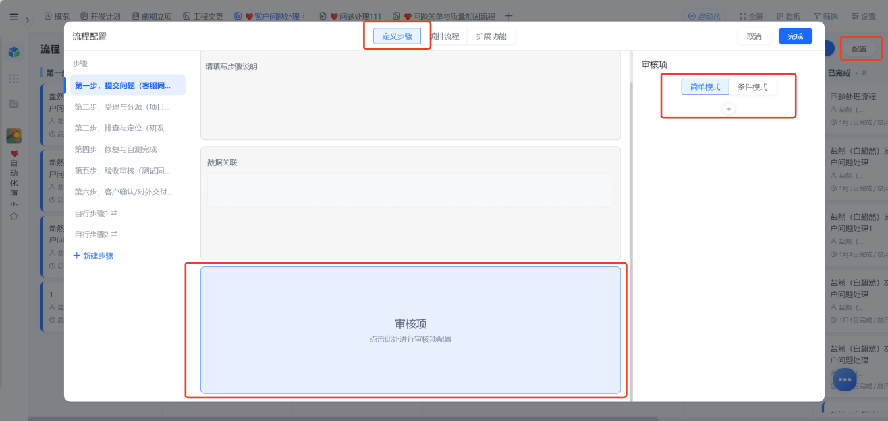
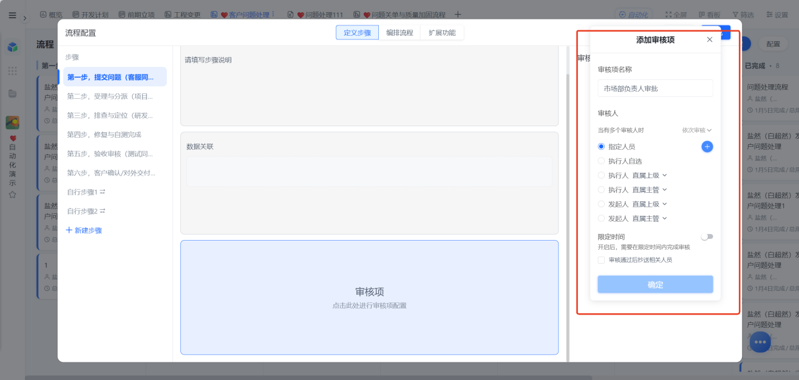
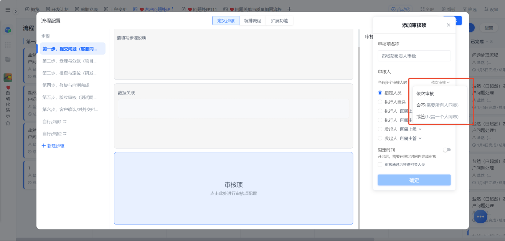
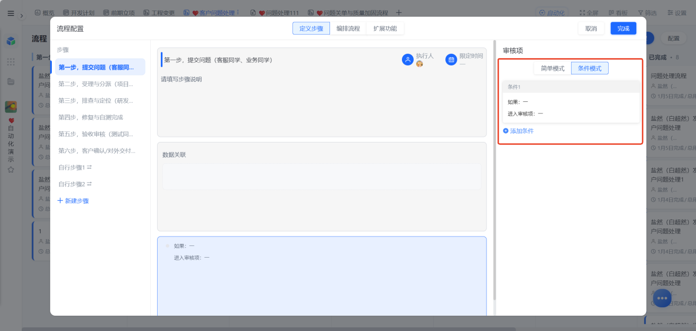
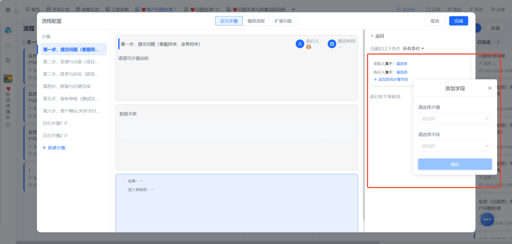
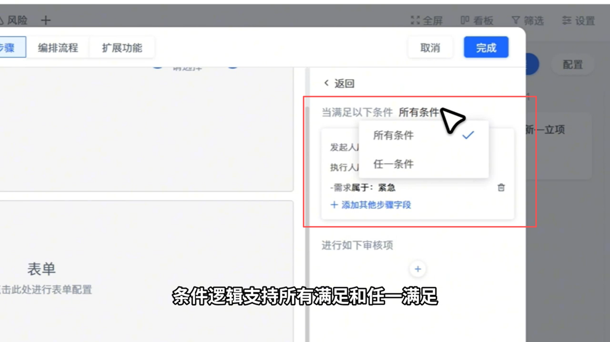
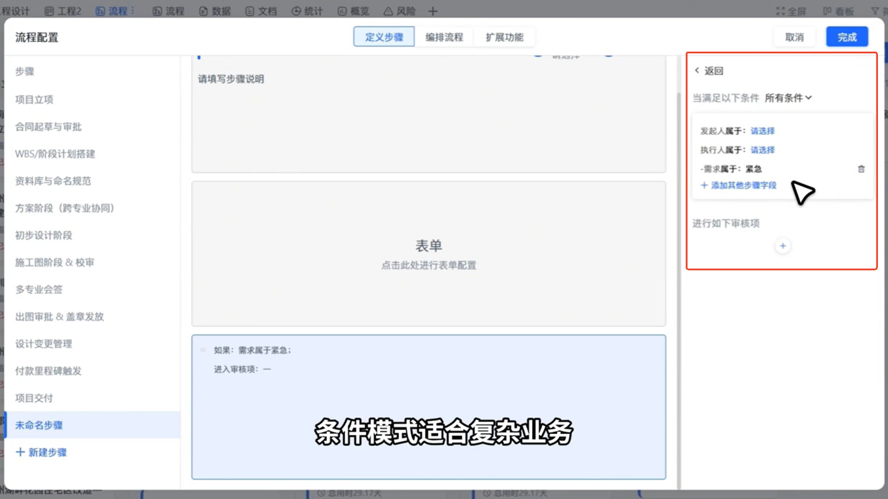

# 日事清流程审核项怎么设置？简单模式与条件模式配置教程

原文链接：https://www.rishiqing.com/web/solution/liuchenshenhexiangpeizhijiaocheng.html

企业传统审批流程普遍存在审批人不固定、权限随意、标准不统一、复杂场景无法适配、无超时管控等问题，极易导致审批混乱、流程违规、工作推诿。日事清**流程审核项**是规范流程审批环节的核心功能，通过两种标准化审核模式，固化审批标准、锁定审批权限、管控审批时效，帮助企业实现审批流程合规化、标准化、透明化运转。

## 一、什么是流程审核项？核心作用是什么？

日事清流程审核项是用于管控流程审批环节的核心功能，分为简单模式和条件模式两种配置类型，可固定审批人员、规范审批规则、管控审批时效、区分差异化审批场景，解决企业审批随意、权责模糊、流程不合规、复杂业务无法适配的管理痛点。

流程审核项的核心价值体现在权责与合规管控：对管理者而言，可精准卡住流程风险节点，杜绝随意审批、越权审批问题；对执行员工而言，可明确审批人、审批内容、审批时限，让每一次审批有据可依、有迹可查，彻底告别模糊化、人情化的人工审批模式。

所有流程审批配置均二选一适配，简单模式适配固定场景，条件模式适配差异化复杂场景，覆盖企业绝大多数办公审批需求。

## 二、流程审核简单模式是什么？怎么配置？

适合特别明确的场景,只需某个人来批,比如“市场部负责人审批”就够。在步骤审核项里点【+】新建审核项,填名字(如“市场部审批”),选审核人——可指定具体的人,也可选动态角色(执行人直属上级、发起人直属主管,或让执行人发起后自己选)。

选多人要定审批规则：依次审批(一个个排队,前一个批完才轮下一个)、会签(所有人都批才通过)、或签(一个人批了就通过、其他人自动完成)。还能设限定时间(如2天内批完,否则超时),加抄送人(通过后自动通知项目经理或财务知道结果)。

## 三、流程审批条件模式是什么？怎么配置？

更智能,适合审批条件不一样的情况,比如请假3天以内部门主管批就行、超过10天人事部门再批一层。点【+添加条件】配置条件,默认有两个字段(发起人属于哪个部门、执行人属于哪个部门),还能调入前面步骤表单里的字段,比如加“需求类型”下拉菜单把紧急需求筛出来。

例如前一步表单加了“需求类型=紧急”,条件里就能设定:当需求类型是紧急时必须额外加一个领导审批。条件逻辑支持“所有满足”或“任一满足”。设好条件后在条件下面点【+】继续加审核项,方法跟简单模式一样。条件模式支持添加多组逻辑,每组条件下都能配一套审核人、审批规则、限定时间,复杂审批场景也能跑通。

## 四、流程审核项功能怎么用？实现审批流程标准化管控

日事清流程审核项支持双模式自由配置，可根据企业业务场景灵活搭建固定或动态审批链路。

整套功能操作零代码、可视化完成，新手也能快速搭建适配企业需求的合规审批流程。

**功能操作与应用价值：**

用户可根据审批场景，按需选用简单模式或条件模式，搭配多人审批规则、超时管控、消息抄送完成全套配置。

该功能彻底解决了传统企业审批标准混乱、审批权责模糊、复杂场景无法适配、审批超时无人管控、人工审批随意性强的办公痛点，实现企业审批流程标准化、合规化、自动化闭环管理。

## 五、流程审核项配置注意事项与避坑要点

配置日事清流程审核项时，需根据业务场景精准区分两种审核模式，简单场景不冗余配置条件逻辑，复杂场景不使用固定审批链路；同时规范多人审批规则选择、超时时限设置与表单字段关联，避免审批失效、流程卡顿、权责混乱等问题。

**核心避坑要点**

1. 模式选择避坑：统一、常规的固定审批优先使用简单模式，降低配置成本；存在场景差异、分级审批需求时，必须使用条件模式，避免审批规则僵化。

2. 审批规则避坑：多人审批需匹配业务属性选择依次审批、会签、或签，重要事项严禁使用或签，避免审批把关缺失。

3. 条件配置避坑：条件模式关联表单字段后，需测试字段触发逻辑，确保紧急场景、分级场景可精准匹配对应审批链路，避免动态审批失效。

4. 时效管控避坑：核心业务流程务必配置审批超时时限，杜绝长期挂单、流程停滞，保障办公流程高效流转。

## 六、流程审核项常见问题 FAQ

**Q1：流程审核简单模式和条件模式核心区别是什么？**

A：简单模式为固定审批链路，审批人、规则全程不变，适合标准化常规审批；条件模式支持根据部门、表单字段、业务场景动态切换审批链路，适配复杂分级审批场景，两者可覆盖企业全部办公审批需求。

**Q2：多人依次审批、会签、或签分别适合什么场景？**

A：依次审批适合层级逐级把关的正式流程；会签适合全员确认、多人共同负责的重要事项；或签适合快速办结、无需全员审批的常规事项，可根据流程重要程度灵活选择。

**Q3：条件模式可以自定义审批触发条件吗？**

A：可以。日事清条件审核模式不仅支持默认的部门字段，还可关联流程前置所有自定义表单字段，如事项类型、金额、天数、优先级等，按需搭建个性化动态审批逻辑，适配企业差异化业务。

**Q4：流程审核可以设置超时自动处理吗？**

A：支持。无论是简单模式还是条件模式，均可自定义审批超时时限，规范审批时效，避免流程长期挂起、审批积压，有效提升企业流程运转效率。

**Q5：动态角色审批和固定人员审批怎么选择？**

A：人员岗位固定的流程可选择固定人员审批；人员流动大、岗位固定的流程，优先选择直属上级、部门主管等动态角色，无需频繁修改审批配置，适配团队人员变动。

**Q6：新手如何快速落地流程审核配置？**

A：先梳理业务审批逻辑，区分“固定审批”和“差异化审批”场景，简单场景用简单模式快速配置，复杂场景搭建条件分组逻辑，先试点测试流转，无误后再全员落地使用。

## 七、总结

日事清流程审核项通过**简单模式+条件模式**双体系，覆盖企业从常规标准化审批到复杂差异化审批的全场景需求。简单模式配置便捷、规则清晰，解决基础审批规范问题；条件模式智能联动、动态适配，解决复杂业务分级审批难题。

通过规范审批人员、审批规则、审批时效、抄送机制，彻底解决传统人工审批权责模糊、标准混乱、管控缺失、流程违规等痛点，帮助企业把人情化、不确定的人治审批，转化为标准化、制度化、可追溯的系统审批，让流程执行更有节奏、团队协作更有章法。

想要完整体验标准化、自动化流程审批管控能力，搭建企业合规审批体系，可扫码了解试用日事清流程管理。

