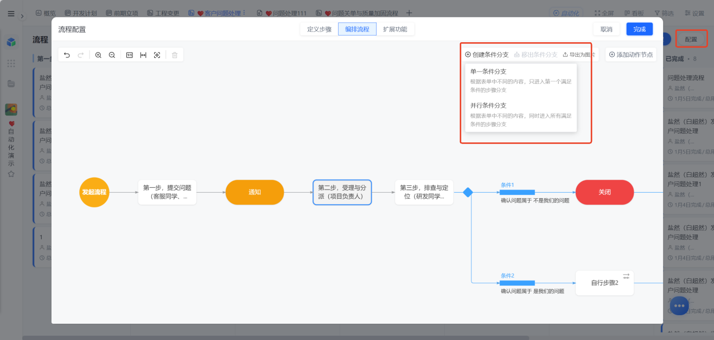
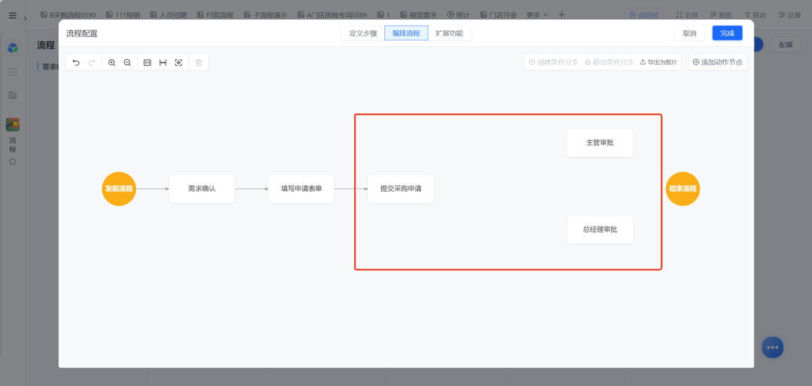
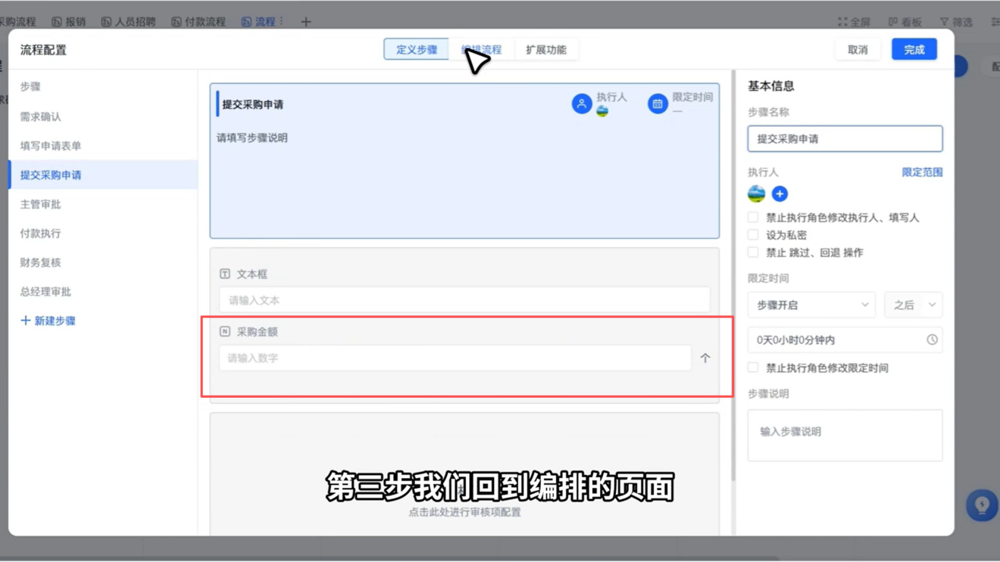
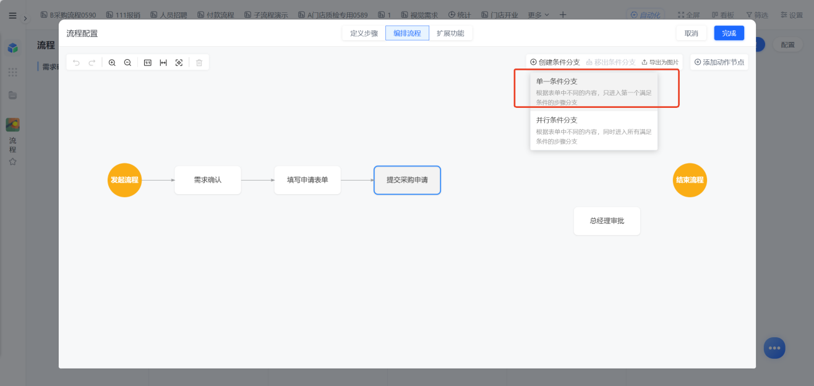
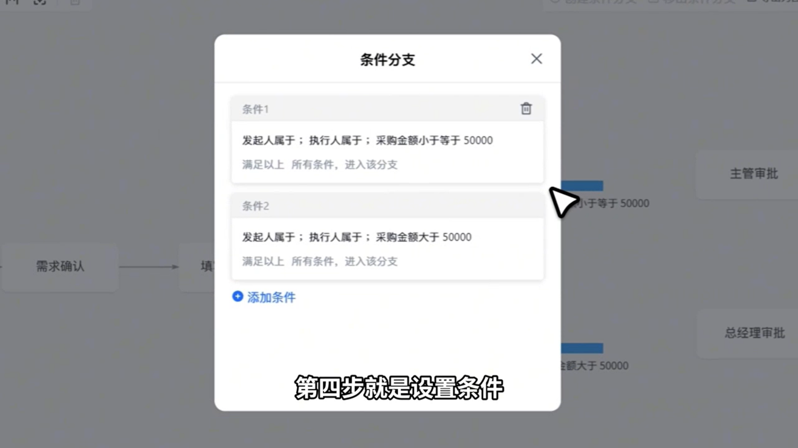
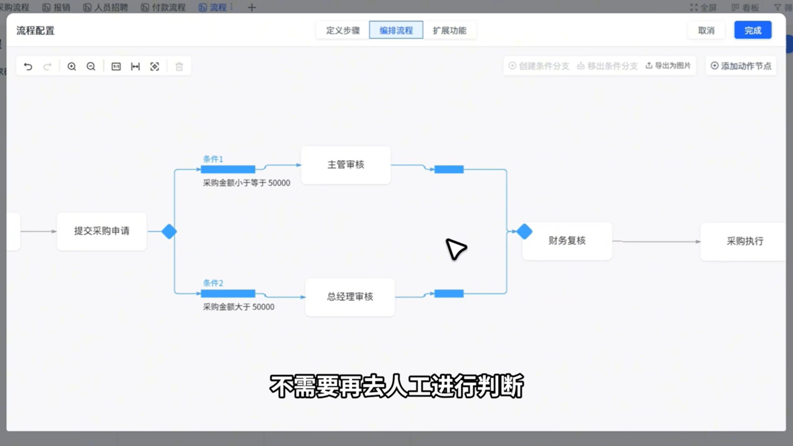
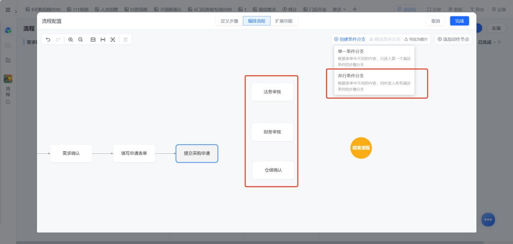
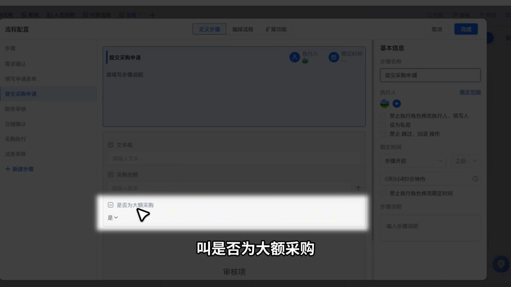
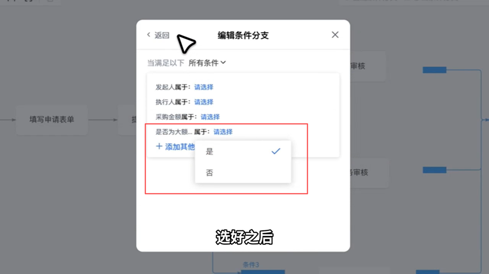
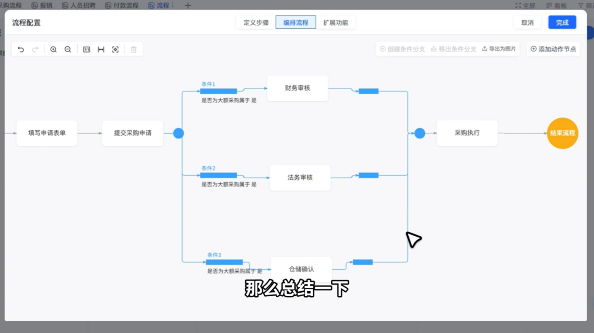

# 日事清流程条件分支怎么设置？单一与并行分支配置教程

原文链接：https://www.rishiqing.com/web/solution/rishiqingprocessconditionbranch.html

日事清流程条件分支是实现**流程智能化、自动分流**的核心功能，打破传统单一路径流程的局限。可根据业务数据、业务类型自动匹配不同审批路径，分为单一条件分支和并行条件分支两种模式，能够解决企业分级审批、多部门协同审批难题，彻底告别人工判断路径、手动分配审批的低效模式。

## 一、什么是日事清流程条件分支？核心作用是什么？

日事清流程条件分支是根据表单字段数据、业务条件自动判断流程走向的智能配置功能，主要分为单一条件分支与并行条件分支两类，可实现流程差异化分流、分级审批、多部门同步审核，让流程不再是固定单一路径，适配企业复杂、分级的真实业务审批场景。

常规基础流程仅支持固定顺序流转，无法适配差异化业务。例如小额采购、大额采购审批标准不同，普通项目、重点项目审核层级不同，依靠人工判断极易出现标准不统一、审批漏项、流程拖沓等问题。

通过日事清条件分支功能，系统可自动识别业务条件、匹配对应审批链路，无需人工干预判断，实现“简单流程快速过、复杂流程严格审”，兼顾协作效率与管理规范，是企业搭建智能流程的核心功能。

## 二、日事清单一条件分支怎么配置？适用场景与步骤

特点是“二选一”或“多选一”。以采购审批为例:公司规定金额5万以下主管批就行,超过5万必须走总经理。

配置四步:第一步建好「提交采购申请」「主管审批」「总经理审批」三个步骤;第二步在「提交采购申请」表单里加一个数字字段”采购金额”;第三步回到编排界面,点「提交采购申请」,选“创建条件分支”→“单一条件分支”;第四步设置条件——金额小于等于50000走主管、大于50000走总经理,再把条件和步骤连起来。

这样员工一提交,系统自动判断金额走对应路径,不需要人工再去判断该找谁批。

## 三、日事清并行条件分支怎么配置？适用场景与步骤

逻辑是“几条路一起走”。还是采购的例子:有些大额采购,公司要求财务审核、法务看合同、仓储确认库存,三个部门同时把关才算过。

配置同样四步:第一步新建「财务审核」「法务审核」「仓储确认」三个步骤;第二步在「采购申请」表单里加下拉选项“是否为大额采购”(是/否);第三步点「采购申请」选“创建条件分支”→“并行条件分支”,系统默认给两个条件,需要三方就再加一个;第四步把三个条件都设成“是”,分别连到三个审核步骤。

这样只要是大额采购,三条路径同时触发,财务、法务、仓储一起并行审核,效率高也更严谨。

## 四、分支选型功能怎么用？实现流程场景精准匹配

日事清流程分支选型功能，可根据企业不同审批业务场景，快速区分单一条件分支与并行条件分支的使用方式，操作简单、无需复杂设置。

依托标准化的分支选型逻辑，能够精准匹配分级审批、多部门协同审批等不同业务，让流程分流设置零出错、适配性更强。

**功能操作与应用价值：**

用户只需根据业务需求判断流程是“单选分级流转”还是“多路径同步流转”，即可快速选定对应分支类型，高效完成智能流程搭建。

该功能彻底解决了企业流程分支选型混乱、场景匹配错误、流程配置返工、审批路径错乱、智能流程适配性差等常见问题，大幅提升流程搭建效率与标准化程度。

## 五、流程条件分支配置注意事项

条件分支是智能化流程的核心配置，配置失误会导致流程卡死、路径错乱、审核遗漏，日常搭建需规范操作，规避常见误区。

**核心避坑要点：**

1. 分支条件必须完整闭环：配置单一条件分支时，需覆盖所有业务情况，避免出现无匹配条件的空白场景，防止流程无法正常流转。

2. 并行分支按需新增节点：系统默认仅两组并行条件，多部门审核场景需手动新增对应组数，避免缺失审核节点导致流程不完整。

3. 判断字段与条件匹配：金额类场景使用数字字段、分类场景使用下拉字段，字段类型错误会导致系统无法识别条件，分支失效。

4. 禁止交叉乱连线：多分支流程需规整路径，避免不同分支连线交叉，防止系统识别错乱，造成流程异常终止。

## 六、流程条件分支常见问题 FAQ

**Q1：日事清单一条件分支和并行条件分支最大区别是什么？**

A：核心区别为流程执行逻辑不同。单一条件分支是多选一互斥执行，仅匹配一条审批路径，适合分级差异化审批；并行条件分支是多路径同步执行，多部门同时审核，适合需要多方把关的复杂业务场景。

**Q2：企业采购分级审批适合用哪种条件分支？**

A：小额、大额分级审批优先使用日事清单一条件分支。可根据采购金额自动匹配主管审批或总经理审批路径，实现分级管控，简化流程、提升流转效率，适配企业常态化采购业务。

**Q3：多部门联合审核的流程怎么配置更合适？**

A：财务、法务、仓储等多部门同步审核场景，建议使用日事清并行条件分支。可同时触发多个审核节点，无需逐级排队，在保证审批严谨合规的同时，大幅缩短整体审批周期。

**Q4：条件分支配置完成后，可以修改条件规则吗？**

A：可以。在日事清流程编排界面可随时编辑、修改分支条件、绑定字段和连线路径，企业可根据制度更新、业务变化灵活调整流程规则，无需重建模板，适配性极强。

**Q5：为什么配置的条件分支无法自动触发？**

A：大概率是表单字段类型不匹配或条件未闭环。金额判断需使用数字字段、分类判断需使用下拉字段，同时需保证所有业务场景都有对应条件匹配，修正字段与规则后即可正常自动分流。

**Q6：并行条件分支可以自定义审核部门数量吗？**

A：可以。日事清并行条件分支支持自由新增、删减条件组数，企业可根据业务需求设置2组、3组或更多并行审核节点，适配不同复杂度的多部门协同审批场景。

## 七、总结

日事清流程条件分支的两种模式，分别解决了企业**业务分级差异化审批**和**多部门协同审核**两大核心难题。单一条件分支主打精准分级、高效流转，适配绝大多数常规分级业务；并行条件分支主打多方把关、严谨合规，适配大额、重点复杂业务。

合理搭配两种分支模式，可彻底摆脱人工判断流程路径的低效模式，让企业流程真正实现智能化自动分流，减少人为失误、统一审批标准、提升协作效率。掌握条件分支配置后，还可学习动作节点设置，实现流程自动通知、自动跳转、自动关闭，让流程更加智能完善。

流程管理——让执行更有节奏，让协作更有章法。若想要了解更多日事清流程管理实操技巧与全功能详情，可扫码了解日事清完整流程管理能力。

