# 日事清流程模块通用模式和自由模式区别是什么？怎么选择使用？

原文链接：https://www.rishiqing.com/web/solution/rishiqingprocesstwomode.html

日事清流程模块是企业固化业务流程、精细化管控工作的核心工具，核心分为**通用模式**和**自由模式**两种类型，分别适配固定标准化流程和动态可变流程场景，可实现流程自动流转、进度可视化、全程留痕管控，解决企业流程混乱、推进低效、权责不清的管理痛点。

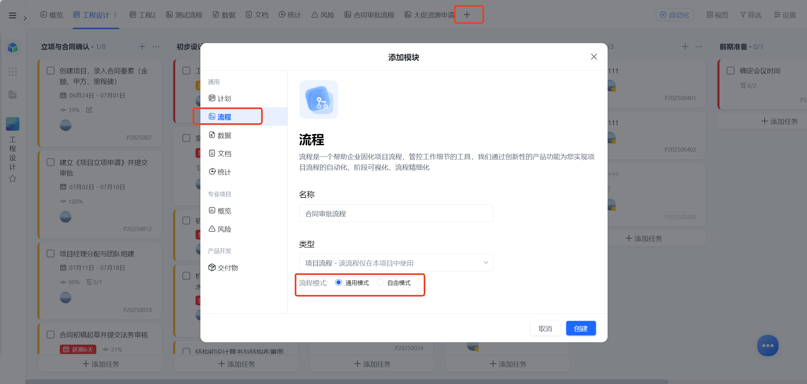

## 一、什么是日事清流程模块？核心作用是什么？

日事清流程模块是适配企业各类办公、审批、业务场景的流程管控工具，能够将入职、报销、采购、审批等固定业务环节标准化固化，依托通用、自由双模式，分别适配固定流程与动态流程，实现流程自动化推进、进度可视化查看、执行细节全程留痕，助力企业规范化管理。

企业日常多数工作都具备固定执行环节，传统人工跟进、口头对接的方式，容易出现流程遗漏、进度不明、责任推诿、无记录可追溯等问题。

日事清流程模块可将所有固定环节的业务线上化落地，核心实现三大价值：一是流程自动化，无需人工催促记忆，系统自动按规则流转；二是执行可视化，全员可实时查看流程进度与负责人；三是管理精细化，每一步操作都有记录、负责人与时间节点，全程可追溯。

## 二、日事清流程通用模式是什么？适用场景与优势

通用模式是最常见的流程形态,适合步骤明确、规则固定的业务,比如请假、报销、采购、入职审批。流程步骤预先定义好,管理员配置时先把整个流程路径画出来——谁先审批、谁后审批、每一步条件,都提前设定清楚。有人发起时就严格按定义好的顺序自动流转。

好处是规范、可控,保证执行一致、不受人为干扰,适用于规则明确、不常变动的场景。

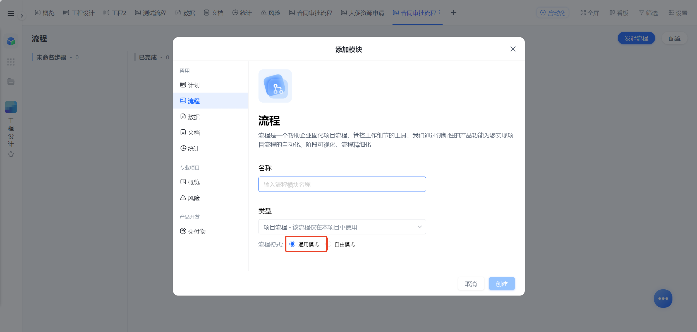

## 三、日事清流程自由模式是什么？操作步骤与适用场景

自由模式专为环节不固定、变化较多的项目场景设计。创建模板时选“自由模式”,系统进入空白模板界面,只要把可能用到的步骤先定义出来,这些步骤只是可选项、还没确定顺序。真正的重点在发起流程时,记住操作顺序:

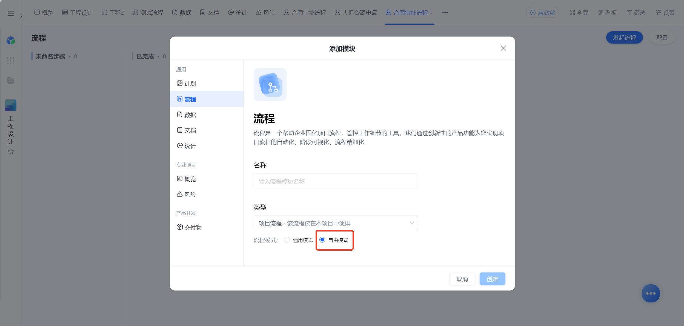

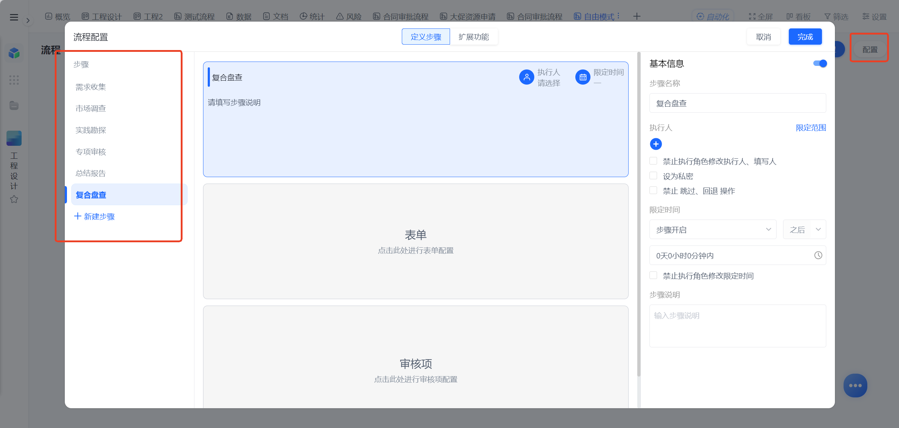

- 第一步确认步骤:点发起流程后弹出选择框,左边是模板里所有可用步骤,右边是本次要用的,确认这次需要哪些环节、只选需要的,每个步骤只能选一次,选完自动编号;

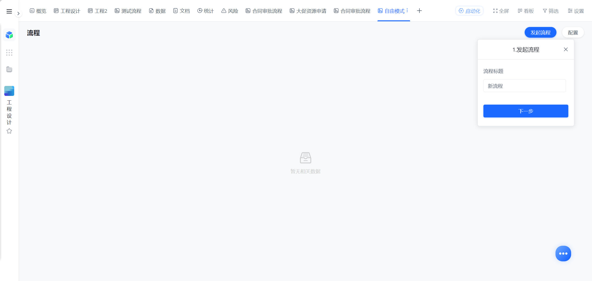

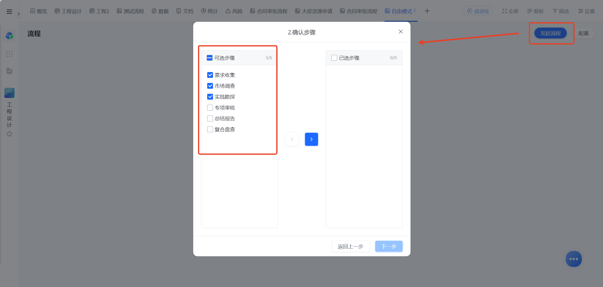

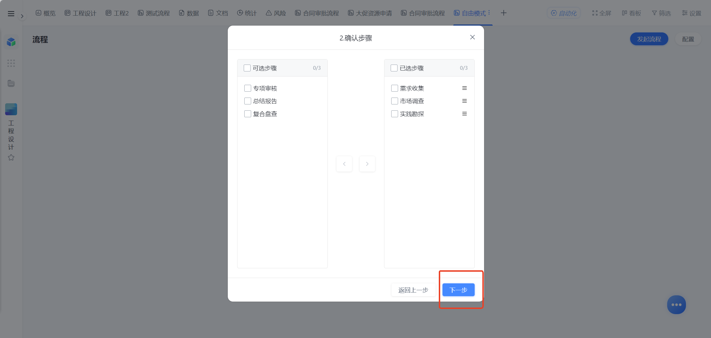

- **第二步编排步骤**:进入编排界面,拖动调整顺序、连线确定执行路径(自由模式不会自动识别逻辑,需手动确定流转方向),系统自动生成流程图;

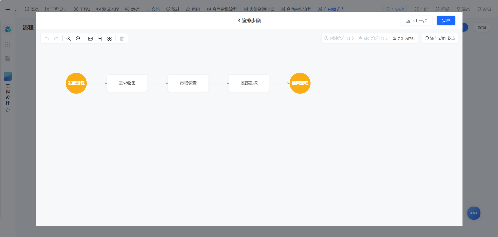

- 第三步完成发起:点右上角【完成】,系统自动检查连线是否正确,有错会提示修改,通过后点【发起流程】正式进入执行。

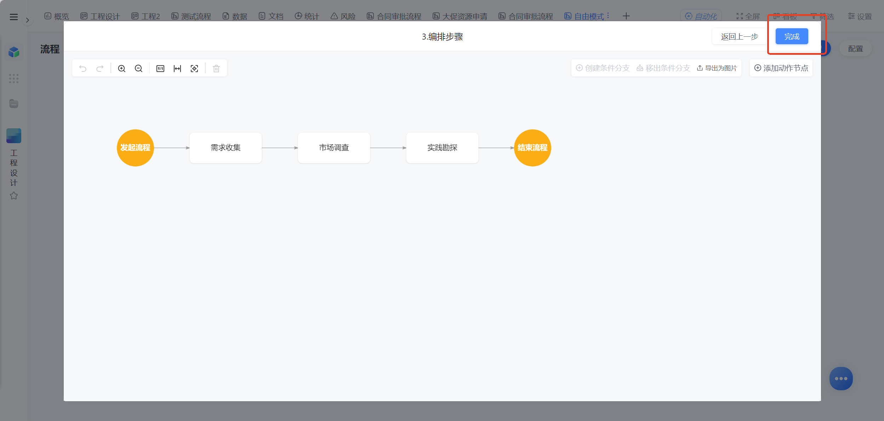

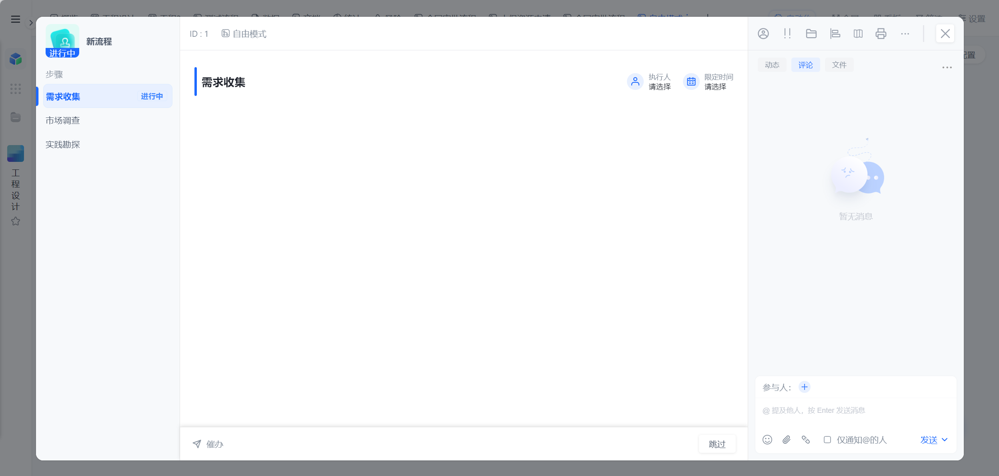

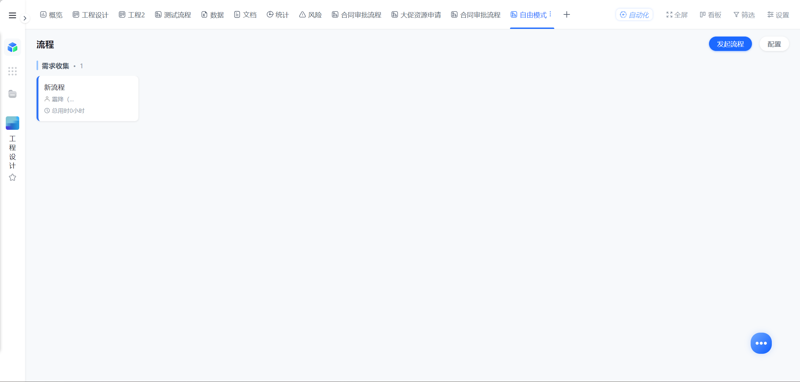

## 四、流程步骤编排功能怎么用？实现流程可视化自动流转

日事清流程步骤编排核心用法，是依托可视化画布，通过拖动、连线、删线三大基础操作，将零散的流程步骤整合为有序、可自动流转的完整业务链路。

**功能操作与应用价值：**

整套操作无需代码、全程可视化，新手可快速上手，适配企业各类审批、执行类工作流程搭建需求。

该功能彻底解决了流程步骤孤立、逻辑混乱、无法自动流转、布局杂乱难维护的企业流程管理痛点，让每一套业务流程都有清晰、标准化的执行路径，大幅降低流程搭建与后期运维成本，提升团队协作流转效率。

流程步骤编排以可视化拖拽、连线的轻量化操作，替代传统手动梳理流程的繁琐方式，快速定义各业务步骤的执行先后关系。

流程编排需优先保障业务逻辑准确，再优化页面布局，避免因操作顺序、连线逻辑错误，导致流程无法正常触发流转。

## 五、流程步骤编排使用注意事项

日事清流程步骤编排看似操作简单，但细微的操作误区会直接导致流程流转异常、布局混乱、无法正常使用。在日常流程搭建与配置过程中，需严格规范操作方式，规避高频问题，保障流程长期稳定、合规复用。

**核心避坑要点：**

1. 严禁直接上手拖拽连线：编排前必须先梳理业务逻辑，明确步骤串行、并行关系，避免反复删改连线、打乱整体流程结构。

2. 禁止随意删除原始节点：不可误删【发起流程】【结束流程】默认节点，缺失首尾节点会直接导致整个流程无法启动和办结。

3. 避免连线逻辑交叉混乱：多步骤流程需规整布局，杜绝跨步骤乱连线，防止系统识别流转逻辑出错，造成流程卡顿、异常终止。

## 六、流程编排常见问题FAQ

**Q1：日事清流程步骤编排的核心意义是什么？**

A：流程步骤编排是流程落地运行的基础，能够将零散、独立的表单步骤、审批步骤串联为完整流转链路，可视化定义执行顺序，解决步骤孤立、流程无法运行、逻辑混乱的问题，帮助企业搭建标准化、自动化的业务审批流程。

**Q2：为什么配置完步骤和表单后，流程无法运行？**

A：仅配置步骤、表单和审核项，未通过步骤连线搭建流转链路，所有步骤处于独立状态，系统无法识别执行顺序。必须完成流程连线编排，形成完整闭环链路，流程才能正常发起和自动流转。

**Q3：日事清怎么调整流程步骤的布局位置？**

A：进入流程编排画布，长按任意流程步骤模块即可自由拖动，可根据业务逻辑调整审批、执行、复核步骤的位置，优化整体布局，让流程结构清晰直观，方便日常查看和后期维护修改。

**Q4：日事清错误的流程连线怎么快速删除？**

A：在编排页面点击选中需要删除的错误连线，按下键盘Delete键，或点击页面顶部工具栏的删除按钮，即可一键移除，无需改动其他步骤配置，操作简单且不会破坏现有流程布局。

**Q5：流程编排时如何区分串行和并行步骤？**

A：存在先后依赖、必须依次完成的步骤为串行步骤，需要逐一线性连线；无业务冲突、无需等待前置完成的步骤为并行步骤，可从同一节点同步引出多条连线，实现多环节同步执行。

**Q6：新手搭建流程有哪些编排小技巧？**

A：建议先梳理完整业务逻辑，划分串行、并行环节，再进行拖动布局和连线操作，避免反复删改。优先保证流程逻辑正确，再优化画布布局，循序渐进搭建，大幅提升流程配置准确率和效率。

## 七、总结

日事清流程步骤编排的核心逻辑，是以可视化方式梳理业务逻辑、串联零散步骤。拖动优化布局、连线搭建链路、删线修正错误，三大基础操作构成了企业流程搭建的底层能力，让静态的步骤配置变成可落地、可流转的标准化工作流程。

基础编排是流程搭建的第一步，后续可进阶学习条件分支、自动动作、自动排版等功能，搭建更智能、更贴合复杂业务的自动化流程。想要搭建全流程标准化协作体系，可扫码了解日事清流程管理完整解决方案。

