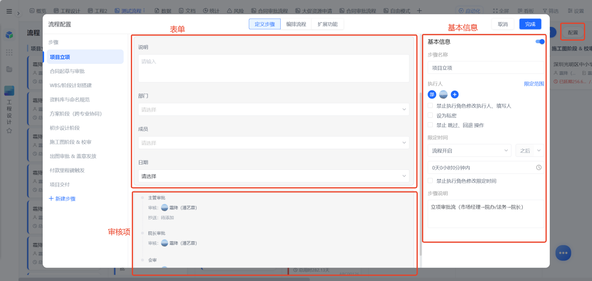
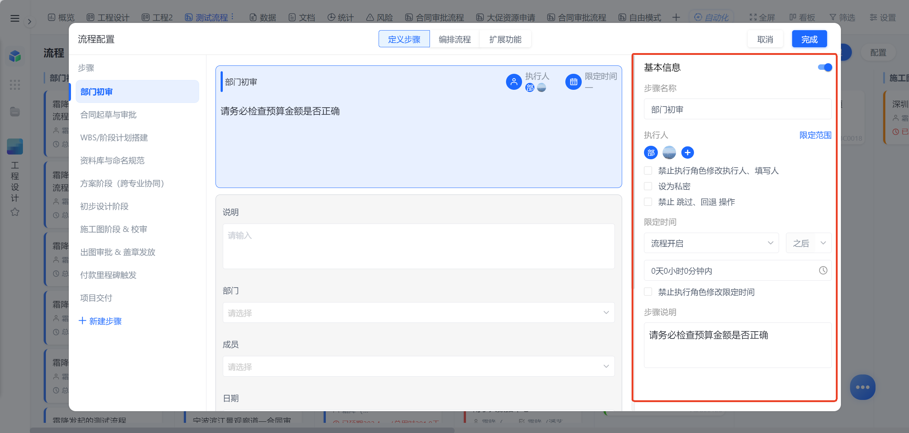
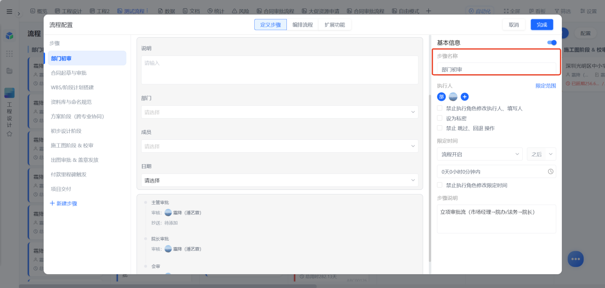
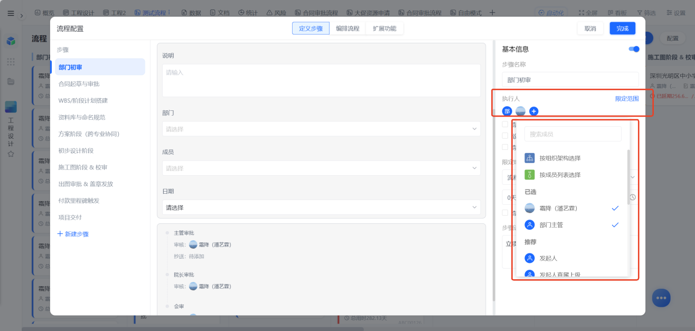
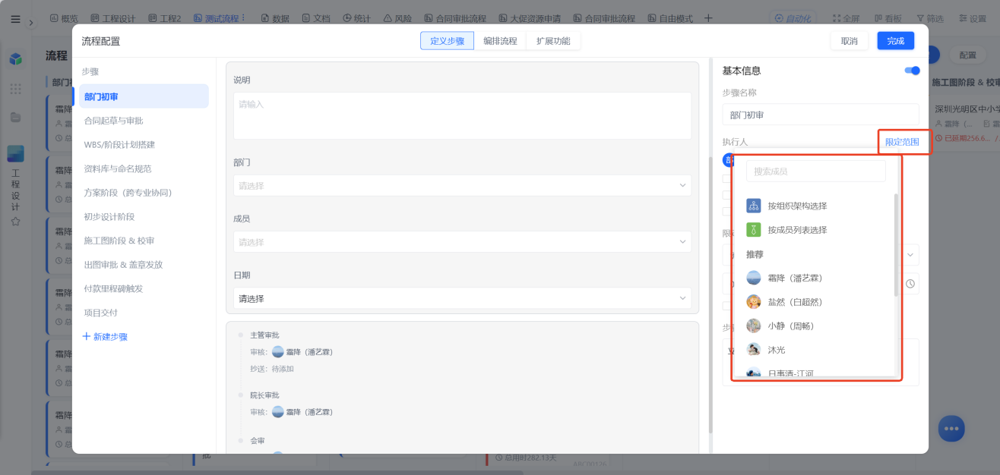
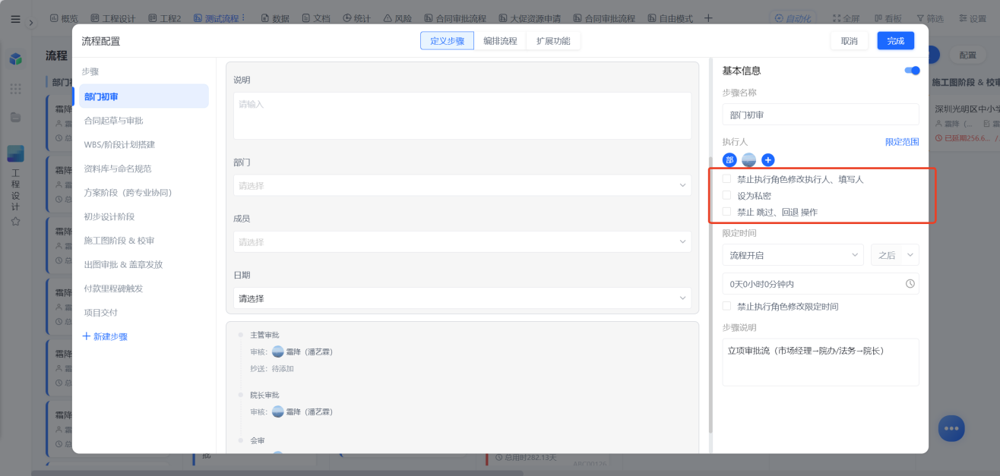
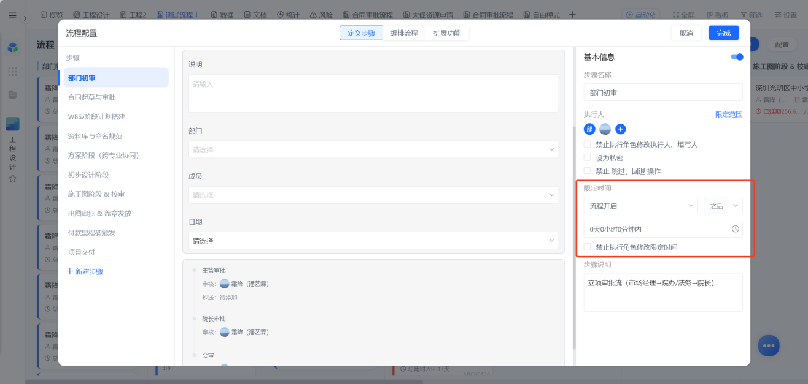
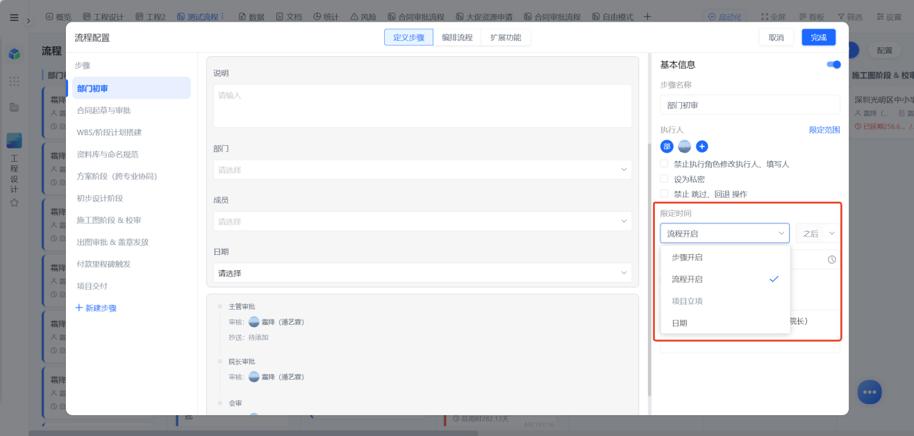
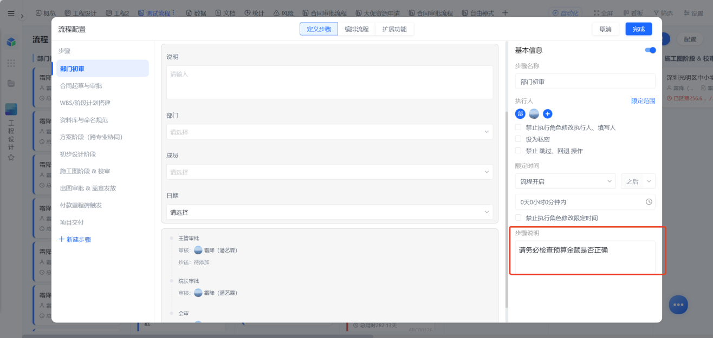

# 日事清流程步骤基本信息怎么配置？完整基础设置教程

原文链接：https://www.rishiqing.com/web/solution/rishiqingprocessstepbasicconfig.html

日事清流程的核心落地基础是**流程步骤配置**，而步骤基本信息配置是重中之重。通过规范设置步骤名称、执行人、执行时效与步骤说明，可明确每一步流程的执行主体、完成时限与操作标准，解决企业流程权责模糊、执行混乱、超时无管控、操作漏项等问题，实现业务流程标准化落地。

## 一、什么是日事清流程步骤基本信息配置？核心作用是什么？

日事清流程步骤基本信息配置，是对单条流程步骤的基础属性进行标准化定义，涵盖名称、执行人、限定时间、步骤说明四大核心模块，用于明确流程「做什么、谁来做、何时做完、怎么做」四大核心问题，是企业流程规范、高效、可追溯执行的基础前提。

一套完整的日事清流程，由多个独立步骤串联组成，而流程能否顺畅落地、标准统一，完全依赖单步骤的精细化配置。完整的流程步骤配置包含基本信息、表单、审核项三大板块，其中基本信息是流程运行的框架基础，决定流程的执行权责与节奏。

很多企业流程执行混乱、权责不清、频繁超时，核心原因就是步骤基本信息配置不规范、不完整，导致员工执行无标准、管理无依据。精准配置基本信息，可从根源规范流程执行，降低协作内耗。

## 二、日事清流程步骤名称与执行人怎么配置？

- 步骤名称：点输入框直接改，写成“部门初审”“财务复核”“法务审批”，大家一眼知道这是哪一步；

- 执行人：点右边【限定范围】先定义执行人范围（如限定市场部、财务部某些成员），发起时只能在范围里选，点【+】添加人员。执行人不仅可以是具体成员，还可以是系统角色——“发起人”“发起人直属上级”“发起人部门主管”或提前定义的“使用角色”，系统自动识别对应人员、不用每次手动分配。

执行人下方三个常用勾选项:【禁止执行角色修改执行人、填写人】(确定后不能改人)、【设为私密】(只有执行人、审核人和有权限的人能看到,适合敏感步骤)、【禁止跳过、回退操作】(严格按设置顺序执行)。

## 三、日事清流程步骤时间与说明怎么设置？

- **限定时间**:设这一步的完成期限,两种方式——“步骤开启之后”多久完成、“流程开启之后”多久完成(如“流程开启后两天内必须完成”,系统自动计算并提醒)。若表单里加了“日期时间”字段,还能设“必须在表单日期之前或之后完成”。例如采购审批里,主管须在提交后2个工作日内审批、财务再1个工作日内复核。也有【禁止执行角色修改限定时间】勾选项可锁定时间;

- 步骤说明:写补充提示,如“请务必检查预算金额是否正确”“此处需附上合同文件”,写得越清晰执行人越不容易漏关键点。

## 四、流程步骤核心配置功能怎么用？实现流程标准化落地

日事清流程步骤四大核心配置功能，是搭建标准化企业流程的核心操作模块，涵盖名称、执行人、时效、说明配置，操作简单、适配各类企业业务场景。

熟练掌握四项基础配置的操作方法，能够完整定义流程每一步的执行标准，让企业流程从无序流转变为可控、可查、可追溯的标准化体系。

**功能操作与应用价值：**

依托日事清流程步骤基础配置功能，企业可自主完成流程权责划分、时效管控、操作规范定制，无需人工线下反复沟通对接。

该功能彻底解决了传统企业流程权责模糊、执行无标准、超时无管控、操作易出错、敏感信息难管控的各类协作痛点，大幅提升流程流转效率与规范化程度。

## 五、流程步骤配置注意事项与避坑要点

日事清流程步骤基本信息配置看似简单，细微配置失误会直接导致流程权责混乱、时效失控、信息泄露、执行不规范。日常配置需遵循标准化原则，规避高频误区，保障流程长期稳定复用。

**核心避坑要点：**

1. 禁止步骤名称模糊笼统：避免使用“审核”“处理”等模糊名称，必须明确岗位与动作，否则易出现权责混淆、执行推诿的问题。

2. 动态岗位优先选用系统角色：人员流动频繁的岗位，尽量绑定系统角色，无需频繁修改流程配置，保证流程适配性与稳定性。

3. 敏感流程务必开启私密设置：涉及财务、人事、机密业务的步骤，必须开启私密权限，防止内部信息泄露，保障企业数据安全。

4. 时效流程锁定限定时间开关：需要严格限时办结的流程，开启禁止修改限定时间功能，避免人为随意调整，失去时效管控意义。

5. 关键步骤必须补充详细说明：复杂业务、易错审批步骤，务必完善步骤说明，明确操作标准，降低新人上手成本与操作失误率。

## 六、流程步骤配置常见问题 FAQ

**Q1：日事清流程步骤执行人只能设置具体员工吗？**

A：不是。日事清流程步骤执行人支持两种模式，可手动限定具体部门员工，也可直接选用发起人、直属上级、部门主管等系统角色，系统会自动动态匹配执行人，适配人员变动的常态化流程，无需反复修改配置。

**Q2：流程步骤限定时间有几种设置方式？分别适合什么场景？**

A：共有三种设置方式，步骤开启后限时适配单环节时效管控，流程开启后限时适配整体流程管控，表单日期联动限时适配有固定节点的业务，可根据企业审批、采购、履约等不同场景灵活选择，精准管控流程进度。

**Q3：私密步骤设置后，哪些人员可以查看内容？**

A：开启日事清流程步骤私密功能后，仅该步骤的执行人、审核人以及拥有专属权限的管理人员可查看步骤详情，普通流程参与人员无法查看，可有效保护财务、人事、机密审批等敏感业务信息。

**Q4：开启禁止回退、跳过功能有什么作用？**

A：该功能可锁定流程执行顺序，杜绝员工随意跳过步骤、回退修改已完成环节，严格按照预设流程链路执行，保障企业核心审批、合规业务流程的严谨性与规范性，规避流程漏洞。

**Q5：步骤说明不填写会影响流程执行吗？**

A：不会影响流程正常发起流转，但会大幅提升操作失误率。无步骤说明时，执行人无统一操作标准，容易出现材料漏传、信息填错、审核遗漏等问题，建议关键、复杂业务步骤务必完善说明。

**Q6：为什么推荐动态岗位使用系统角色配置执行人？**

A：企业岗位人员存在正常流动，若固定员工为执行人，人员离职调岗后会导致流程无法正常执行。使用系统角色可自动匹配在岗人员，无需频繁修改流程配置，保障流程长期稳定复用。

## 七、总结

日事清流程步骤基本信息配置的核心逻辑，是**标准化定义流程的权责、时效与操作规范**。规范的步骤名称明确工作内容，精准的执行人配置锁定责任主体，严格的时效管控把控执行节奏，详细的步骤说明统一操作标准，四大模块相辅相成，是企业流程落地、高效流转的核心基础。

完成基本信息配置后，流程仅搭建了基础框架，想要实现流程标准化落地、规范化填报，还需搭配流程表单配置、审核项设置。后续可深入学习表单配置教程，完善全流程体系，借助日事清流程管理功能，让企业团队执行更有节奏、协作更有章法，全方位提升企业流程管理效率。若想要了解更多日事清流程管理实操技巧与功能详情，可扫码了解日事清完整流程管理能力。

