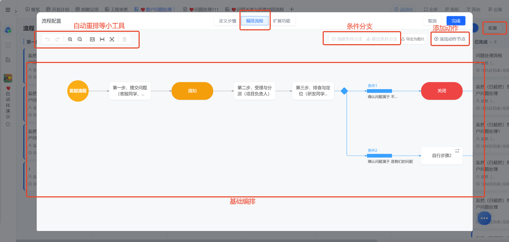
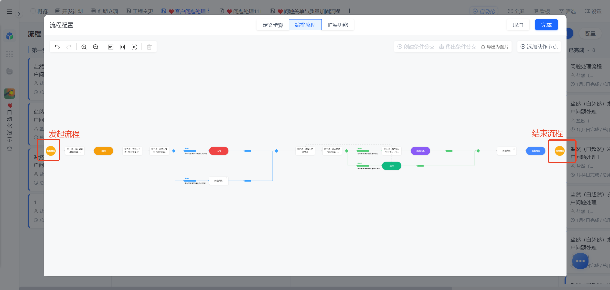
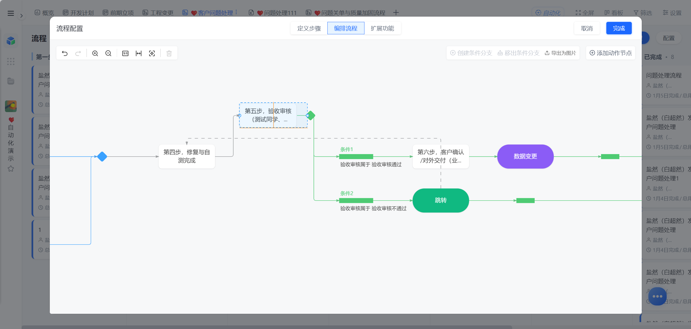
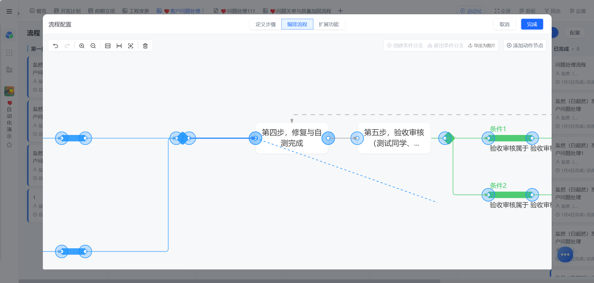
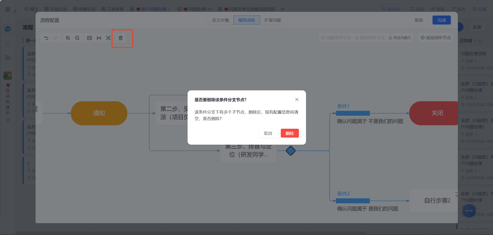

# 日事清流程步骤编排怎么操作？拖动、连线、删线基础教程

原文链接：https://www.rishiqing.com/web/solution/rishiqingprocesssteparrange.html

日事清流程步骤编排是可视化搭建业务流程的基础功能，可将独立的审批、执行、检查步骤，通过拖动、连线、删线等操作串联为完整流转链路，明确流程先后顺序与执行逻辑，解决步骤零散、流程混乱、无法自动流转的问题，快速搭建标准化企业工作流程。

## 一、什么是日事清流程步骤编排？核心作用是什么？

日事清流程步骤编排是流程可视化搭建的核心基础能力，依托可视化画布，对已创建的流程步骤进行拖动布局、连线建链、错误调整，把零散独立的步骤整合为完整、可自动流转的业务流程，明确各环节执行顺序，适配各类企业审批与业务协作场景。

很多企业在配置流程时，已完成新建步骤、表单设置、审核项配置，但各类流程步骤相互独立，没有形成流转关系，导致流程无法正常运行。

流程步骤编排的核心价值，就是打通孤立步骤，通过可视化操作定义「谁先执行、谁后执行、按什么顺序流转」，让静态的步骤配置变成动态可运行的完整业务流程，适配企业各类办公与审批场景。

日事清完整流程编排体系包含四大模块：基础编排、条件分支、动作添加、自动排版。本文重点讲解新手必备的**基础编排操作**，是所有复杂流程搭建的前提。

## 二、日事清流程步骤拖动与连线怎么操作？布局优化与流程流转搭建方法

进入“编排步骤”页面,系统自动生成一张完整流程图:最左边是【发起流程】、最右边是【结束流程】,中间是配置好的步骤,自动用线条连接展示流转顺序。

- 拖动步骤:流程复杂看起来乱时,鼠标点住某个步骤拖到更合适的位置,把审批环节放执行前面、复核放右下角,逻辑层次更清楚;

- **连接步骤**:点击某个步骤,两侧出现小圆点(连接点),鼠标按住圆点拖到另一个步骤的圆点上放开,两步就连上了。比如“提交申请”拖线到“部门审批”,再从“部门审批”拖到“财务复核”,系统就明白流程按这个顺序执行,像搭积木一样。

## 三、日事清流程连错线怎么删除？错误流程修改方法

连错了关系不用担心:点一下那条线,按键盘【Delete】键,或点上方工具栏【删除】,就能删掉连线,删完重新连就行。所以编排步骤主要做三件事:拖动步骤让布局更合理、连接步骤让流程跑得通、删除连线随时调整关系。

## 四、流程步骤编排功能怎么用？实现流程可视化自动流转

日事清流程步骤编排核心用法，是依托可视化画布，通过拖动、连线、删线三大基础操作，将零散的流程步骤整合为有序、可自动流转的完整业务链路。

**功能操作与应用价值：**

整套操作无需代码、全程可视化，新手可快速上手，适配企业各类审批、执行类工作流程搭建需求。

该功能彻底解决了流程步骤孤立、逻辑混乱、无法自动流转、布局杂乱难维护的企业流程管理痛点，让每一套业务流程都有清晰、标准化的执行路径，大幅降低流程搭建与后期运维成本，提升团队协作流转效率。

流程步骤编排以可视化拖拽、连线的轻量化操作，替代传统手动梳理流程的繁琐方式，快速定义各业务步骤的执行先后关系。

流程编排需优先保障业务逻辑准确，再优化页面布局，避免因操作顺序、连线逻辑错误，导致流程无法正常触发流转。

## 五、流程基础编排常见注意事项

日事清流程步骤编排看似操作简单，但细微的操作误区会直接导致流程流转异常、布局混乱、无法正常使用。在日常流程搭建与配置过程中，需严格规范操作方式，规避高频问题，保障流程长期稳定、合规复用。

**核心避坑要点：**

1. 严禁直接上手拖拽连线：编排前必须先梳理业务逻辑，明确步骤串行、并行关系，避免反复删改连线、打乱整体流程结构。

2. 禁止随意删除原始节点：不可误删【发起流程】【结束流程】默认节点，缺失首尾节点会直接导致整个流程无法启动和办结。

3. 避免连线逻辑交叉混乱：多步骤流程需规整布局，杜绝跨步骤乱连线，防止系统识别流转逻辑出错，造成流程卡顿、异常终止。

## 六、流程编排常见问题FAQ

**Q1：日事清流程步骤编排的核心意义是什么？**

A：流程步骤编排是流程落地运行的基础，能够将零散、独立的表单步骤、审批步骤串联为完整流转链路，可视化定义执行顺序，解决步骤孤立、流程无法运行、逻辑混乱的问题，帮助企业搭建标准化、自动化的业务审批流程。

**Q2：为什么配置完步骤和表单后，流程无法运行？**

A：仅配置步骤、表单和审核项，未通过步骤连线搭建流转链路，所有步骤处于独立状态，系统无法识别执行顺序。必须完成流程连线编排，形成完整闭环链路，流程才能正常发起和自动流转。

**Q3：日事清怎么调整流程步骤的布局位置？**

A：进入流程编排画布，长按任意流程步骤模块即可自由拖动，可根据业务逻辑调整审批、执行、复核步骤的位置，优化整体布局，让流程结构清晰直观，方便日常查看和后期维护修改。

**Q4：日事清错误的流程连线怎么快速删除？**

A：在编排页面点击选中需要删除的错误连线，按下键盘Delete键，或点击页面顶部工具栏的删除按钮，即可一键移除，无需改动其他步骤配置，操作简单且不会破坏现有流程布局。

**Q5：流程编排时如何区分串行和并行步骤？**

A：存在先后依赖、必须依次完成的步骤为串行步骤，需要逐一线性连线；无业务冲突、无需等待前置完成的步骤为并行步骤，可从同一节点同步引出多条连线，实现多环节同步执行。

**Q6：新手搭建流程有哪些编排小技巧？**

A：建议先梳理完整业务逻辑，划分串行、并行环节，再进行拖动布局和连线操作，避免反复删改。优先保证流程逻辑正确，再优化画布布局，循序渐进搭建，大幅提升流程配置准确率和效率。

## 七、总结

日事清流程步骤编排的核心逻辑，是以可视化方式梳理业务逻辑、串联零散步骤。拖动优化布局、连线搭建链路、删线修正错误，三大基础操作构成了企业流程搭建的底层能力，让静态的步骤配置变成可落地、可流转的标准化工作流程。

基础编排是流程搭建的第一步，后续可进阶学习条件分支、自动动作、自动排版等功能，搭建更智能、更贴合复杂业务的自动化流程。想要搭建全流程标准化协作体系，可扫码了解日事清流程管理完整解决方案。

