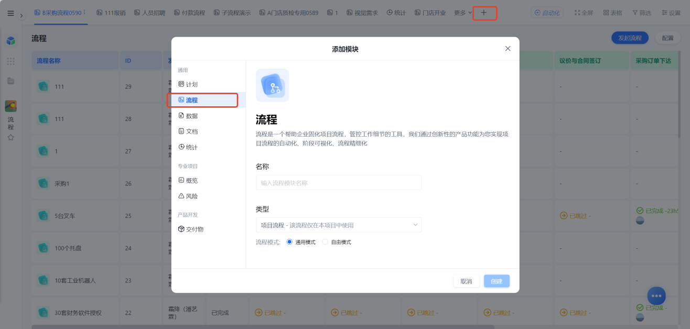
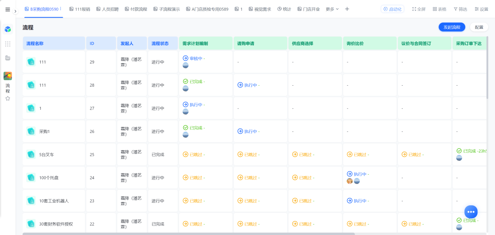
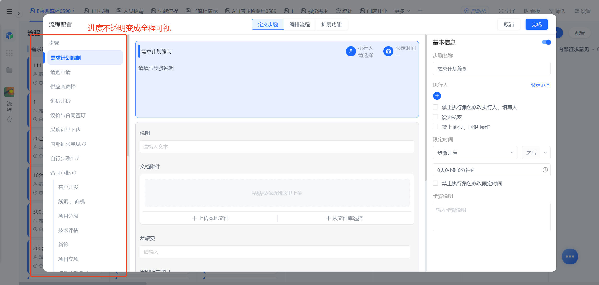
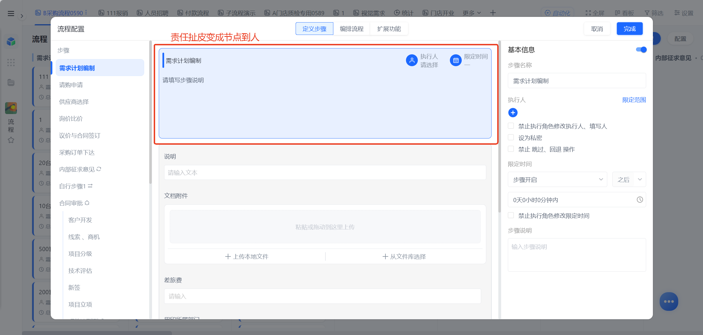
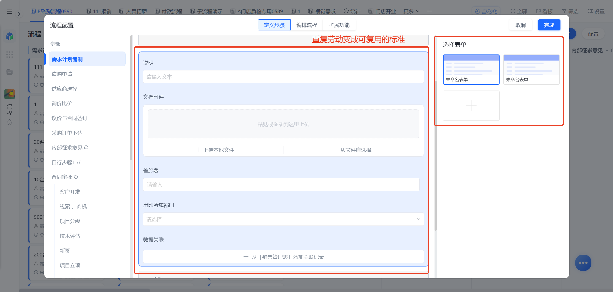
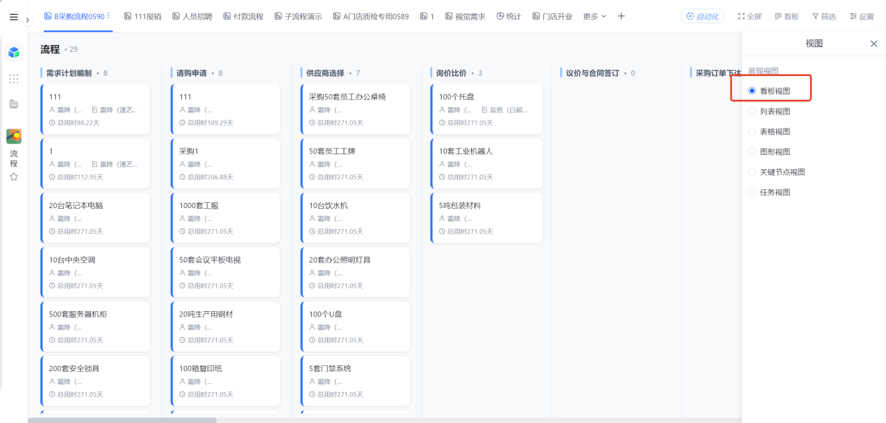

# 日事清流程管理模块有什么用？企业流程落地管控与高效协作指南

原文链接：https://www.rishiqing.com/web/solution/liuchengguanli%E6%A8%A1%E5%9D%97shiyongjiaocheng.html

多数企业都搭建了完善的制度流程，但大多仅停留在文档、流程图或微信群通知层面，无法真正落地执行。普遍存在流程失控、审批卡顿、权责模糊、进度不明、资料散乱等问题，依赖人工催促、口头对齐、经验管控，管理不确定性极强。日事清流程管理模块主打**数字化、可视化、标准化、自动化**，将人工管控的不确定模式，升级为系统自动推动、全程可溯、标准可复用的确定性管理模式，帮助企业摆脱“人盯人”的低效管理。

## 一、日事清流程管理是什么？核心定义与落地价值

日事清流程管理是适配中小企业全业务场景的数字化流程管控工具，核心是将企业线下制度、口头流程、纸质审批线上化、标准化、自动化。通过节点拆分、权责绑定、全程记录、自动流转，解决传统流程人治化、碎片化、不可追溯的问题，让企业流程可控、可查、可复用、可优化。

该功能不只是简单的审批线上化，更是企业组织的执行管控工具。它打通了制度与执行的壁垒，让每一条企业流程都能真正落地运行，替代传统人工盯办、口头催办的管理模式，帮助管理者解放精力、精准管控。

## 二、日事清流程管理对管理者的三层核心价值

- 进度不透明变成全程可视：以前想知道一件事推进到哪了要问三个人、翻半天聊天记录；现在流程一发起，系统清清楚楚告诉你现在在哪个节点、谁是责任人、停了多久、原因是什么。流程透明了，管理才真正有抓手；

- 责任扯皮变成节点到人：很多延期都是“以为别人会做”。流程模块把每一步拆成清晰节点，绑定明确的执行人和审批人，什么时候做、交付什么、要哪些资料，一开始就写进流程里。出问题不用吵谁负责，系统记录就是事实；

- 重复劳动变成可复用的标准：表单字段一次配好、材料要求写清楚、审批逻辑设置好，后面每次发起都按同一套标准跑。团队越用越统一，新人也能按标准做事，组织能力被沉淀下来。

## 三、为什么说流程模块是企业组织的执行引擎？

流程模块更像一个组织的“执行引擎”。把流程搬进系统后，很多以前靠管理者个人能力硬扛的事，系统会替你扛掉一部分：自动提醒、自动流转、自动记录，管理者从“追着人跑”变成“看板式管理”。你把精力从催办、对齐、解释、找材料里解放出来，回到判断优先级、控制风险、做决策。

如果你正遇到审批慢、流程乱、资料散、跨部门协作卡顿——流程模块会非常有用。它解决的是“流程能不能落地执行”：每一步有迹可循、每个节点有人负责、每份资料都有记录，出问题能定位、复盘有数据、管理有依据。

## 四、流程管理怎么用？实现企业全场景流程规范落地

日事清流程管理操作简单、通用性强，无需复杂配置，依托标准化模板体系，可快速适配企业各类业务，实现流程全面线上化、规范化落地。

该功能覆盖企业行政、财务、人事、业务全场景，一套系统即可替代零散线下流程，实现全公司流程统一管控、高效运转。

**功能操作与应用价值：**

用户可优先选取报销、采购、用章、人事审批等高频核心流程，快速配置标准化模板，完成流程线上化搭建，逐步替换线下零散流程，循序渐进实现全业务流程数字化升级。

该功能彻底解决了企业流程落地难、执行混乱、权责不清、人工管控成本高、组织标准无法沉淀的管理难题，全方位实现企业流程执行提速、管理维稳、组织标准化升级。

## 五、企业流程落地实操建议与避坑要点

为保障流程管理高效落地、发挥最大管控价值，企业在实操过程中需遵循轻量化落地原则，规避盲目全量上线的问题：

1. 轻量化试点落地：无需一次性上线全部流程，优先选择3条高频、见效快的核心流程，如报销、采购、用章审批，跑通流程、养成团队使用习惯后，再逐步拓展全场景；

2. 标准化模板配置：搭建流程时统一表单字段、审批节点、材料要求，避免模板杂乱，保障全团队执行标准统一；

3. 权责精准绑定：每个流程节点明确专属负责人，杜绝空岗、权责重叠，避免流程卡顿、无人推进；

4. 定期复盘优化：依托系统留存的流程数据，定期复盘流程卡点、低效环节，持续优化流程体系，提升协作效率。

## 六、FAQ 常见问题

**Q1：日事清流程管理模块的核心作用是什么？**

A：日事清流程管理模块核心是实现企业流程数字化落地，将线下零散、依赖人工管控的流程转为系统自动化管控。可实现流程全程可视、权责精准绑定、标准一键复用、数据全程沉淀，解决流程失控、审批卡顿、推诿内耗、管理低效等问题，助力企业从人治管理升级为标准化数治管理。

**Q2：日事清流程管理适合哪些企业业务场景？**

A：该功能适配企业全场景协作流程，核心覆盖财务报销、采购审批、用章管理、人事入职离职、合同审核、项目需求评审、跨部门协作等高频场景，通用性极强，能够全方位规范企业日常办公与业务流程。

**Q3：数字化流程管理能为管理者带来哪些价值？**

A：主要带来三层核心价值，一是流程进度全程可视，无需人工问询跟进；二是节点权责精准到人，杜绝工作推诿扯皮；三是流程标准可复用，沉淀企业组织能力，大幅降低管理者事务性工作压力，让管理更高效、更精准、更可控。

**Q4：企业如何快速落地日事清流程管理功能？**

A：建议采用轻量化试点落地方式，无需一次性全量上线。优先选择报销、采购、用章三类高频、见效快的核心流程，配置标准化模板跑通流程，培养团队使用习惯后，再逐步拓展人事、业务等全场景流程，平稳实现数字化升级。

**Q5：日事清流程模块如何解决跨部门协作卡顿问题？**

A：通过标准化节点拆分与自动流转机制，明确各部门、各岗位的流程职责与交付标准，系统自动推送任务、提醒节点人员执行，无需人工对接催促。同时全程记录协作数据，快速定位跨部门卡点，打通部门信息孤岛，让协作更有序。

**Q6：流程模板复用能为企业带来什么优势？**

A：流程模板一次配置、永久复用，无需重复搭建流程，大幅减少管理配置工作量。同时统一全团队执行标准，避免因人而异的操作差异，降低新人学习成本，将个人工作经验沉淀为企业可固化、可传承的组织管理能力。

**Q7：日事清流程管理和传统线下流程的区别是什么？**

A：传统线下流程依赖人工推进、口头管控、无留存记录，存在混乱、低效、不可追溯、权责模糊等问题；日事清数字化流程实现自动流转、全程可视、数据留痕、标准统一，用系统确定性替代人工不确定性，全面提升流程落地质量与效率。

**Q8：流程管理的数据记录可以用于企业复盘优化吗？**

A：可以。日事清会全程留存所有流程的操作记录、流转时长、节点状态、卡顿原因等数据，形成完整的流程台账。管理者可依托这些数据开展流程复盘，精准定位低效环节、管理漏洞，持续优化流程体系，实现企业管理迭代升级。

## 七、总结

日事清流程管理模块的核心价值，是**把不确定的人治流程，变成确定的系统流程**。通过可视化进度管控、节点化权责绑定、可复用标准模板、自动化流程流转，彻底解决企业流程落地难、审批卡顿、协作混乱、管理低效等核心问题。既能提速执行、稳定管理秩序，又能沉淀企业标准化组织能力，助力企业摆脱“人工盯办”的低效管理模式。建议企业从高频核心流程试点落地，循序渐进实现全业务流程数字化、规范化升级。若想要完整体验日事清数字化流程管控、标准化协作能力，可扫码了解试用日事清流程管理。

