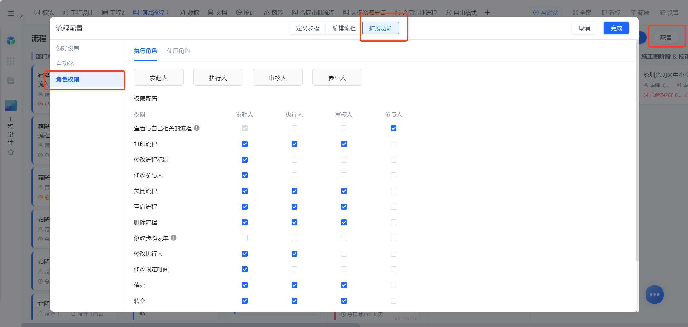
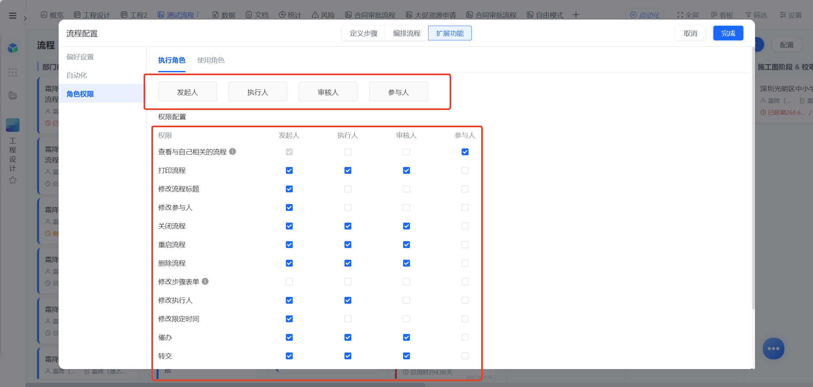
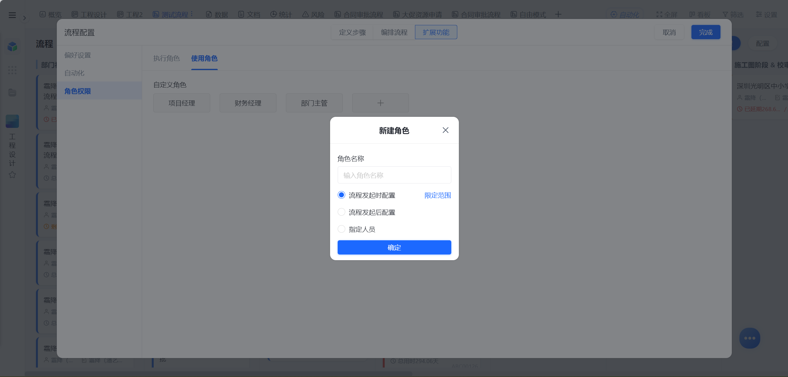
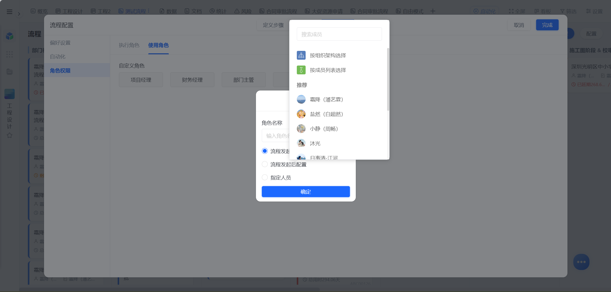

# 日事清流程角色权限怎么设置？执行角色与使用角色配置教程

原文链接：https://www.rishiqing.com/web/solution/liuchengjuesequanxianpeizhi.html

企业流程能否规范、安全、高效流转，核心取决于**流程角色权限**配置。合理的角色权限划分，可精准界定流程发起人、执行人、审核人、参与人的权责边界，规范各类流程操作权限，杜绝越权操作、权责模糊、流程混乱等问题，同时简化人员变动后的流程维护工作。日事清流程角色权限入口位于流程配置页右上角【扩展功能 → 角色权限】，支持精细化、模块化的流程权责管控。

## 一、什么是流程角色权限？核心作用是什么？

日事清流程角色权限是流程扩展核心管控功能，通过划分标准化流程角色、配置精细化操作权限，明确企业流程中各岗位的操作范围与工作职责，从根源规范流程协作秩序，保障流程运行安全、权责清晰、流转高效，同时大幅降低流程后期维护成本。

很多企业流程跑乱、管控失效、存在安全漏洞，本质是权责没有固化。谁能发起、谁能审核、谁能修改、谁能归档没有统一标准，极易出现推诿扯皮、越权操作、流程误改等问题。

依托日事清流程角色权限功能，可实现“权责到人、权限可控、变动自动适配”，让企业流程从人工粗放管理，转变为标准化、制度化的系统管控。

## 二、流程执行角色有哪些？权限如何划分？

流程里的**执行角色**有四类:

- **发起人**(谁来发起)
- **执行人**(负责具体步骤操作)
- **审核人**(审批环节签字把关)
- **参与人**(不直接操作但需关注进展)

这四个角色构成流程运转的基本分工。

系统里权限非常细,常用的有:

- 查看与自己相关的流程(最基础)
- 打印流程(归档汇报)
- 修改流程标题/参与人(调整基础信息)
- 关闭/重启/归档/删除流程(状态相关,一般只有发起人或管理员有)
- 修改步骤表单/执行人/限定时间(决定谁来做、做到什么时候)
- 催办(提醒尽快完成)
- 转交(把自己负责的步骤交给别人)
- 转交审核中的任何审核人(审核卡住时灵活转交,避免停摆)。

配置合理,安全和效率就都有了。

## 三、流程使用角色模板是什么？核心优势与实操价值

**使用角色**可以理解成一个“角色模版”:先预设好“财务经理”“部门主管”这类角色,流程配置里直接选这个角色,不用每次点具体人名。

好处有两个:一是配置更快更灵活,不用反复设置;二是公司人员调整时,只要更新角色里的人选,所有相关流程自动跟着更新,省去逐个修改。比如定义了“部门主管”这个使用角色,流程里直接选它,不管现在谁担任主管,流程都自动匹配到最新的人。

## 三、流程角色权限功能怎么用？实现企业流程权责标准化管控

日事清流程角色权限支持可视化可视化配置，无需代码操作，企业可快速搭建专属的流程权责管控体系。

功能依托执行角色与使用角色双重体系搭配落地，兼顾单次流程分工灵活配置与长期岗位规则固化。

**功能操作与应用价值：**

用户可先通过四类执行角色划分单次流程协作权责、配置精细化操作权限，再通过使用角色固化岗位模板，适配长期办公场景。

该功能彻底解决了传统企业流程分工模糊、权限混乱、人员变动需重复改流程、运维成本高、权责无边界、流程安全风险突出的协作痛点，实现企业流程权责清晰、规范统一、高效运维、安全可控。

日事清流程角色权限操作简单、可视化配置，无需复杂设置，可快速完成企业流程权责体系搭建。

整套功能依托执行角色+使用角色双体系搭配使用，既能理清单次流程分工，又能固化长期岗位规则。

## 四、流程角色权限使用注意事项

配置流程角色权限需区分两类角色的适用场景，按需选用、精准配置，避免权责设置错位。

权限分配需遵循最小权限原则，按需开放操作权限，严控高危操作，保障流程安全稳定运行。

**核心避坑要点：**

1. 角色场景避坑：临时单次协作流程可直接配置执行人员，企业常态化、岗位固定、人员易流动的流程，优先使用使用角色模板，减少重复运维。

2. 权限范围避坑：催办、转交、步骤修改等操作权限，仅对对应岗位执行人、管理员开放，禁止全员开放，避免流程混乱无序。

3. 高危操作避坑：流程删除、归档、重启、基础信息修改等高危权限，仅分配给流程发起人与企业管理员，杜绝普通员工误操作导致流程异常。

## 五、流程角色权限常见问题 FAQ

**Q1：流程执行角色和使用角色核心区别是什么？**

A：执行角色是单次流程的临时分工，用于界定当前流程发起人、执行人、审核人等具体权责；使用角色是长期岗位模板，用于固化岗位权限，适配人员变动场景，实现流程自动同步更新，降低维护成本。

**Q2：人员岗位调整后，需要手动修改所有流程吗？**

A：不需要。在日事清中使用流程使用角色模板后，仅需更新角色对应的岗位人员，所有绑定该角色的流程会自动同步更新，无需逐条手动修改，高效适配企业人员轮岗、变动场景。

**Q3：流程参与人可以操作、审核流程吗？**

A：不可以。流程参与人仅拥有流程查看、信息知晓权限，无执行、审批、修改、催办等操作权限，主要用于流程进度同步，不参与流程核心协作，保障流程权责清晰。

**Q4：哪些流程权限属于高危权限，需要严格管控？**

A：流程关闭、重启、归档、删除、步骤表单修改、执行人修改等均为高危权限，建议仅分配给流程发起人与企业管理员，避免普通员工误操作导致流程数据异常、流程中断。

**Q5：什么样的流程适合使用角色模板配置？**

A：部门审批、财务审核、管理层把关等岗位固定、人员易流动的常态化流程，均适合使用使用角色模板，可实现流程规则长期稳定，无需反复迭代配置。

**Q6：如何配置流程权限才能兼顾安全和效率？**

A：遵循最小权限原则，按四类执行角色精准分配操作权限，常规查看、催办权限全员适配，高危权限专人管控；固定岗位搭配使用角色模板，既规范权责边界，又简化运维，兼顾安全与协作效率。

## 六、总结

日事清流程角色权限分为**执行角色分工**与**使用角色模板**两大核心体系，搭配精细化的操作权限，全方位解决企业流程权责模糊、分工混乱、运维繁琐、安全失控等管理痛点。执行角色理清单次流程“谁来做、谁来审、谁来看”，使用角色固化长期岗位规则、适配人员变动，双重体系搭配让企业流程协作更标准、运行更安全、维护更高效。

至此，日事清流程偏好设置、自动化动作、角色权限三大扩展功能已全部讲解完毕，企业可依托完整的流程配置能力，搭建标准化、自动化、安全化的办公流程体系，让团队执行更有节奏、协作更有章法。

想要搭建权责清晰、安全高效的企业流程管理体系，可扫码了解试用日事清流程管理功能。

