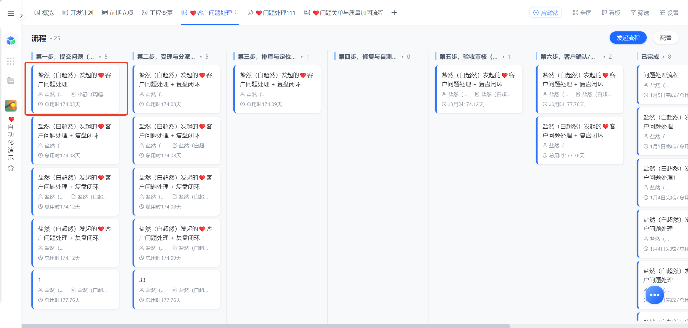
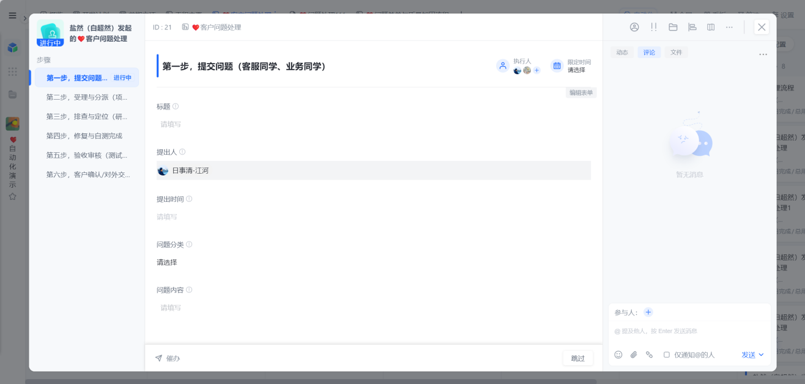
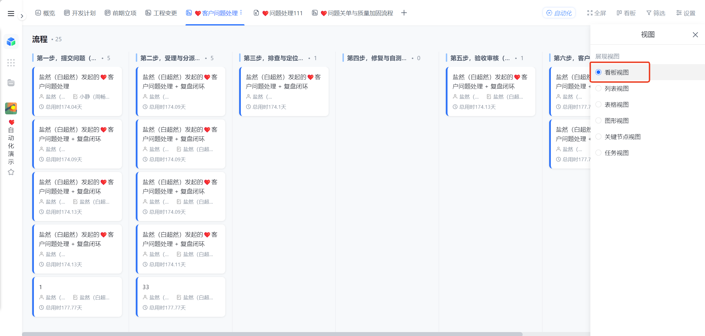
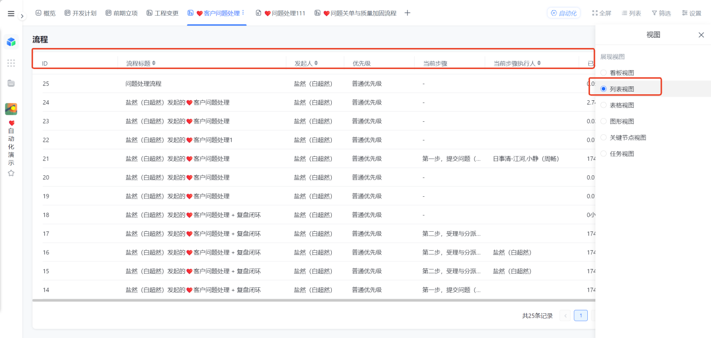
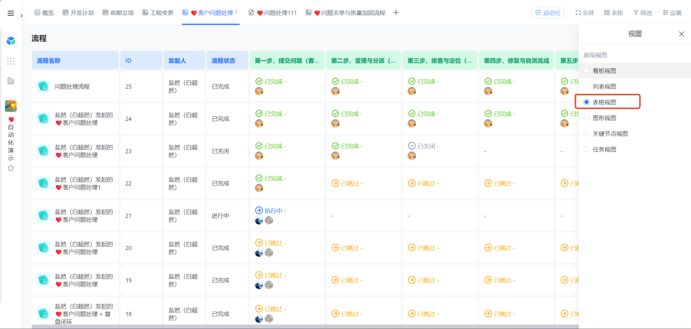
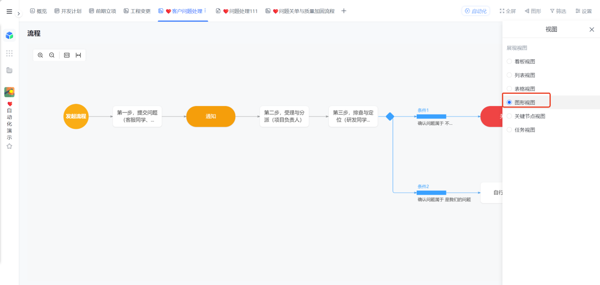
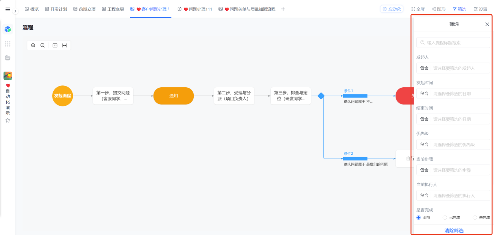
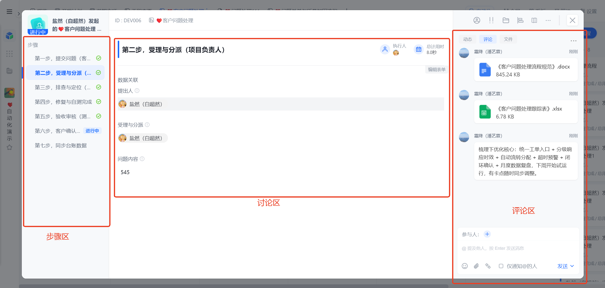

# 日事清流程进度怎么查看？全局与单条流程进度查询教程

原文链接：https://www.rishiqing.com/web/solution/liuchengjinduchakan.html

企业流程执行中，普遍存在进度不透明、卡点不明确、延期难发现、反复催办沟通成本高的问题。日事清**流程进度查看功能**提供全局主页与单条详情页双入口，搭配四类可视化视图，可全方位查看流程状态、步骤进度、操作记录与协作动态，实现流程全程透明、可查、可追溯，帮助团队精准把控执行节奏。

## 一、流程进度查看功能是什么？核心价值是什么？

日事清流程进度查看是流程管理核心可视化功能，依托流程模块主页与流程详情页双入口，通过多维度视图展示、状态识别、操作记录追溯，帮助企业全局把控批量流程、精准查看单条细节，解决流程进度模糊、卡顿未知、追溯困难、沟通低效等问题。

传统线下或粗放式流程管理中，管理者无法批量掌握团队流程进度，执行人不清楚自身任务节点，流程卡顿、延期后难以快速定位问题，只能通过反复询问跟进，严重影响协作效率。

依托日事清流程进度查看能力，所有流程进度、状态、操作记录全部线上可视化，无需人工反复沟通，实现流程管控标准化、透明化、高效化。

## 二、流程模主页怎么用？如何查看全局流程进度

主页把所有已发起的流程列出来,可在四种视图间切换:

- 看板视图:每张卡片对应一个步骤,流程走到哪步就显示在哪张卡片下,同时走多步会同时出现在几张卡片里。末尾还有“其他”“已完成”“已关闭”三张特殊卡片;

  

  
- 列表视图:按行展示,可按步骤ID、标题、发起人、当前步骤、进行时间、状态筛选排序,适合快速查找或对比进度;

  

  
- 表格视图:把每个流程的步骤展开,明确标出“已完成”“执行中”“延期”“审核中”等状态,管理者全面掌握进展最合适;

  

  
- 图形视图:用图形化方式展示步骤连接和顺序,点某个步骤还能查看哪些流程实例走到了这里。

右上角的筛选功能也别忘了,可按标题、发起人、发起时间、执行人快速过滤。

## 三、流程详情页怎么看？如何查询单挑流程细节？

点进详情页,左侧步骤区显示所有步骤及当前状态(执行中、待审核、延期、完成、跳过),一眼看出卡在哪步。操作区很关键,不同角色不同状态看到的按钮不一样:执行人常见填写表单、完成、跳过;有审核项时看到提交审核、同意、拒绝、撤销;走到第二步及之后还多一个”回退”按钮可退回前面某步。审核状态有五种:待审核、审核中、已拒绝、已关闭、已通过,不用挨个问审批人。讨论区分评论、动态、文件、操作记录,团队直接沟通、上传附件、看谁何时做了什么,流程全程透明可追溯。

## 四、流程进度查看功能怎么用？实现流程可视化透明管控

日事清流程进度查看功能采用双入口可视化设计，操作简单无需复杂配置，适配企业全员流程管控场景。

功能区分全局批量管控与单条细节追溯，覆盖管理者复盘巡检、员工跟进执行全场景需求。

**功能操作与应用价值：**

用户可通过流程模块主页完成团队整体流程进度筛查、状态查看与批量复盘，通过流程详情页完成单条流程卡点排查、操作核对与记录追溯。

该功能彻底解决了企业流程进度不透明、卡点无法定位、延期无人跟进、人工催办沟通成本高、流程执行无记录可追溯的协作与管理痛点，助力企业实现流程标准化、可视化、轻量化高效管控。

## 五、流程进度查看使用注意事项

使用流程进度查看功能需区分场景适配对应入口与视图，避免操作低效、排查遗漏。

查看流程进度需遵循全局巡检、细节追溯的使用逻辑，保障流程管控精准、全面、无死角。

**核心避坑要点：**

1. 视图场景避坑：批量进度复盘、筛查延期卡顿流程优先使用表格视图，梳理流程逻辑、排查步骤卡点优先使用图形视图，按需选用提升管控效率。

2. 进度追溯避坑：遇到流程争议、延期问题时，必须通过详情页操作记录追溯源头，杜绝仅凭人工记忆判断问题。

3. 日常管理避坑：管理者需定期通过主页筛选功能巡检全量流程，执行人及时查看个人负责步骤，避免流程长期卡顿、无人处理。

## 六、FAQ 常见问题

**Q1：流程模块主页四种视图分别适合什么场景使用？**

A：看板视图适合日常快速浏览流转进度；列表视图适合精准检索单条流程；表格视图适合管理者批量复盘、筛查延期流程；图形视图适合梳理流程逻辑、排查步骤卡点，四类视图搭配可覆盖全场景流程管控需求。

**Q2：流程详情页可以追溯历史操作记录吗？**

A：可以。日事清流程详情页讨论区会完整留存所有操作动态、人员操作记录、上传文件与沟通评论，全程留痕不可篡改，可随时追溯流程全生命周期执行细节，满足企业合规与复盘需求。

**Q3：不同角色在流程详情页的操作按钮一样吗？**

A：不一样。系统会根据用户角色、流程步骤、当前状态动态匹配操作权限，执行人拥有执行、填写权限，审核人拥有审批权限，普通参与人仅可查看，精准实现权责区分，保障流程安全规范。

**Q4：如何快速找出团队所有延期、卡住的流程？**

A：登录日事清进入流程模块主页，切换至表格视图，系统会清晰标注延期、执行中、卡住的流程状态，搭配顶部筛选功能，可一键批量筛查问题流程，高效完成团队流程巡检与整改。

**Q5：流程审核状态分为哪几种？分别代表什么意思？**

A：日事清流程共五大审核状态：待审核为等待审批人处理、审核中为正在审批、已通过为审批完成、已拒绝为审批驳回、已关闭为流程终止，状态清晰直观，无需人工沟通确认进度。

**Q6：全局查看和详情页查看应该如何搭配使用？**

A：日常管理先用流程主页做全局巡检，快速发现问题流程；针对卡顿、延期、有争议的单条流程，点击进入详情页核对步骤状态、追溯操作记录、完成对应操作，兼顾批量管控与精准落地。

## 七、总结

日事清流程进度查看功能依托**流程模块全局主页**与**单条流程详情页**双核心入口，搭配四类可视化视图、精准筛选、状态识别、全程追溯能力，彻底解决企业流程进度不透明、卡点难排查、延期无人管、沟通成本高、流程无追溯等管理痛点。管理者可高效批量管控团队流程，员工可精准跟进个人任务，让企业流程执行更有节奏、协作更有章法。

后续将继续讲解流程操作区不同角色的实操权限，帮助企业搭建更完善、更规范的标准化流程管理体系，全方位提升团队协作与执行效率。

想要实现企业流程可视化、透明化、可追溯管理，高效把控团队执行进度，可扫码了解试用日事清流程管理功能。

