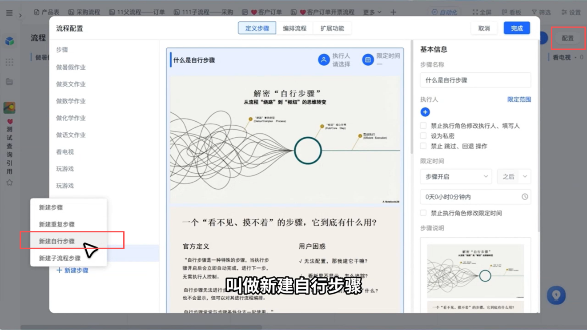
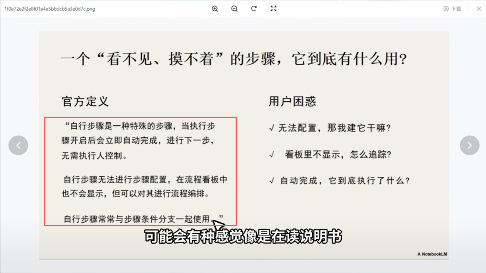
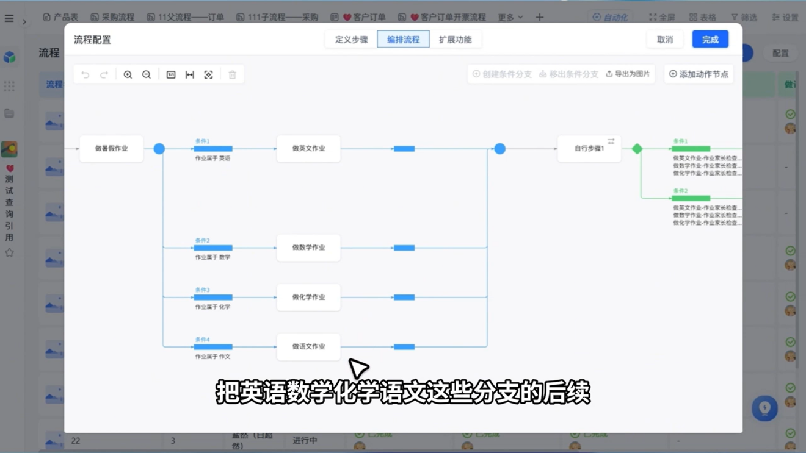
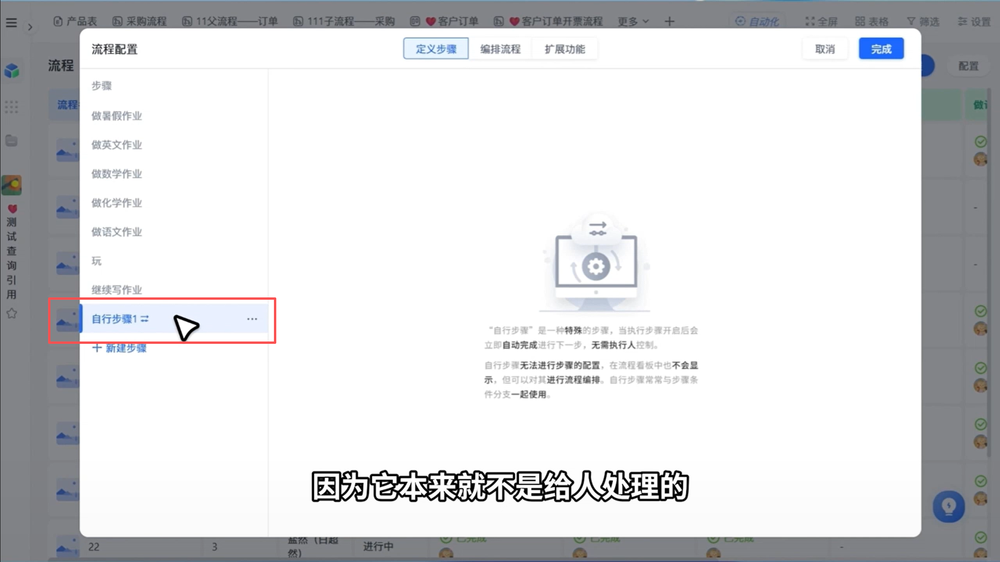
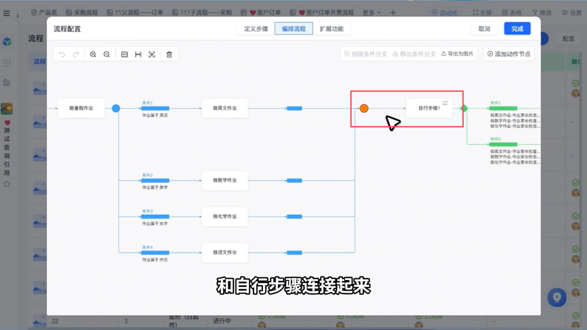
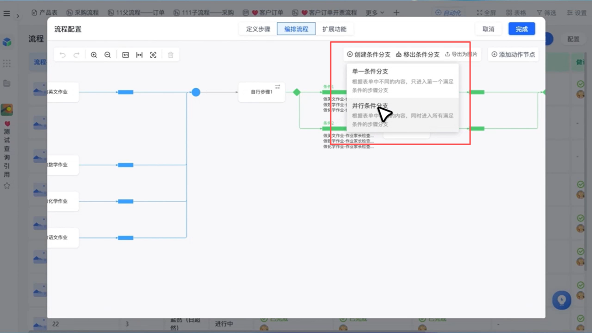
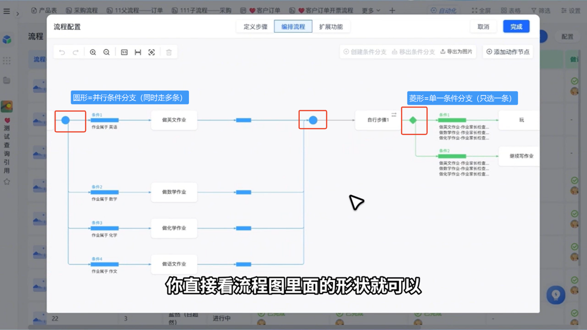
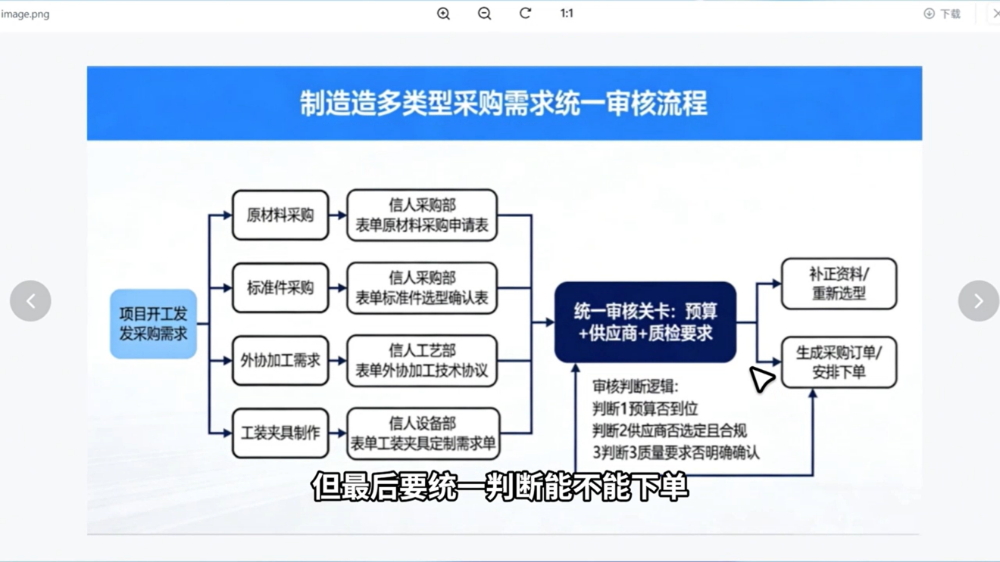
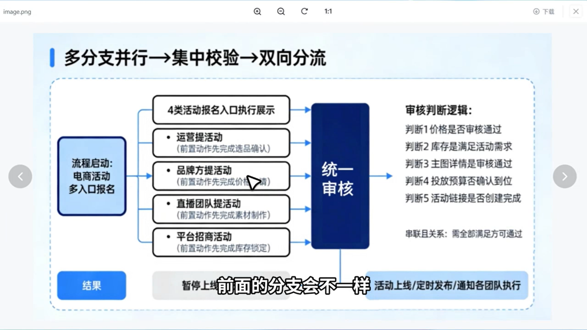

# 日事清自行步骤是什么？怎么用？流程分支统一判断配置教程

原文链接：https://www.rishiqing.com/web/solution/zixingbuzhouliuchengpeizhi.html

日事清自行步骤是一款专属流程编排的**自动隐形节点**，无需人工操作、不在看板展示，流程运行至该节点会自动完成跳转，核心作用是集中整合多分支流程的重复条件判断，简化复杂流程逻辑、降低企业流程维护成本，是日事清流程管理中优化多分支流程的核心功能。

## 一、什么是日事清自行步骤？

日事清自行步骤是流程编辑中特殊的隐形自动化节点，流程流转至该步骤会立即自动完成、无需人工点击操作，不会在前端看板展示，也不支持表单、人员等自定义配置，主要搭配条件分支使用，实现流程自动分流、统一判断与跳转，是优化复杂多分支流程的核心功能。

很多用户初次接触自行步骤会产生疑惑：无操作、无配置、不展示的节点，存在意义是什么？核心区别于普通人工步骤，自行步骤不承担执行工作，只承担「流程过渡、集中判断、自动转向」的作用。

其核心特性可总结为三点：自动执行、隐形展示、分支适配。全程无需人工干预，是企业梳理规整复杂流程逻辑的关键工具。

## 二、为什么要用日事清自行步骤（核心价值）

系统的定义是:自行步骤是一种特殊步骤,执行开启后立即自动完成进入下一步,无需执行人控制;它无法做步骤配置、在看板中也不显示,但可以做流程编排,常与条件分支一起使用。

翻译成大白话就是三点:第一,它走到就自动完成,不需要任何人点;第二,它在看板里基本不出现,是个隐形的转弯节点;第三,它常和条件分支搭配,专门用来当“统一判断、统一转向”的那个点。所以它更像一个“过渡+分流”节点,负责让流程自己做一次判断然后自动跳转。

## 三、生活化案例：多科目作业流程看懂自行步骤集中管理价值

举个生活化例子:把“做作业”做成流程,有英语、数学、语文、化学四门,先做哪门都行。每门做完都要走同一套判断——家长检查了没?检查了才能放松,没检查继续做;放松时还要再判断累不累,累了看电视、不累玩游戏。

如果不用自行步骤,你得在四条分支后面各写一遍“检查+累不累”的判断,流程图画着画着就崩溃——结构是四条路、判断却是同一套,要重复配很多次。用自行步骤就简单了:把四条分支的后续都汇到一个自行步骤,在它后面创建条件分支统一判断。这样判断只写一次,改规则(比如加一条“晚上九点后不能玩游戏”)也只改这一个地方,这就是“集中管理”的价值。

## 四、日事清自行步骤怎么配置？（实操步骤+避坑指南）

操作要点:新建一个自行步骤(它没有执行人、表单可配),切到编排界面,把各条分支的交汇点连到这个自行步骤,再点进去“创建条件分支”。条件里用“添加其他步骤字段”把前面各步骤的字段(如“家长检查了吗”“你累吗”)调进来统一判断。

这里有个实战坑要提醒:并行场景下,如果某门作业这次根本没选,“四门都检查了”这条分支就永远不满足、流程会卡死。正确思路是先把“不能往下走”的互斥条件抓牢——只要有任意一门没检查,就跳回“继续写作业”;剩下没被拦截的情况自然就是可以放行。判断辨认也有小技巧:流程图里圆形=并行条件分支(同时走多条),菱形=单一条件分支(只选一条)。

## 五、日事清自行步骤适用场景有哪些？（行业实战案例）

- **制造业采购**:一个项目开工同时冒出原材料、标准件、外协加工、工装夹具多类采购,前面走不同责任人,但最后都要过同一套关——有没有预算、供应商选好没、质检要求确认没。把各分支汇到一个自行步骤统一判断,任一不满足就跳回补资料,都满足才放行下单;

- 电商活动上线:报名入口多(运营、品牌方、直播、平台招商),前面各做选品、价格、素材、库存,但上线前都要过同一套门槛——价格审核、库存满足、主图过审、预算确认、链接创建。汇到一个“上线校验”自行步骤统一判断,门槛规则变了只改这一个点。

共同特点:当你发现同一段判断开始在两三个地方重复配置时,就停下来想想能不能汇到一个自行步骤统一判断。

## 六、日事清自行步骤怎么用？如何实现流程自动分流优化

日事清自行步骤的核心使用逻辑，是依托自动化节点聚合多分支流程，搭配条件分支功能实现全流程智能判断与自动流转，无需人工介入即可完成流程分流与规则校验。

用户只需完成分支汇总、规则配置、互斥校验三步基础操作，即可快速落地复杂多分支流程的标准化优化，适配绝大多数企业办公、采购、运营等流程场景。

功能操作与应用价值

在日事清流程编辑器中插入自行步骤节点，聚合所有并行、分散的流程分支，统一配置全局判断规则，替代多分支重复配置的传统模式。

该功能彻底解决了企业复杂流程**分支逻辑零散、规则重复配置、迭代修改繁琐、人工干预成本高**的核心痛点，让多分支流程管控集中化、标准化、自动化。

借助自行步骤，企业流程可实现一次配置、全局复用、一键迭代，大幅降低流程搭建与维护成本，同时减少人工操作带来的逻辑漏洞与流程故障。

## 七、日事清自行步骤使用注意事项

自行步骤属于自动化流程核心节点，使用场景、配置逻辑区别于普通人工步骤，盲目套用容易出现流程卡死、逻辑失效等问题，需严格适配场景规范使用。

日常使用中需区分单一线性流程与多分支并行流程，把控规则配置、分支对接、逻辑校验等关键环节，保障流程稳定高效运行。

核心避坑要点

- **场景适配避坑**：单一线性流程无需配置自行步骤，仅两条及以上分支、需要统一校验的并行流程适用，多余配置会造成流程逻辑冗余。
- **规则配置避坑**：并行多分支场景必须设置互斥拦截规则，禁止仅配置达标放行规则，避免部分分支未触发导致流程停滞、卡死。
- **逻辑区分避坑**：严格区分流程图图标逻辑，圆形为并行条件分支、菱形为单一条件分支，错用图标会导致判断规则失效、流程流转错乱。

## 八、FAQ常见问题

1. 日事清自行步骤为什么看不到、不能配置表单？

日事清自行步骤是纯自动化流程决策节点，无需人工参与执行，因此不会展示在工作看板中，也没有执行人、表单配置入口。其核心功能是承接多分支流程、完成自动条件判断，所有配置仅需在流程编排和条件规则中完成，无需额外表单设置。

2. 日事清自行步骤和普通流程步骤有什么区别？

普通流程步骤依赖人工操作、展示在看板、支持表单配置；而日事清自行步骤是隐形自动化节点，无需人工操作、无表单配置、自动执行跳转。普通步骤用于落地具体工作，自行步骤仅用于优化流程逻辑、统一分支判断。

3. 哪些流程必须用日事清自行步骤优化？

只要出现**两条及以上流程分支，且末端需要相同条件判断**的场景，都适合用自行步骤优化。典型场景包括多品类采购、多渠道活动上线、多模块并行工作收尾校验等，可彻底解决规则重复配置问题。

4. 使用日事清自行步骤会出现流程卡死吗？

正确配置规则不会出现卡死问题。流程卡死多出现于并行场景，因部分分支未触发、统一条件无法满足导致。只需配置互斥拦截规则，将未达标场景拦截重跑，即可彻底规避流程停滞、卡死的问题。

5. 配置日事清自行步骤需要修改原有流程结构吗？

无需大幅修改原有流程业务结构，仅需将原有多条分支的末端流转路径，统一汇总至新增的自行步骤节点，再配置统一判断规则即可，业务执行逻辑不变，仅优化流程管控逻辑，改造难度极低。

6. 修改流程判断规则时，自行步骤有什么优势？

无自行步骤时，多分支重复规则需要逐一分支修改，耗时且易出错；使用日事清自行步骤后，所有统一判断规则集中在单一节点，迭代修改仅需编辑一次，全局所有分支同步生效，大幅提升流程维护效率。

7. 自行步骤可以单独使用吗？

不建议单独使用。日事清自行步骤的核心价值是整合多分支逻辑，需搭配**条件分支功能**使用，单条线性流程无需配置自行步骤，仅多分支、多并行流程场景使用可发挥最大优化效果。

8. 新手配置自行步骤有什么快速技巧？

新手可优先记住两个核心技巧：一是流程图圆形代表并行分支、菱形代表单一分支，精准区分逻辑类型；二是优先设置拦截互斥条件，再配置放行规则，从根源规避流程故障，快速完成标准化配置。

## 九、总结

日事清自行步骤的核心核心是**自动化流程决策节点，而非人工执行节点**，具备自动执行、隐形展示、统一判优三大核心特点。在多分支流程搭建中，只要出现重复条件判断的配置场景，即可通过自行步骤整合优化，让复杂流程逻辑更清晰、配置更简单、迭代更高效，大幅降低企业流程管理的出错率与维护成本。

日事清自行步骤是专属的自动化流程决策节点，具备自动执行、隐形展示、统一判优三大核心特性，可有效解决多分支流程重复判断、逻辑混乱、维护繁琐等问题，简化流程配置与规则迭代，降低企业流程管理出错率。想要搭建标准化、自动化的团队协作流程，优化复杂分支工作流程，可扫码了解日事清流程管理完整功能与实操技巧。

